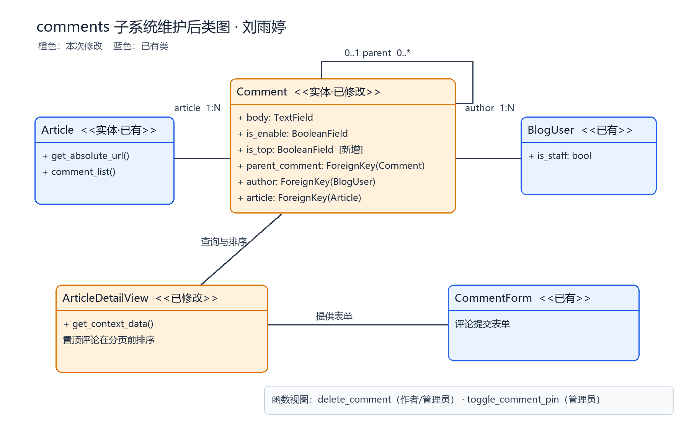

# 开源软件维护报告——comments 部分

> 组别：软工3班8组  
> 负责人：刘雨婷（计划经理）  
> 对应分支：`lyt_branch`

## 4. 开源软件的代码标注（comments 素材）

本次维护新增的 comments 代码注释使用 `#lyt:` 标识。按当前本地 `src/comments/` 中 Python 文件逐行检索，该标识出现 33 次；这个数字仅表示带标识的注释行数，不能替代全组表 2 所要求的「标注的代码行数」。全组各包、类及标注行数仍须由成员按同一口径回传后汇总。

## 5. 开源软件的维护

| 序号 | 维护类别 | 名称 | 维护的细节描述 | 负责组员 |
|---|---|---|---|---|
| 1 | 新增功能 | 评论删除 | 评论作者和管理员可通过文章页按钮提交 POST 删除请求；服务端再次核验身份，父评论删除时按原有外键规则级联删除回复，并清理评论缓存。 | 刘雨婷 |
| 2 | 新增功能 | 置顶评论 | 为 `Comment` 增加 `is_top` 字段和数据库迁移；管理员可置顶或取消置顶已公开的顶层评论，文章页在分页前优先排列置顶评论，回复不可单独置顶。 | 刘雨婷 |

## 6. 开源软件维护所产生的设计

本次修改了 `Comment` 实体、评论操作视图、URL 路由和文章详情页评论排序，没有新增独立业务类。`Comment.is_top` 保存置顶状态；`delete_comment` 和 `toggle_comment_pin` 分别负责权限校验及状态变更；`ArticleDetailView` 负责按置顶状态和评论 ID 组织顶层评论。删除和置顶入口由评论模板中的 POST 表单提供，表单携带 CSRF 令牌。

维护后类图需展示 `Article 1 → * Comment`、`BlogUser 1 → * Comment` 和 `Comment 1 → * Comment`（父评论与回复）关系，并标出 `Comment.is_top` 为本次新增字段。`ArticleDetailView`、评论操作视图为本次修改的行为节点，图中应与未修改的 `Article`、`BlogUser` 区分颜色。

## 7. 维护代码数量及其质量情况（comments 素材）

按朱亮宇的统计口径，仅统计本次功能涉及的源代码与模板，不计自动生成的 `0006_comment_is_top.py` 迁移文件，也不计此前第七、八周的代码标注。本地功能提交 `fa8e013` 相对其父提交有 6 个修改文件、0 个计数范围内的新增文件；`git diff --numstat` 显示新增 223 行、删除或替换原行 5 行，受影响共 228 行。其中 `src/blog/views.py` 的 2 行新增与 1 行替换是评论置顶排序所必需的跨 app 改动，合并前需由 blog 负责人复核。

| 测试项 | 预期结果 | 本次结果 |
|---|---|---|
| 作者删除自己的评论及回复 | 删除成功，回复按外键规则一并删除 | 通过 |
| 管理员删除他人评论 | 删除成功 | 通过 |
| 其他用户、匿名用户删除评论 | 请求被拒绝或转至登录页，评论保留 | 通过 |
| GET 删除、无 CSRF 的 POST 删除 | 拒绝操作，评论保留 | 通过 |
| 管理员置顶与取消置顶 | 状态正确切换，置顶评论排在前面 | 通过 |
| 普通用户置顶、置顶楼中楼回复 | 被拒绝 | 通过 |
| 页面操作入口 | 作者可见删除，管理员可见删除和置顶 | 通过 |

2026-11-05 在本地 MySQL 上应用 `comments.0006_comment_is_top` 迁移，执行 `manage.py test comments --verbosity=0`，47 项测试全部通过，Django 系统检查为 0 个问题。另在隔离的临时数据库运行网站，通过真实 HTTP 登录、读取带 CSRF 的页面表单并提交置顶、取消置顶和删除请求，数据库状态与刷新后的文章页一致。Cloudflare 插件因本机未配置 `CLOUDFLARE_ZONE_ID` 而在日志中禁用，不影响本次 comments 测试结果。

## 8. 维护后的软件原型

文章详情页的顶层评论显示「置顶」标记；作者可见自己评论的「删除」按钮，管理员还可见顶层评论的「置顶／取消置顶」按钮。操作后返回文章详情页；此处需补充实际运行界面 PNG，并按通知将报告配图放入 `imgs/`、在正文使用相对路径引用。

## 9. 实践收获和体会（个人素材）

这次维护从评论模型、权限校验、路由、模板到文章页排序串起了完整流程。测试中发现只检查数据库状态还不够，还需要核对刷新后的页面和缓存；因此补充了实际 HTTP 表单操作与缓存相关测试。原项目使用的 MySQL 密码与本机实际密码不一致，修正当前终端的连接环境后完成了迁移和测试。
