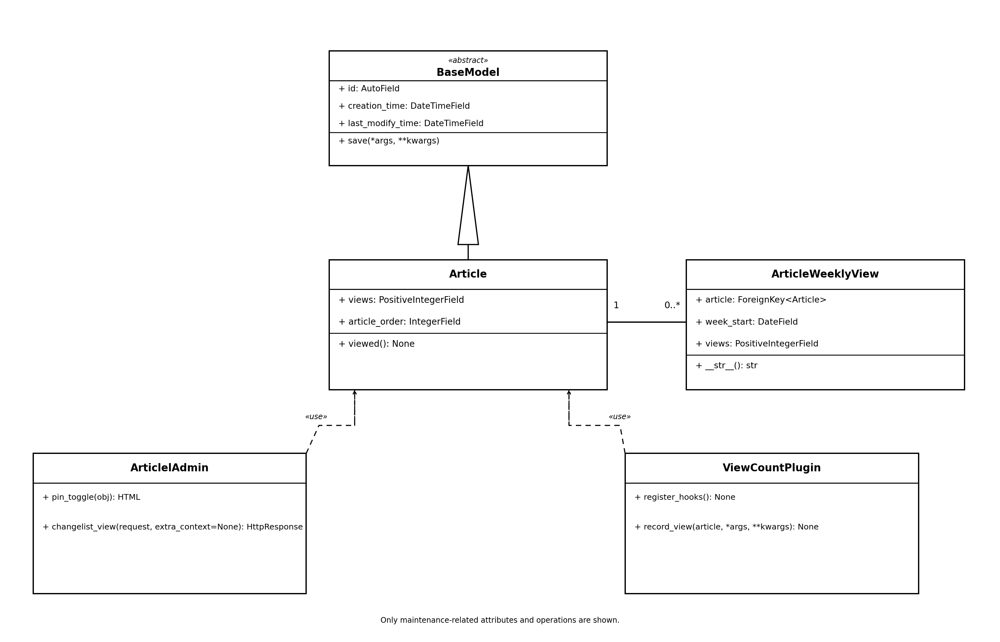
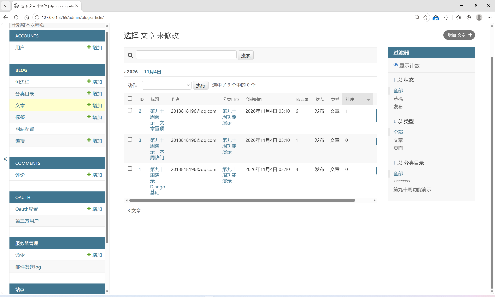
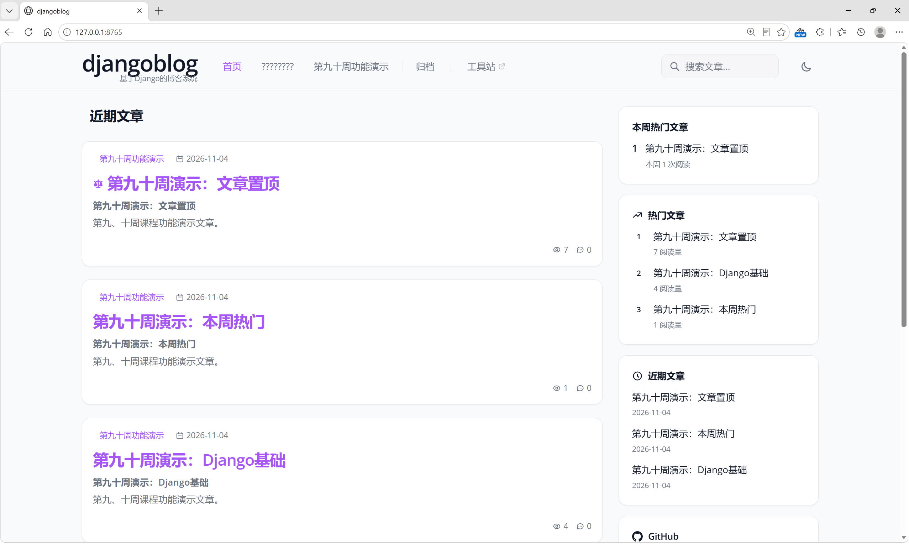

# 开源软件维护报告——功能对应、维护要素整合（黄梓涵）

> 小组：软件工程 3 班第 8 组
>
> 负责成员：黄梓涵
>
> 负责角色：开发经理（主）
>
> 负责模块：blog
>
> 负责章节：第 3 章软件功能与类间的对应关系、第 5 章开源软件维护要素整合。
>
> 代码依据：第九、十周维护后的 DjangoBlog 源码，以 `develop` 合并至 `hzh_branch` 后的版本为核对基线。

---

## 3. 软件功能/用例与类间的对应关系

本次维护涉及 DjangoBlog 的 djangoblog、blog、accounts、comments、oauth 和 servermanager 六个主要子系统。各项功能基于 Django MVT 架构实现，通过模型、视图、表单、管理后台、中间件、模板标签及第三方平台管理器协同完成。

根据任务分工，将站点维护模式和全局公告栏作为一个站点维护配置功能点，因此本章按照 12 个功能点进行整理。第 5 章进一步按照 具体维护事项拆分描述。

**表 1. 软件功能与类间的关系**

| 序号 | 功能名称 | 涉及的类/模块 | 涉及的类方法 | 涉及的模块级函数 |
|---|---|---|---|---|
| 1 | 站点维护模式与全局公告栏 | BlogSettings、MaintenanceModeMiddleware、BlogSettingsAdmin、seo_processor 模块 | MaintenanceModeMiddleware.__call()、BlogSettingsAdmin.save_model() | seo_processor() |
| 2 | 自定义错误页面（404、500、403、400） | error_views 模块、djangoblog URL 配置 | — | render_error_page()、page_not_found_view()、server_error_view()、permission_denied_view()、bad_request_view() |
| 3 | 文章累计阅读量与本周热门文章 | Article、ArticleWeeklyView、ViewCountPlugin、blog 模块 | Article.viewed()、ArticleWeeklyView.__str__()、ViewCountPlugin.register_hooks()、ViewCountPlugin.record_view() | get_weekly_hot_articles()、get_most_read_articles()、load_sidebar() |
| 4 | 后台文章单篇置顶与批量置顶 | Article、ArticlelAdmin、blog.admin 模块 | ArticlelAdmin.pin_toggle()、ArticlelAdmin.changelist_view() | _change_article_pin()、pin_articles()、unpin_articles() |
| 5 | 用户头像上传与个人资料编辑 | BlogUser、ProfileForm、ProfileView | ProfileForm.clean_avatar()、ProfileView.get_form_kwargs()、ProfileView.form_valid() | — |
| 6 | 已登录用户修改密码 | AccountPasswordChangeForm、AccountPasswordChangeView | AccountPasswordChangeForm.__init__()、AccountPasswordChangeView.get_form_kwargs()、AccountPasswordChangeView.form_valid() | — |
| 7 | 评论删除 | Comment、comments.views 模块 | — | delete_comment()、_clear_comment_caches() |
| 8 | 评论置顶与取消置顶 | Comment、ArticleDetailView、comments.views 模块 | ArticleDetailView.get_context_data() | toggle_comment_pin()、_clear_comment_caches() |
| 9 | Gitee 第三方登录 | OAuthConfig、OAuthUser、BaseOauthManager、GiteeOauthManager、oauthmanager/views 模块 | GiteeOauthManager.__init__()、GiteeOauthManager.get_authorization_url()、GiteeOauthManager.get_access_token_by_code()、GiteeOauthManager.get_oauth_userinfo()、GiteeOauthManager.get_picture() | get_oauth_apps()、get_manager_by_type()、oauthlogin()、authorize() |
| 10 | GitHub OAuth 回调地址修复 | GitHubOauthManager、BaseOauthManager、oauthmanager/views 模块 | GitHubOauthManager.get_authorization_url()、GitHubOauthManager.get_access_token_by_code() | oauthlogin()、authorize() |
| 11 | 站点数据统计面板 | SiteStatisticsService、servermanager.views 模块 | SiteStatisticsService.collect() | site_statistics() |
| 12 | 邮件发送失败重试 | EmailSendLog、EmailService、EmailSendLogAdmin、Command | EmailService.retry_failed()、EmailService.retry()、EmailService._attempt()、EmailService._finish()、EmailSendLogAdmin.retry_failed()、Command.add_arguments()、Command.handle() | — |

> 注：类方法采用“类名.方法名()”形式表示；模块级函数单独列出。模块、配置文件和模型类分别按其实际职责列示。

### 3.1 各子系统功能与类的关系说明

#### （1）djangoblog 子系统

站点维护模式与全局公告栏主要依赖 BlogSettings 模型保存站点配置。

MaintenanceModeMiddleware 在请求处理阶段读取维护模式配置。当维护模式开启时，对普通访客展示维护提示页面并返回 HTTP 503 状态；具有工作人员权限的用户仍可正常访问。

BlogSettingsAdmin 负责后台站点配置管理，save_model() 在配置保存后清理缓存，保证配置变更能够及时生效。

全局公告栏通过 seo_processor() 将 BlogSettings 中的 announcement 字段传递至模板上下文，统一基础模板根据公告内容决定是否 展示公告栏。

自定义错误页面由 error_views 模块中的 render_error_page() 统一负责页面渲染。page_not_found_view()、server_error_view()、permission_denied_view() 和 bad_request_view() 分别处理 404、500、403 和 400 错误，并通过项目 URL 配置注册对应处理器。

#### （2）blog 子系统

文章阅读量统计由 ViewCountPlugin 插件接入原有文章详情加载流程。

ViewCountPlugin.register_hooks() 注册 after_article_body_get 钩子，record_view() 在钩子触发后调用 Article.viewed()。

Article.viewed() 在数据库事务中使用 F 表达式更新 Article 原有 views 字段，同时创建或更新 ArticleWeeklyView 记录。周统计 按照站点时区计算自然周起始日期，并通过 article 与 week_start 的唯一约束避免同一文章同一周出现重复统计记录。

侧边栏通过 get_most_read_articles() 查询累计热门文章，通过 get_weekly_hot_articles() 查询本周热门文章，最后由 load_sidebar() 组织模板数据并完成展示。

文章置顶功能复用 Article 原有 article_order 字段，不增加重复的置顶状态字段。后台 ArticlelAdmin 提供单篇置顶按钮及批量操 作入口。_change_article_pin() 负责更新排序值，pin_articles() 和 unpin_articles() 负责批量操作，pin_toggle() 和 changelist_view() 负责单篇操作及权限检查。

#### （3）accounts 子系统

BlogUser 模型在原有用户信息基础上增加 avatar 和 bio 字段，分别保存用户头像和个人简介。

ProfileForm 负责个人资料表单及头像文件校验，ProfileView 通过 get_form_kwargs() 将当前登录用户绑定到表单实例，并通过 form_valid() 保存资料和清理相关侧栏缓存。

AccountPasswordChangeForm 继承 Django 原生 PasswordChangeForm，复用旧密码校验及密码强度验证机制。

AccountPasswordChangeView 通过 get_form_kwargs() 传递当前用户，并在 form_valid() 中保存新密码、更新当前会话认证哈希，避 免修改密码后当前用户被强制退出。

#### （4）comments 子系统

Comment 模型新增 is_top 字段，用于记录评论置顶状态。

delete_comment() 负责评论删除操作，要求用户已登录并使用 POST 请求。评论作者可以删除自己的评论，工作人员可以执行管理删除 。删除操作完成后调用 _clear_comment_caches() 清理相关缓存。

toggle_comment_pin() 负责评论置顶和取消置顶，仅允许工作人员操作已公开的顶层评论。ArticleDetailView.get_context_data() 在评论分页之前按照置顶状态和评论 ID 排序，使置顶评论优先展示。

#### （5）oauth 子系统

GiteeOauthManager 继承 BaseOauthManager，实现 Gitee 平台授权地址生成、授权码换取访问令牌、用户信息读取和头像信息获取。

OAuthConfig 提供 Gitee 平台配置，get_oauth_apps() 和 get_manager_by_type() 负责 OAuth 平台管理器的加载和选择。oauthlogin() 和 authorize() 负责统一的第三方登录授权流程及回调处理。

GitHub OAuth 修复主要调整 GitHubOauthManager 的授权回调地址构造逻辑。授权请求和授权码换取令牌时均使用后台配置的 callback_url，避免错误拼接 next_url 导致回调地址不一致。

#### （6）servermanager 子系统

SiteStatisticsService 负责汇总站点核心数据，collect() 返回统计面板所需的文章、评论、用户、OAuth 用户、分类、标签和邮件发送数据，并提供热门文章及最近失败邮件记录。

site_statistics() 负责统计面板访问权限检查和页面渲染，仅允许超级管理员访问。

邮件失败重试由 EmailService 统一实现，支持单条及批量重试。EmailSendLogAdmin 提供后台批量重试入口，管理命令 Command 提供 独立的命令行重试入口。两种入口均复用 EmailService，避免重复实现邮件发送逻辑。

---

## 5. 开源软件的维护

本次维护针对 DjangoBlog 原有系统的功能不足和使用体验问题，对六个子系统进行了功能新增与完善。

维护工作以复用现有业务逻辑为基础，尽量避免重复建设已有功能，同时通过模型、视图、表单、后台管理、中间件和模板之间的协作实现功能扩展。

**表 3. 开源软件维护的要素**

| 序号 | 维护类别（新增功能/修改缺陷） | 名称 | 维护的细节描述 | 负责该维护的组员 |
|---|---|---|---|---|
| 1 | 新增功能 | 站点维护模式 | 在 BlogSettings 中增加 is_maintenance 配置项，并新增 MaintenanceModeMiddleware。管理员开启维护模式后，普通访客访问前台页面时展示维护提示页面并返回 HTTP 503；工作人员仍可访问管理功能，避免维护期间无法管理站点 。 | 张月 |
| 2 | 新增功能 | 全局公告栏 | 在 BlogSettings 中增加 announcement 字段，支持管理员配置全站公告。通过 seo_processor() 将 公告内容传递至模板上下文，由公共基础模板统一展示；公告内容为空时不显示公告栏。 | 张月 |
| 3 | 修改缺陷/完善 | 自定义错误页面 | 统一错误页面渲染逻辑，通过 render_error_page() 处理页面展示，并完善 404、500、403、400 错误处理函数及 URL 配置，修正原有错误处理器配置问题，改善异常访问时的用户体验。 | 张月 |
| 4 | 修改缺陷/完善 | 文章阅读量展示与本周热门文章 | 复用 Article 原有 views 字段记录累计阅读量，新增 ArticleWeeklyView 模型记录每周阅读量。通过 Article.viewed() 同步更新累计阅读量与本周阅读量，使用事务和 F 表达式降低并发计数丢失风险；侧边 栏分别展示累计热门文章和本周热门文章，并完善缓存失效逻辑。 | 黄梓涵 |
| 5 | 新增功能/完善 | 后台文章单篇置顶与批量置顶 | 复用 Article 原有 article_order 字段实现文章置顶排序，在后台新增单篇 置顶、取消置顶以及批量置顶、批量取消置顶操作。通过统一辅助函数更新排序值，并在数据变化后清理缓存，不需要增加重复的置顶字段。 | 黄梓涵 |
| 6 | 新增功能 | 用户头像上传与个人资料编辑 | 扩展 BlogUser 模型，新增 avatar 和 bio 字段，实现用户个人资料编辑页面，支 持修改昵称、简介及上传本地头像。通过 ProfileForm 限制头像文件扩展名和文件大小，ProfileView 将当前登录用户绑定到表单，防 止用户通过请求参数修改他人资料。 | 侍文博 |
| 7 | 新增功能 | 已登录用户修改密码 | 新增独立的修改密码页面，复用 Django PasswordChangeForm 验证旧密码、两次新密码一致 性及密码强度策略。修改成功后调用 update_session_auth_hash() 更新当前会话认证哈希，避免用户修改密码后被强制退出。 | 侍文 博 |
| 8 | 新增功能 | 评论删除 | 新增评论删除接口，允许评论作者删除自己的评论，工作人员可以执行管理删除。操作要求用户登录并通过 POST 请求提交；删除父评论时沿用原有外键级联规则处理回复，并清理文章评论及侧栏缓存。 | 刘雨婷 |
| 9 | 新增功能 | 评论置顶与取消置顶 | 在 Comment 模型中新增 is_top 字段，允许工作人员对已公开的顶层评论执行置顶或取消置 顶操作。普通用户不能置顶，楼中楼回复不能单独置顶；文章详情页在分页前优先排列置顶评论，并同步清理缓存。 | 刘雨婷 |
| 10 | 新增功能 | Gitee 第三方登录 | 在 OAuthConfig 中增加 Gitee 平台类型，并实现 GiteeOauthManager，完成授权地址生成、 授权码换取访问令牌、用户信息读取及头像信息获取。将 Gitee 接入原有 OAuth 管理器加载机制，使其复用现有第三方登录、用户绑定及会话建立流程。 | 谢承志 |
| 11 | 修改缺陷/完善 | GitHub OAuth 回调地址修复 | 修复 GitHub OAuth 授权地址中错误拼接 next_url 导致回调地址不符合第三 方平台配置的问题。改为直接使用后台配置的 callback_url，并在授权码换取访问令牌时保持回调地址一致，提高 GitHub 第三方登录 的稳定性。 | 谢承志 |
| 12 | 新增功能 | 站点数据统计面板 | 新增 SiteStatisticsService 统计服务，集中汇总文章总数、发布文章、草稿、阅读量、评论、用户、OAuth 用户、分类、标签及邮件发送情况，并提供热门文章和最近失败邮件数据。新增统计面板页面，通过登录及超级管理员权限检查限制访问。 | 朱亮宇 |
| 13 | 新增功能/完善 | 邮件发送失败重试 | 扩展 EmailSendLog，新增重试次数、最后重试时间及失败原因字段；新增 EmailService，支持单条和批量重试失败邮件。在后台增加失败邮件重试操作，并提供 retry_failed_emails 管理命令，支持通过 --limit 参数限制单次重试数量。 | 朱亮宇 |

### 5.1 blog 子系统维护重点

blog 是本次由本人负责维护的核心子系统，主要完成文章阅读量统计及后台置顶管理两方面的完善。

**（1）文章累计阅读量与本周阅读量**

原系统已经存在 Article.views 字段，能够记录文章累计阅读量。本次维护没有重复增加累计阅读量字段，而是新增 ArticleWeeklyView 模型，将文章 ID、每周起始日期及该周阅读次数独立保存。

文章详情加载后，ViewCountPlugin 通过 after_article_body_get 钩子调用 Article.viewed()。该方法在数据库事务中同步更新累计 阅读量和周阅读量，避免两个统计指标分别更新而产生不一致。

周统计按照站点时区确定自然周起始日期，并通过唯一约束限制同一篇文章在同一周只能存在一条统计记录。

在展示方面，get_most_read_articles() 根据累计阅读量排序，get_weekly_hot_articles() 根据本周阅读量排序，load_sidebar() 将两组数据传递给侧边栏模板。

此外，对首页第一页阅读量缓存进行失效处理，避免文章阅读次数增加后仍然展示旧数据。

**（2）后台文章单篇与批量置顶**

原系统已经存在 Article.article_order 排序字段。本次维护直接复用该字段，通过大于普通文章排序值的优先级实现置顶效果。

后台 ArticlelAdmin 新增单篇置顶按钮和批量置顶操作。单篇操作由 pin_toggle() 和 changelist_view() 处理，批量操作由 pin_articles() 和 unpin_articles() 处理。

_change_article_pin() 统一负责置顶状态对应的排序值更新。由于 QuerySet 批量更新不会自动触发模型保存信号，因此在数据发生变化后主动清理缓存，确保前台文章排序及时更新。

### 5.2 本次维护的总体说明

本次维护共覆盖六个主要子系统，按照任务分工归纳为 12 个功能点；按照具体维护事项拆分后，第 5 章表 3 共包含 13 项维护记录。其中，站点维护模式与全局公告栏在功能对应表中作为一个站点维护配置功能点，在维护要素表中分别列出。

各项维护尽量沿用原有系统的数据模型、业务流程和 Django 框架能力。例如，blog 复用 views 和 article_order 字段，accounts 复用 Django 用户认证和密码修改机制，comments 沿用原有评论自关联结构，oauth 复用统一的第三方登录管理器，servermanager 则将 统计和邮件重试逻辑集中封装为服务类。

通过上述维护，系统在文章内容管理、用户资料管理、评论管理、第三方登录、站点维护和后台运维等方面得到进一步完善，同时保持了原有系统的整体架构和业务流程。

---

## 6. 开源软件维护所产生的设计

本次 blog 子系统维护主要围绕文章模型、阅读量统计、后台文章管理及热门文章展示展开。设计上优先复用原有模型字段和插件机制，仅对需要独立保存的数据增加相应模型，避免重复建设已有功能。

### 6.1 维护涉及的主要类及其职责

**（1）Article 类**

复用原有 `views` 字段记录文章累计阅读量，复用 `article_order` 字段实现置顶文章排序。本次维护通过完善 `viewed()` 方法，实现累计阅读量和每周阅读量的同步更新，没有额外增加重复的累计阅读量字段或置顶状态字段。

**（2）ArticleWeeklyView 类**

新增 `ArticleWeeklyView` 模型，用于独立记录文章每周阅读量。主要数据包括文章关联、每周起始日期和阅读次数。通过文章与周起始日期的唯一约束，避免同一文章在同一自然周产生重复统计记录。

**（3）ViewCountPlugin 类**

复用原有文章阅读量统计插件及其钩子机制。通过 `register_hooks()` 注册文章详情相关钩子，在 `record_view()` 中调用 `Article.viewed()`，使阅读量统计接入原有文章访问流程。

**（4）ArticlelAdmin 类**

扩展后台文章管理能力，提供单篇文章置顶、取消置顶以及批量置顶、批量取消置顶操作。置顶排序直接复用 `Article.article_order`，不增加重复字段。

### 6.2 类之间的关系及协作过程

`Article` 与 `ArticleWeeklyView` 之间为一对多关系。一篇文章可以对应多个自然周的阅读量记录，每条周统计记录归属于一篇文章。

阅读量统计过程中，`ViewCountPlugin` 通过插件钩子调用 `Article.viewed()`，由文章模型统一完成累计阅读量和本周阅读量的更新。

文章置顶过程中，`ArticlelAdmin` 负责后台操作入口，模块级辅助函数 `_change_article_pin()`、`pin_articles()` 和 `unpin_articles()` 负责排序值更新及批量操作。

在前台展示过程中，`get_most_read_articles()` 负责查询累计热门文章，`get_weekly_hot_articles()` 负责查询本周热门文章，`load_sidebar()` 组织数据并传递给侧边栏模板。

上述设计使文章数据维护、阅读量统计、后台操作和前台展示形成相对清晰的职责划分。

### 6.3 维护后的 blog 子系统设计类图

下图展示本次维护后 blog 子系统的主要模型、维护相关类及其关系。

可编辑 StarUML 源工程：

[blog-maintenance-classmodel-hzh.uml](StarUML工程-黄梓涵/blog-maintenance-classmodel-hzh.uml)

---

## 8. 维护后的软件原型

本次维护完成后，通过本地 DjangoBlog 系统实际运行，对文章置顶、阅读量统计和热门文章展示功能进行验证。以下截图记录了维护后的前台展示及后台管理界面。

### 8.1 前台热门文章及阅读量展示

前台首页右侧分别展示本周热门文章和累计热门文章，显示文章排名及对应阅读量。文章列表同时展示文章置顶标识及累计阅读量，体现文章阅读统计和热门内容展示效果。

### 8.2 后台文章管理及置顶排序

后台文章列表展示文章标题、阅读量和排序字段。截图中置顶文章的排序值为 1，其他文章排序值为 0，体现后台文章置顶及排序维护后的数据状态。

上述截图均来自本地实际运行的 DjangoBlog 系统，用于记录维护后的软件原型及功能展示情况。
