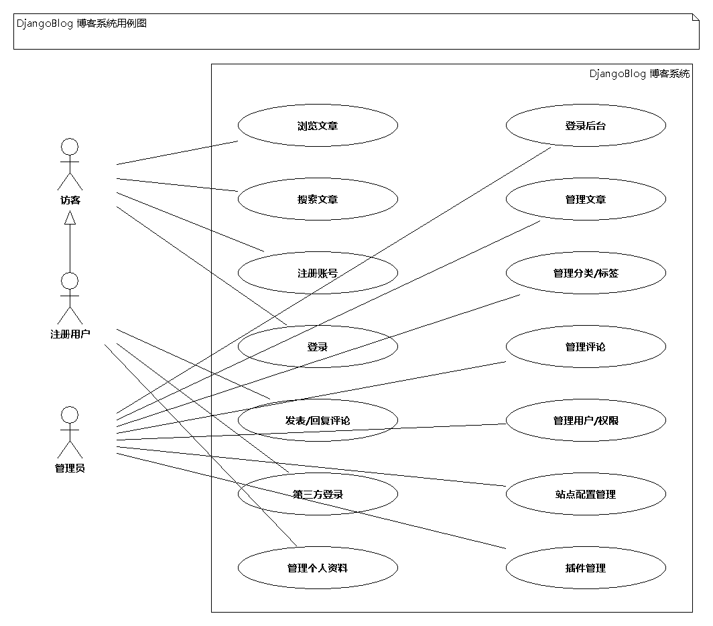
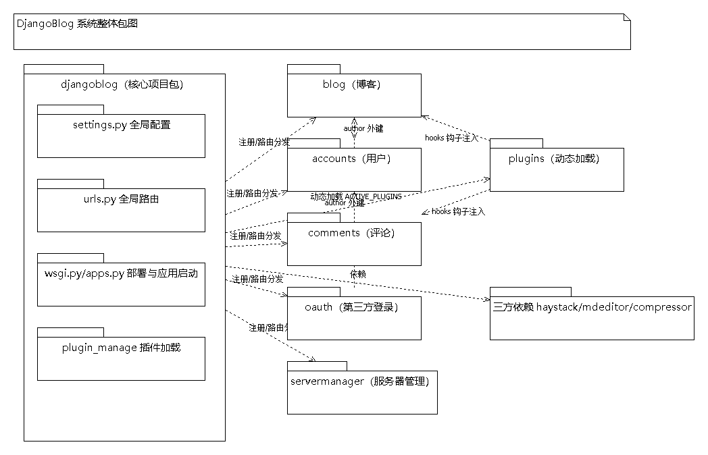
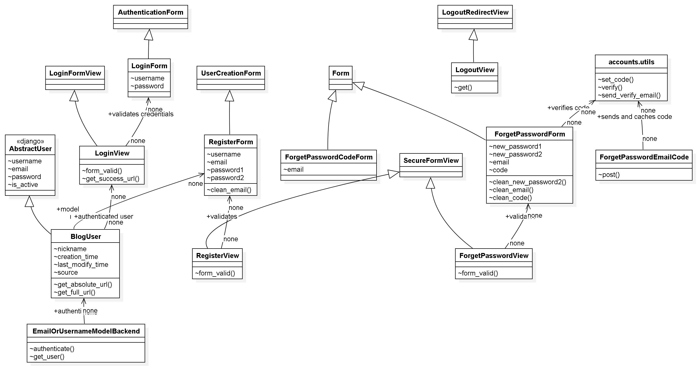
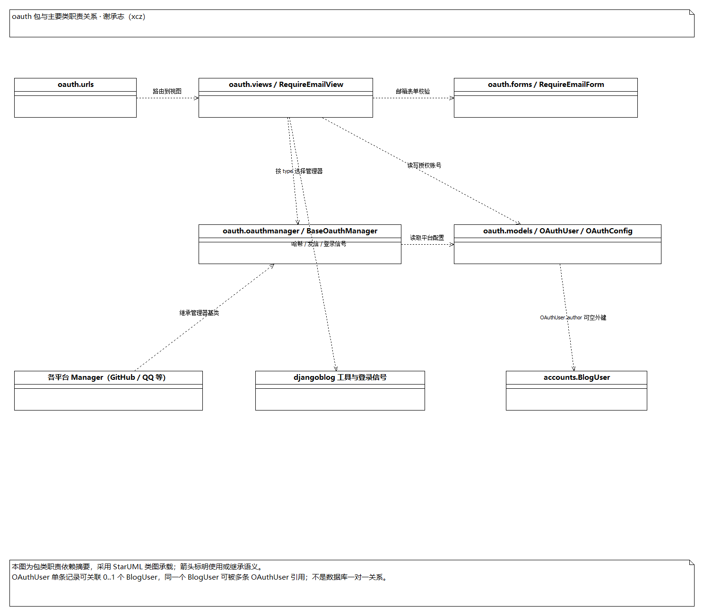
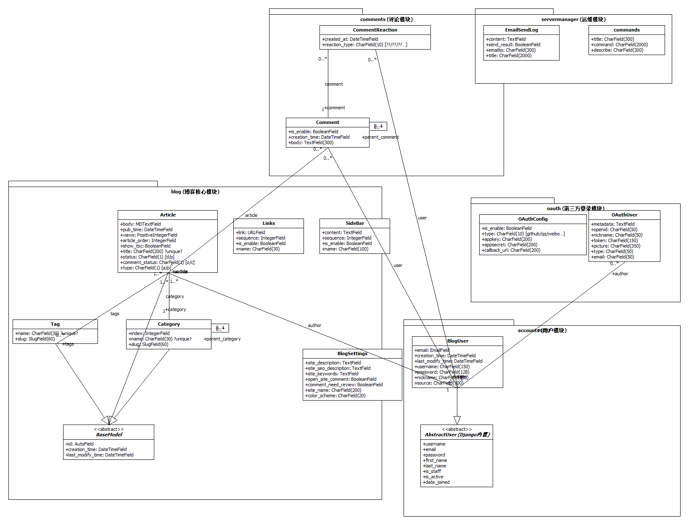

# DjangoBlog 开源软件维护报告 · 第 1、2 章（功能描述与软件架构）

> 组号：8 ｜ 小组成员：张月、黄梓涵、侍文博、刘雨婷、谢承志、朱亮宇
> 本章负责人：张月（组长）
> 说明：本章复用第六周《开源软件泛读报告》成果，用例图 / 包图 / 类图引自 `doc/第六周/imgs/`（已同步到 `doc/第九十周/imgs/`）。

## 1. 开源软件的功能描述

DjangoBlog 是一个基于 Django 框架的开源博客系统，采用 Python 语言开发。系统主要功能包括：文章发布与管理、分类与标签组织、用户注册登录与第三方 OAuth 授权、评论互动、全文搜索、RSS 订阅、站点地图，以及服务器运维管理等。系统按功能划分为 6 个业务应用（app）——blog、accounts、comments、oauth、servermanager，外加核心项目包 djangoblog 和运行时插件系统 plugins。

其软件需求的用例模型（系统整体用例图）如图 1 所示。

图 1. DjangoBlog 开源软件系统整体用例图

### 1.1 主要用例描述

各业务应用的核心用例简述如下表，详细用例说明与各 app 用例图见第六周《开源软件泛读报告》。

| 应用 | 主要用例 | 说明 |
|---|---|---|
| blog | 浏览文章列表 / 详情、按分类 / 标签 / 作者浏览、搜索、发布 / 编辑 / 删除文章、查看归档与友情链接 | 博客核心内容管理 |
| accounts | 注册、登录、登出、找回密码、邮箱验证 | 用户认证与资料 |
| comments | 发表评论、楼中楼回复、Emoji 表情反应、评论审核 | 评论互动 |
| oauth | 第三方授权登录（GitHub / Google / 微博 / QQ / Facebook）、账号绑定 | 第三方登录 |
| servermanager | 命令维护、邮件发送日志、微信会话缓存、远程命令 | 服务器运维 |
| plugins | 文章推荐、阅读时长、SEO 优化、图片懒加载、版权声明、外部链接、浏览量统计 | 可插拔扩展 |

## 2. 开源软件的软件架构及各个包和类的作用

系统采用 Django 的「核心项目包 + 业务应用（app）」分层架构：`djangoblog` 核心包负责全局配置、路由与基础设施；6 个业务应用各自独立承担一个功能模块；`plugins` 通过插件钩子按需扩展业务应用。

系统整体 UML 包图如图 2 所示。

图 2. DjangoBlog 开源软件系统整体包图

### 2.1 djangoblog 核心包各模块与主要类的作用

| 模块 | 作用 | 主要类 / 函数 |
|---|---|---|
| `settings.py` | 全局配置：应用注册、中间件、数据库、搜索、插件、日志 | `INSTALLED_APPS`、`MIDDLEWARE` |
| `urls.py` | 全局路由入口，把 URL 分发给各 app | `urlpatterns`、`i18n_patterns()`、`health_check()` |
| `wsgi.py` | 部署时的 WSGI 入口 | `application` |
| `base_views.py` | 带装饰器的视图基类（CSRF / 登录 / 禁缓存） | `SecureFormView`、`AuthenticatedFormView`、`LoginFormView` 等 |
| `error_views.py` | 统一错误页渲染（404 / 500 / 403 / 400） | `render_error_page()`、`page_not_found_view()`、`server_error_view()`、`permission_denied_view()`、`bad_request_view()` |
| `mixins.py` | 可复用混入类（时间戳 / 缓存 / 分页 / 查询优化） | `TimeStampedModel`、`SlugCachedMixin`、`ArticleListMixin` 等 |
| `constants.py` | 全局常量：缓存超时、缓存键、分页 | `CacheTimeout`、`CacheKey`、`Pagination` |
| `utils.py` | 工具函数（缓存封装、站点设置读取） | `cache()`、`get_blog_setting()` |
| `admin_site.py` | 自定义后台站点 | `admin_site` |
| `feeds.py` / `sitemap.py` | RSS / Atom 订阅、站点地图（SEO） | `DjangoBlogFeed`、`ArticleSiteMap` 等 |
| `elasticsearch_backend.py` / `whoosh_cn_backend.py` | 搜索后端 | `ElasticSearchEngine`、`WhooshEngine` |
| `plugin_manage/` | 插件加载与钩子机制 | `BasePlugin`、`load_plugins()`、`hooks.register()` |

### 2.2 各业务应用包与主要类的作用

**blog（博客核心）**：系统最重的应用，负责文章、分类、标签、友情链接、侧栏与站点配置。核心类：`Article`（文章实体）、`Category`（分类）、`Tag`（标签）、`Links`（友情链接）、`BlogSettings`（站点配置）；视图 `IndexView` / `ArticleDetailView` / `CategoryDetailView` 等负责页面组织；`seo_processor` 上下文处理器统一提供站点级 SEO 与公告上下文。

**accounts（用户认证）**：处理注册、登录、登出、邮箱验证与密码找回，提供自定义用户模型 `BlogUser`（继承 `AbstractUser`，扩展昵称、来源等字段）。

**comments（评论）**：定义评论与表情反应两张表（`Comment`、`CommentReaction`）。`Comment` 通过 `parent_comment` 自关联实现楼中楼回复；`CommentReaction` 记录用户对评论的 Emoji 反应。

**oauth（第三方登录）**：提供第三方 OAuth 登录与本地账号绑定。核心类 `OAuthUser`（第三方用户）、`OAuthConfig`（平台配置），`oauthmanager` 模块为各平台实现授权流程（如 `GitHubOauthManager`）。

**servermanager（服务器运维）**：负责命令维护（`commands`）与邮件发送日志（`EmailSendLog`），并提供微信远程命令、会话缓存等运维能力。

### 2.3 各包之间的依赖关系

1. **djangoblog → 业务应用**：`settings.py` 注册各 app，`urls.py` 把 URL 分发到各 app 的 `urls.py`，形成「总控 → 分支」的依赖关系。
2. **业务应用之间**：`blog → accounts`（文章 `author` 外键指向 `accounts.BlogUser`）；`comments → blog / accounts`（评论 `article` 外键指向文章、`author` 外键指向用户）；`oauth → accounts`（第三方账号 `OAuthUser.author` 可选绑定本地用户）。
3. **djangoblog → plugins**：`plugin_manage.loader` 按 `ACTIVE_PLUGINS` 动态加载 `plugins/` 下的插件。
4. **plugins → 业务应用**：插件通过 `hooks` 钩子（如 `article_bottom`、`sidebar`、`the_content`）把内容注入博客 / 评论页面。
5. **三方库依赖**：全文搜索依赖 `haystack`，Markdown 编辑依赖 `mdeditor`，静态资源压缩依赖 `compressor`。
