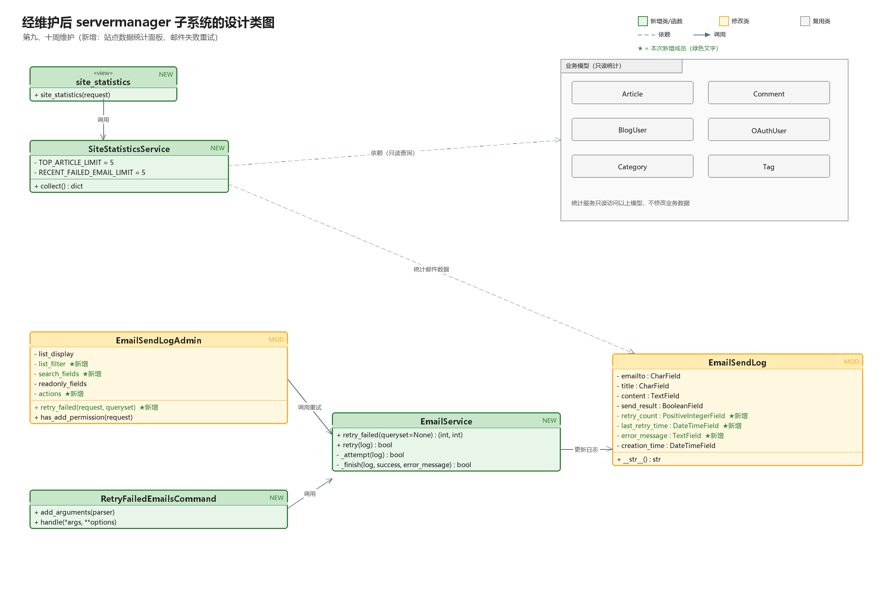
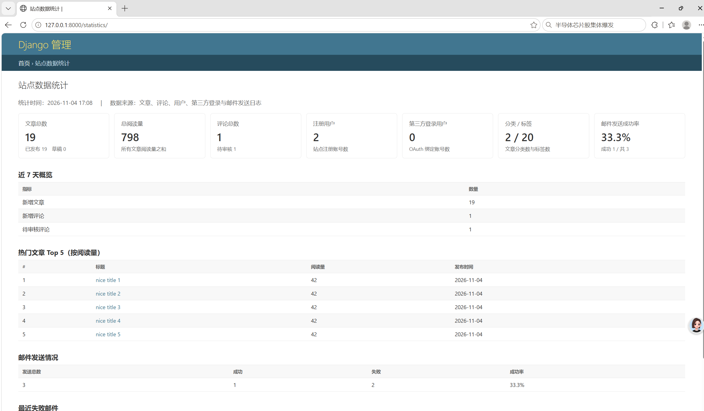
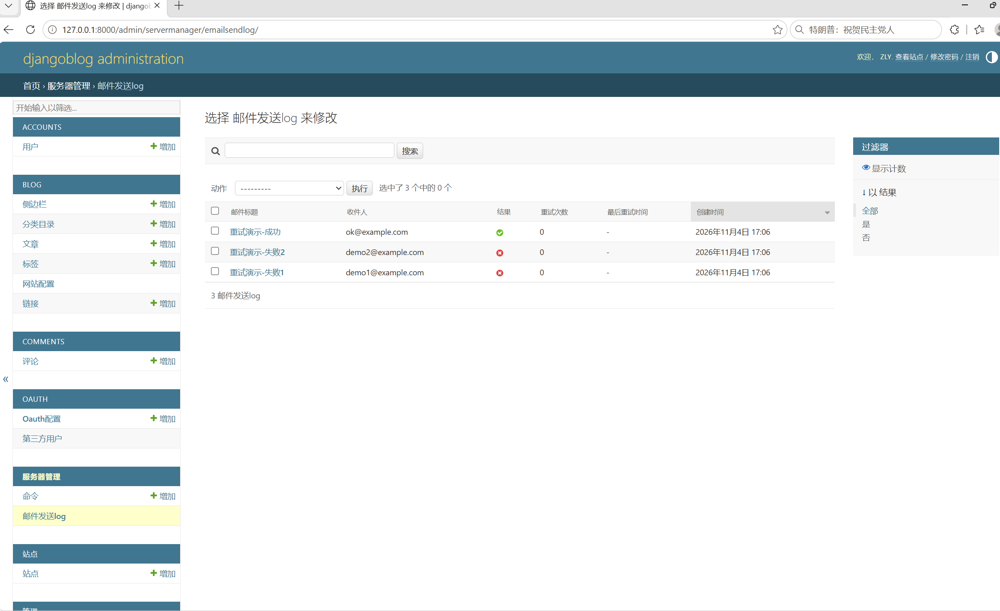
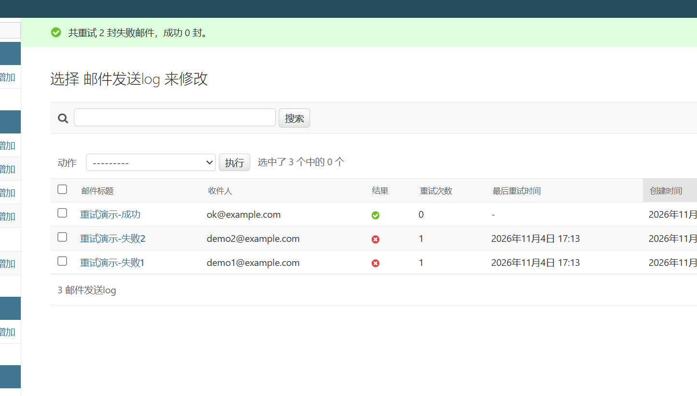

# 开源软件维护报告

> 组号：8
> 小组成员：张月、黄梓涵、侍文博、刘雨婷、谢承志、朱亮宇
>
---

## 1. 开源软件的功能描述
> 负责人：**张月**（复用第六周成果整合）

（描述 DjangoBlog 的整体功能，附用例图及主要用例描述。图 1：DjangoBlog 开源软件的用例图。）

---

## 2. 开源软件的软件架构及各个包和类的作用
> 负责人：**张月**（复用第六周成果整合）

（描述系统的子系统划分，附包图；说明各包/各类的作用，附各子系统类图。图 2 包图、图 3/4 类图。）

---

## 3. 软件功能/用例与类间的对应关系
> 负责人：**黄梓涵**（开发经理，主笔）

（根据对代码的理解，列出软件功能与类之间的对应关系，填下表。）

**表 1. 软件功能与类间的关系**

| 序号 | 功能名称 | 涉及的类 | 涉及的类的方法名 |
|---|---|---|---|
| 1 | | | |
| 2 | | | |

> 说明：涉及的类可能有多个，涉及的类方法可能有多个。

---

## 4. 开源软件的代码标注
> 负责人：**刘雨婷**（计划经理，统计汇总）；各成员提供自己 app 的标注数据

（汇总前几周小组对代码的标注：包 / 类 / 标注行数 / 负责标注的组员。）

**表 2. 代码标注分布**

| 序号 | 包名称 | 类名称 | 标注的代码行数 | 负责标注的组员 |
|---|---|---|---|---|
| 1 | | | | |
| 2 | | | | |
| 共计 | **个包 | ***类 | **行 | |

---

## 5. 开源软件的维护（servermanager 部分）

本次对 servermanager（服务器管理/运维模块）完成 **1 个新增功能 + 1 个完善**，具体维护要素如下。

**表 3. 开源软件维护的要素**

| 序号 | 维护类别（新增功能/修改缺陷） | 名称 | 维护的细节描述 | 负责该维护的组员 |
|---|---|---|---|---|
| 1 | 新增功能 | 站点数据统计面板 | 新增 `SiteStatisticsService`，统一聚合文章、评论、注册用户、OAuth 用户、分类/标签、近 7 天数据、热门文章与邮件发送情况；新增 `/statistics/` 统计页面（仅超级管理员可访问，普通用户返回 403）；在自定义后台首页增加“站点数据统计”入口卡片；新增 `templates/servermanager/statistics.html` 页面模板。 | 朱亮宇 |
| 2 | 修改缺陷/完善 | 邮件发送失败重试 | 基于已有的 `EmailSendLog` 增加 `retry_count`、`last_retry_time`、`error_message` 三个字段；新增 `EmailService` 服务类，支持单条重试与批量重试失败邮件；后台“邮件发送log”增加“重试发送选中的失败邮件”操作、结果筛选与搜索；新增 `retry_failed_emails` 管理命令，可配合 cron 定时补发。**未修改原有邮件发送信号链路**，只对已落库的失败日志做补发。 | 朱亮宇 |

---

## 6. 开源软件维护所产生的设计（servermanager 部分）

本次维护对 servermanager 相关类做了如下调整：

- **新增类 3 个**：
  - `SiteStatisticsService`（`servermanager/statistics.py`）——统计聚合服务，方法 `collect()`；只读依赖 Article、Comment、BlogUser、OAuthUser、Category、Tag、EmailSendLog。
  - `EmailService`（`servermanager/services.py`）——失败邮件重试服务，方法 `retry_failed(queryset)`、`retry(log)`、`_attempt(log)`、`_finish(log, success, error_message)`。
  - `RetryFailedEmailsCommand`（`servermanager/management/commands/retry_failed_emails.py`）——管理命令，方法 `add_arguments(parser)`、`handle(*args, **options)`，内部复用 `EmailService`。
- **新增视图函数 1 个**：`site_statistics`（`servermanager/views.py`）——校验超级管理员权限后调用 `SiteStatisticsService.collect()` 并渲染统计页。
- **修改类 2 个**：
  - `EmailSendLog`（`servermanager/models.py`）——新增 `retry_count`（重试次数）、`last_retry_time`（最后重试时间）、`error_message`（失败原因）三个字段。
  - `EmailSendLogAdmin`（`servermanager/admin.py`）——新增 `retry_failed()` 后台操作、结果筛选 `list_filter`、搜索 `search_fields`，并把重试字段设为只读。
- **复用类**：Article、Comment、BlogUser、OAuthUser、Category、Tag 仅被统计服务只读查询，未修改。

图 *. 经维护后 servermanager 子系统的设计类图（朱亮宇）

> 说明：图中**绿色为新增类/函数、黄色为修改类、灰色为复用的业务模型**；`★` 标注本次新增的字段/方法。源工程为 `StarUML工程-朱亮宇/servermanager-维护后.uml`。

---

## 7. 维护代码数量及其质量情况（全组汇总）

> 统计口径见 `第九十周维护代码量统计口径模板-朱亮宇.md`：新增/修改文件数、新增/修改行数分别统计，**受影响行数 = 新增行数 + 修改行数**；不含自动生成文件（`migrations` 自动迁移、`__pycache__`、`*.pyc`）。

截至 2026-11-06，6 个 app 的维护代码量数据已收齐，按统一口径汇总如下（均已扣除自动生成的迁移文件）：

**表 4-1. 维护代码量统计明细（按统一口径汇总）**

| app | 功能点 | 新增文件数 | 修改文件数 | 新增行数 | 修改行数 | 受影响行数 | 负责组员 | 备注 |
|---|---|---|---|---|---|---|---|---|
| djangoblog | 维护模式/公告栏、404/500 页面美化 | 1 | 9 | 131 | 9 | 140 | 张月 | 已扣除自动迁移 0009（23 行） |
| blog | 阅读量展示/本周热门、后台一键置顶及取消置顶 | 2 | 4 | 606 | 12 | 618 | 黄梓涵 | 已扣除自动迁移 29 行；含 2 份自动化测试文件；53 项测试通过；commit 75096ed |
| accounts | 头像上传/资料编辑、修改密码 | 2 | 7 | 187 | 4 | 191 | 侍文博 | 另新增迁移文件 1 个（23 行），未计入上述行数 |
| comments | 评论删除、评论置顶 | 0 | 6 | 223 | 5 | 228 | 刘雨婷 | 另自动迁移文件 1 个（18 行），已扣除 |
| oauth | Gitee 登录、GitHub OAuth 修复 | 0 | 2 | 89 | 1 | 90 | 谢承志 | 迁移文件约 18 行，已扣除 |
| servermanager | 站点数据统计面板、邮件发送失败重试 | 7 | 6 | 663 | 14 | 677 | 朱亮宇 | 已扣除迁移 0003（29 行）；9 个单元测试通过 |
| **合计** | 6 个 app / 约 13 个功能点 | **12** | **34** | **1899** | **45** | **1944** | 朱亮宇汇总 | — |

> 说明：受影响行数 = 新增行数 + 修改行数；已按口径扣除各 app 自动生成的迁移文件（djangoblog 23 行、blog 29 行、accounts 23 行、comments 18 行、oauth 约 18 行、servermanager 29 行）。

**表 4. 开源软件维护的代码分析**

| 序号 | 维护类别 | 名称 | 受影响的代码行数 | 负责维护的组员 |
|---|---|---|---|---|
| 1 | 新增功能 | 站点维护模式（djangoblog） | 约 90 行 | 张月 |
| 2 | 新增功能 | 全局公告栏（djangoblog） | 约 21 行 | 张月 |
| 3 | 修改缺陷/完善 | 404/500/403/400 错误页（djangoblog） | 约 29 行 | 张月 |
| 4 | 新增功能 | 站点数据统计面板（servermanager） | 约 428 行 | 朱亮宇 |
| 5 | 修改缺陷/完善 | 邮件发送失败重试（servermanager） | 约 249 行 | 朱亮宇 |
| 6 | 新增功能 | 阅读量展示/本周热门、后台一键置顶及取消置顶（blog） | 618 行 | 黄梓涵 |
| 7 | 新增功能 | 头像上传/资料编辑、修改密码（accounts） | 191 行 | 侍文博 |
| 8 | 新增功能 | 评论删除、评论置顶（comments） | 228 行 | 刘雨婷 |
| 9 | 新增功能/修复 | Gitee 登录、GitHub OAuth 修复（oauth） | 90 行 | 谢承志 |
| **合计** | — | **6 个 app / 约 13 个功能点** | **1944 行** | — |

> 备注：djangoblog 与 servermanager 按功能点拆分；blog、accounts、comments、oauth 按各成员回填的合计口径合并为一行。blog 的阅读量/置顶属于“复用已有 `views`/`article_order` 的完善型维护”，改动行数已按实际改动统计。

**维护代码质量情况**：

- 按分工要求，各 app 新增代码使用对应缩写注释（`#zy:`、`#hzh:`、`#swb:`、`#lyt:`、`#xcz:`、`#zly:`），遵守第七、八周定稿的《编码规范-谢承志.md》。
- 测试情况：blog 53 项相关测试全部通过；servermanager 9 个单元测试通过（统计面板权限/数据、邮件重试成功/失败/空收件人/批量/管理命令，成功路径用 mock 覆盖）；djangoblog 完成本地冒烟测试（首页 200、404、维护模式 503、公告可见）。
- 工具检查：朱亮宇部分新增文件经 `ruff check` 通过；其余 app 的 ruff/flake8/pylint 结果与 comments/accounts/oauth 的功能测试记录，见谢承志的质量过程评审意见。

---

## 8. 维护后的软件原型（servermanager 部分）

- 图 *. 经维护后 DjangoBlog「站点数据统计」界面原型（文章/评论/用户/阅读量/邮件发送等指标；仅超级管理员可见）

  

- 图 *. 经维护后 DjangoBlog「邮件发送失败重试」界面原型——重试前（失败记录的重试次数为 0）

  

- 图 *. 执行“重试发送选中的失败邮件”后：页面提示重试结果，失败记录的重试次数 +1、最后重试时间更新；成功记录不参与重试

  

> 说明：统计面板为本次新增入口，原系统没有站点级统计页面；邮件重试为在原有“邮件发送log”基础上的完善，原系统只有日志展示、没有补发能力。

---

## 9. 实践收获和体会（朱亮宇）

- 收获 1：通过统计面板的实现，理解了“跨 app 只读聚合”的设计方式——把 Article、Comment、BlogUser、OAuthUser、Category、Tag、EmailSendLog 的查询集中到 `SiteStatisticsService`，视图只负责权限与渲染，既避免视图层堆砌 ORM，也方便单独测试。
- 收获 2：邮件重试让我体会到“完善”与“重构”的边界——没有直接改原有邮件发送信号，而是基于已有的 `EmailSendLog` 增加补发能力，把重试逻辑收敛到 `EmailService`，后台操作和管理命令复用同一套代码，风险更小、也更容易回退。
- 问题 1：本地 MySQL 的账号密码与 `settings.py` 默认值不一致，`migrate` 和测试建库都报 1045；后来通过 `.env` 和终端环境变量显式传入密码才跑通，提醒我维护开源项目时先确认本地运行环境。
- 问题 2：邮件重试的“成功路径”依赖真实 SMTP，本地没有邮箱配置时只能验证失败路径（重试次数、时间、失败原因会更新）；最后用 mock 单元测试覆盖成功路径，也让我意识到测试替身在外部依赖场景下的必要性。另外，统计口径遇到“代码已合入 develop”的成员时，`git diff origin/develop...分支` 会得到 0，需要改为按功能 commit 统计，这个边界条件已经补充进口径说明。
