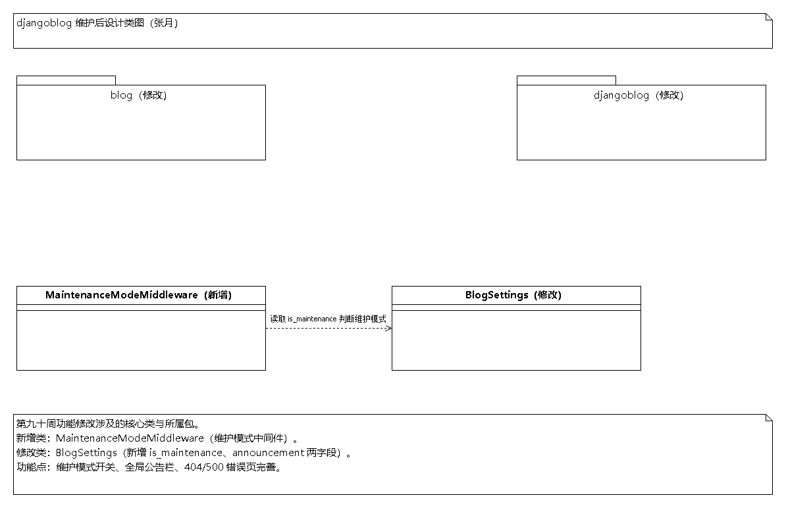
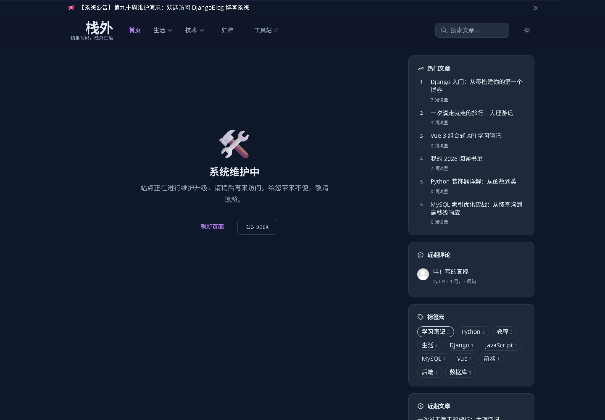
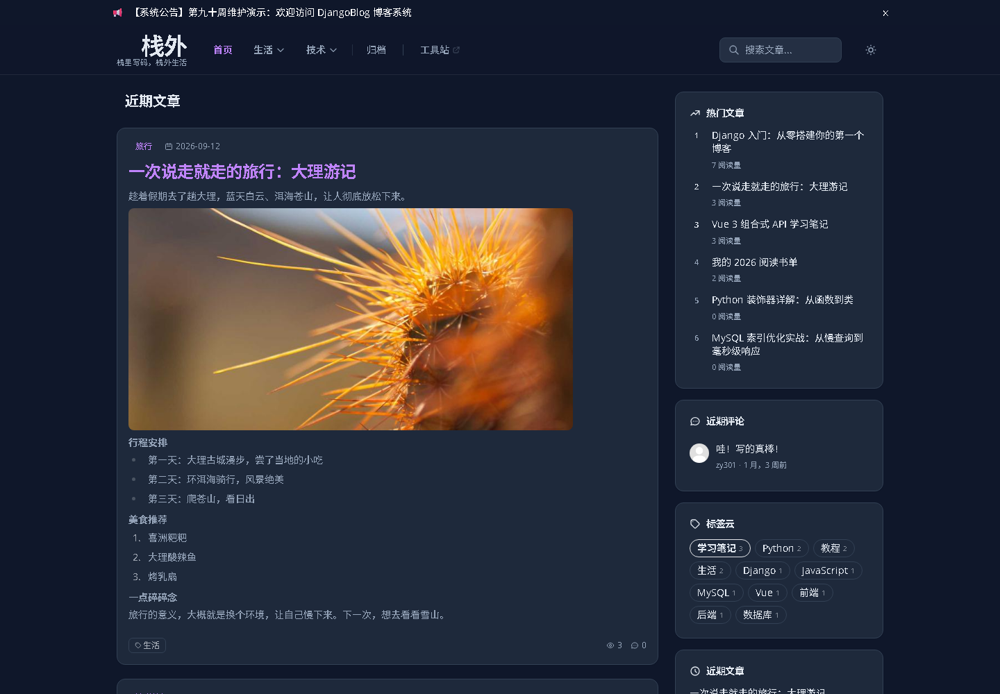
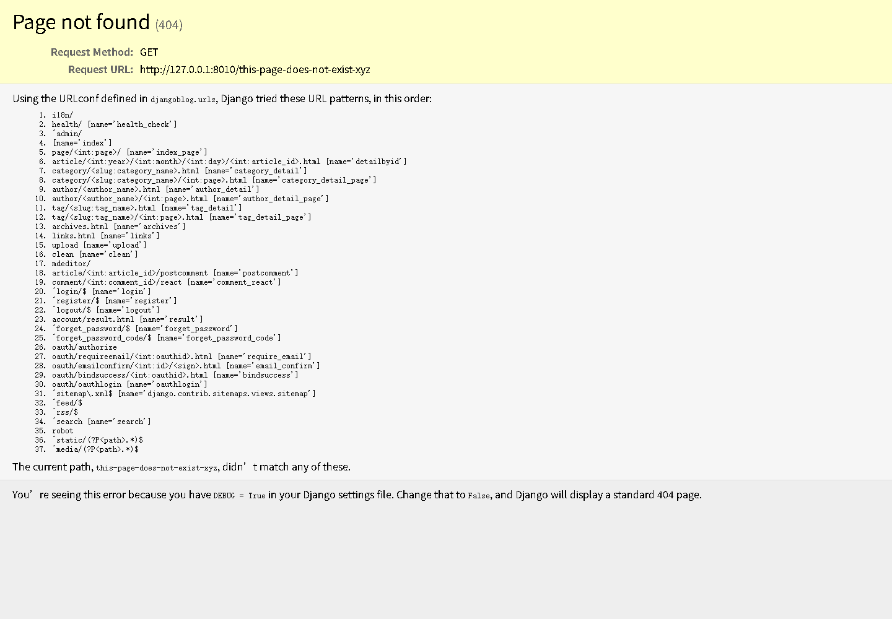

# 开源软件维护报告 · 维护部分（张月 · djangoblog）

> 组号：8
> 小组成员：张月、黄梓涵、侍文博、刘雨婷、谢承志、朱亮宇
> 本文件为**张月负责的 djangoblog（核心项目包）部分**（第 5、6、7、8、9 章），提交后由张月整合进《开源软件维护报告（最终版）》。
> 功能点：① 站点维护模式开关；② 全局公告栏；③ 404/500/403/400 错误页完善。

---

## 5. 开源软件的维护（djangoblog 部分）

**表 3. 开源软件维护的要素**

| 序号 | 维护类别（新增功能/修改缺陷） | 名称 | 维护的细节描述 | 负责该维护的组员 |
|---|---|---|---|---|
| 1 | 新增功能 | 站点维护模式 | 在 `BlogSettings` 中新增布尔字段 `is_maintenance`，并新增 `MaintenanceModeMiddleware` 中间件。开启后前台请求统一返回维护提示页（HTTP 503），后台管理与已登录管理员（`is_staff`）不受影响，便于版本升级或故障时临时封站。 | 张月 |
| 2 | 新增功能 | 全局公告栏 | 在 `BlogSettings` 中新增文本字段 `announcement`，经全局上下文处理器 `seo_processor` 注入 `ANNOUNCEMENT` 变量，在 `base.html` 顶部展示公告横幅；字段留空时不显示横幅。 | 张月 |
| 3 | 修改缺陷/完善 | 404/500/403/400 错误页 | 修正 `djangoblog/urls.py` 中 `handle403` 的拼写错误为 `handler403`（原拼写错误导致自定义 403 页不生效、回落到 Django 默认错误页），并补充 `handler400`；将 4 个错误处理器的提示语中文化；错误页增加搜索框，改善用户引导。 | 张月 |

---

## 6. 开源软件维护所产生的设计（djangoblog 部分）

本次维护对 djangoblog 相关包/类做了如下调整：

- **新增类 1 个**：`MaintenanceModeMiddleware`（`blog/middleware.py`）——维护模式中间件，方法 `__init__(get_response)`、`__call__(request)`；在请求进入视图前读取 `BlogSettings.is_maintenance`，命中维护态且非管理员时直接渲染维护页。
- **修改类 1 个**：`BlogSettings`（`blog/models.py`）——新增字段 `is_maintenance`（布尔，维护模式开关）、`announcement`（文本，全局公告，最大 1000 字符）。
- **修改函数若干**：`seo_processor` 新增 `ANNOUNCEMENT` 上下文项；`error_views` 四个错误处理器提示语中文化；`urls.py` 修正 `handler403`/补充 `handler400`；`settings.py` 注册维护模式中间件。

图 *. 经维护后 djangoblog 的设计类图（张月）

> 说明：图中以「（新增）」「（修改）」标注区分新增类与修改类（源工程为 `StarUML工程-张月/djangoblog-maintain-classmodel-zy.uml`）。`MaintenanceModeMiddleware` 依赖 `BlogSettings`（读取 `is_maintenance` 字段判断是否进入维护模式）；`blog` 与 `djangoblog` 两个包均发生修改。

---

## 7. 维护代码数量及其质量情况（djangoblog 部分）

本次维护（commit `3019aa8`）共改动 **11 个文件**：新增 **131 行**、修改 **9 行**（已按统计口径扣除 Django 自动生成的迁移文件 `0009_blogsettings_announcement_and_more.py` 的 23 行）；其中新增文件 1 个（`templates/blog/maintenance.html`）、修改文件 9 个。

**表 4. 开源软件维护的代码分析**

| 序号 | 维护类别 | 名称 | 受影响的代码行数 | 负责维护的组员 |
|---|---|---|---|---|
| 1 | 新增功能 | 站点维护模式 | 约 90 行 | 张月 |
| 2 | 新增功能 | 全局公告栏 | 约 21 行 | 张月 |
| 3 | 修改缺陷/完善 | 404/500/403/400 错误页 | 约 29 行 | 张月 |
| 合计 | — | 3 个功能点 | 140 行（新增 131 + 修改 9） | 张月 |

**维护代码质量情况**：新增代码均带 `#zy:` 注释标识，遵守第七、八周定稿的《编码规范-谢承志.md》（导入分组、docstring、命名规范）；维护模式中间件采用懒加载导入避免模块加载阶段循环依赖，并对配置读取异常做了兜底（数据库未迁移时按「未开启维护」处理，保证站点可用）；`urls.py` 的 `handler403/handler400` 修正顺带修复了一个真实缺陷（原 `handle403` 拼写错误）。功能已通过本地冒烟测试（首页 200、404 页 404、维护模式 503、公告可见）。

---

## 8. 维护后的软件原型（djangoblog 部分）

- 图 *. 经维护后 DjangoBlog「站点维护模式」界面原型（维护提示页，HTTP 503）

  

- 图 *. 经维护后 DjangoBlog「全局公告栏」界面原型（首页顶部公告横幅）

  

- 图 *. 经维护后 DjangoBlog「404 错误页」界面原型（中文提示 + 搜索框）

  

---

## 9. 实践收获和体会（张月）

- 收获 1：通过对 DjangoBlog 的维护，深入理解了 Django 的中间件机制——中间件在请求进入视图前、响应返回前提供统一的横切处理点，用 `MaintenanceModeMiddleware` 实现「一处开启、全站拦截」的维护模式，比在每个视图里加判断更干净、更易回退。
- 收获 2：学会了「读源码定位真实缺陷」的方法。本次顺带发现并修复了上游遗留的 `handle403` 拼写错误（导致自定义 403 页长期不生效），说明精读代码、对照框架约定（如 Django 的 `handler403/handler404/handler500` 命名）能发现测试覆盖不到的隐性 bug。
- 问题 1：维护模式中间件需要区分「前台」与「后台/静态资源/健康检查」，一开始容易把 `/admin`、`/static`、`/media` 也一并拦掉，把管理员锁在门外，最终通过白名单路径放行解决。
- 问题 2：公告栏内容通过模板上下文全局注入，涉及缓存（`seo_processor` 有 10 小时缓存），修改公告后需要清除缓存才能立即生效，提醒我在后续维护中注意「配置类字段与缓存失效」的联动。
