# 开源软件维护报告

> **组号：8**
> **小组成员：张月、黄梓涵、侍文博、刘雨婷、谢承志、朱亮宇**
> **课程：软件工程 3 班**
> **周期：第九、十周（系统修改与维护）**

---

## 1. 开源软件的功能描述

DjangoBlog 是一个基于 Django 框架的开源博客系统，采用 Python 语言开发。系统主要功能包括：文章发布与管理、分类与标签组织、用户注册登录与第三方 OAuth 授权、评论互动、全文搜索、RSS 订阅、站点地图，以及服务器运维管理等。系统按功能划分为 6 个业务应用（app）——blog、accounts、comments、oauth、servermanager，外加核心项目包 djangoblog 和运行时插件系统 plugins。

其软件需求的用例模型（系统整体用例图）如图 1 所示。

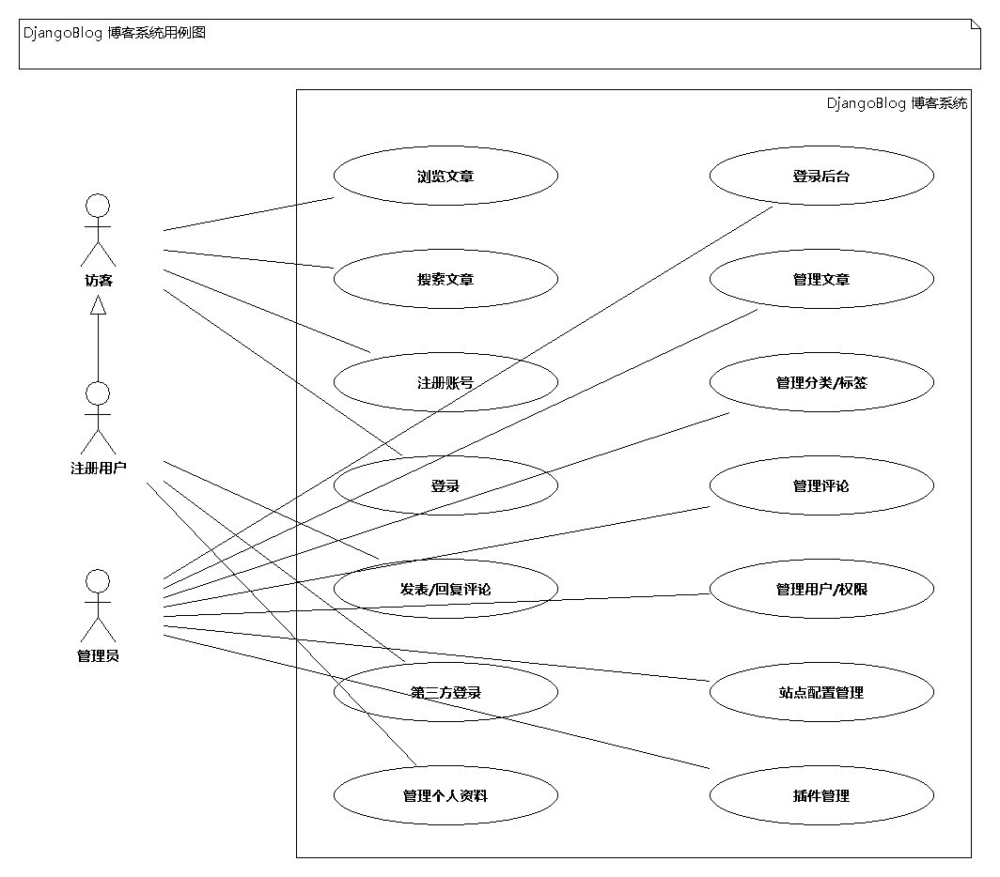

图 1. DjangoBlog 开源软件系统整体用例图

### 1.1 主要用例描述

各业务应用的核心用例简述如下表，详细用例说明与各 app 用例图见第六周《开源软件泛读报告》。

| 应用 | 主要用例 | 说明 |
|---|---|---|
| blog | 浏览文章列表 / 详情、按分类 / 标签 / 作者浏览、搜索、发布 / 编辑 / 删除文章、查看归档与友情链接 | 博客核心内容管理 |
| accounts | 注册、登录、登出、找回密码、邮箱验证 | 用户认证与资料 |
| comments | 发表评论、楼中楼回复、Emoji 表情反应、评论审核 | 评论互动 |
| oauth | 第三方授权登录（GitHub / Google / 微博 / QQ / Facebook / Gitee）、账号绑定 | 第三方登录 |
| servermanager | 命令维护、邮件发送日志、微信会话缓存、远程命令、站点数据统计 | 服务器运维 |
| plugins | 文章推荐、阅读时长、SEO 优化、图片懒加载、版权声明、外部链接、浏览量统计 | 可插拔扩展 |

## 2. 开源软件的软件架构及各个包和类的作用

系统采用 Django 的「核心项目包 + 业务应用（app）」分层架构：`djangoblog` 核心包负责全局配置、路由与基础设施；6 个业务应用各自独立承担一个功能模块；`plugins` 通过插件钩子按需扩展业务应用。

系统整体 UML 包图如图 2 所示。

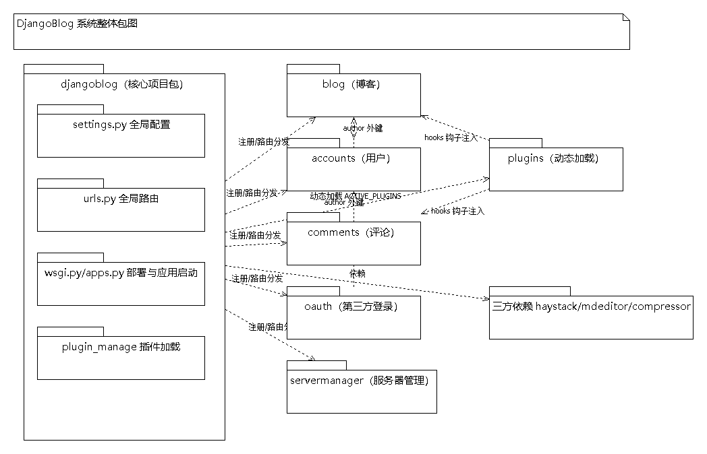

图 2. DjangoBlog 开源软件系统整体包图

### 2.1 djangoblog 核心包各模块与主要类的作用

| 模块 | 作用 | 主要类 / 函数 |
|---|---|---|
| `settings.py` | 全局配置：应用注册、中间件、数据库、搜索、插件、日志 | `INSTALLED_APPS`、`MIDDLEWARE` |
| `urls.py` | 全局路由入口，把 URL 分发给各 app | `urlpatterns`、`i18n_patterns()`、`health_check()` |
| `wsgi.py` | 部署时的 WSGI 入口 | `application` |
| `base_views.py` | 带装饰器的视图基类（CSRF / 登录 / 禁缓存） | `SecureFormView`、`AuthenticatedFormView`、`LoginFormView` 等 |
| `error_views.py` | 统一错误页渲染（404 / 500 / 403 / 400） | `render_error_page()`、`page_not_found_view()`、`server_error_view()`、`permission_denied_view()`、`bad_request_view()` |
| `mixins.py` | 可复用混入类（时间戳 / 缓存 / 分页 / 查询优化） | `TimeStampedModel`、`SlugCachedMixin`、`ArticleListMixin` 等 |
| `constants.py` | 全局常量：缓存超时、缓存键、分页 | `CacheTimeout`、`CacheKey`、`Pagination` |
| `utils.py` | 工具函数（缓存封装、站点设置读取） | `cache()`、`get_blog_setting()` |
| `admin_site.py` | 自定义后台站点 | `admin_site` |
| `feeds.py` / `sitemap.py` | RSS / Atom 订阅、站点地图（SEO） | `DjangoBlogFeed`、`ArticleSiteMap` 等 |
| `elasticsearch_backend.py` / `whoosh_cn_backend.py` | 搜索后端 | `ElasticSearchEngine`、`WhooshEngine` |
| `plugin_manage/` | 插件加载与钩子机制 | `BasePlugin`、`load_plugins()`、`hooks.register()` |

### 2.2 各业务应用包与主要类的作用

**blog（博客核心）**：系统最重的应用，负责文章、分类、标签、友情链接、侧栏与站点配置。核心类：`Article`（文章实体）、`Category`（分类）、`Tag`（标签）、`Links`（友情链接）、`BlogSettings`（站点配置）；视图 `IndexView` / `ArticleDetailView` / `CategoryDetailView` 等负责页面组织；`seo_processor` 上下文处理器统一提供站点级 SEO 与公告上下文。

**accounts（用户认证）**：处理注册、登录、登出、邮箱验证与密码找回，提供自定义用户模型 `BlogUser`（继承 `AbstractUser`，扩展昵称、来源等字段）。

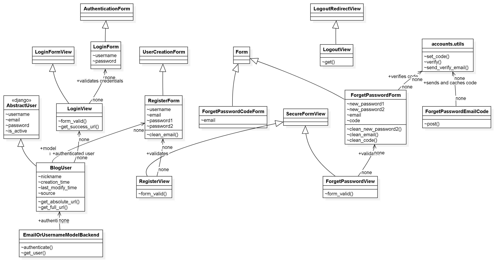

**comments（评论）**：定义评论与表情反应两张表（`Comment`、`CommentReaction`）。`Comment` 通过 `parent_comment` 自关联实现楼中楼回复；`CommentReaction` 记录用户对评论的 Emoji 反应。

**oauth（第三方登录）**：提供第三方 OAuth 登录与本地账号绑定。核心类 `OAuthUser`（第三方用户）、`OAuthConfig`（平台配置），`oauthmanager` 模块为各平台实现授权流程（如 `GitHubOauthManager`、`GiteeOauthManager`）。

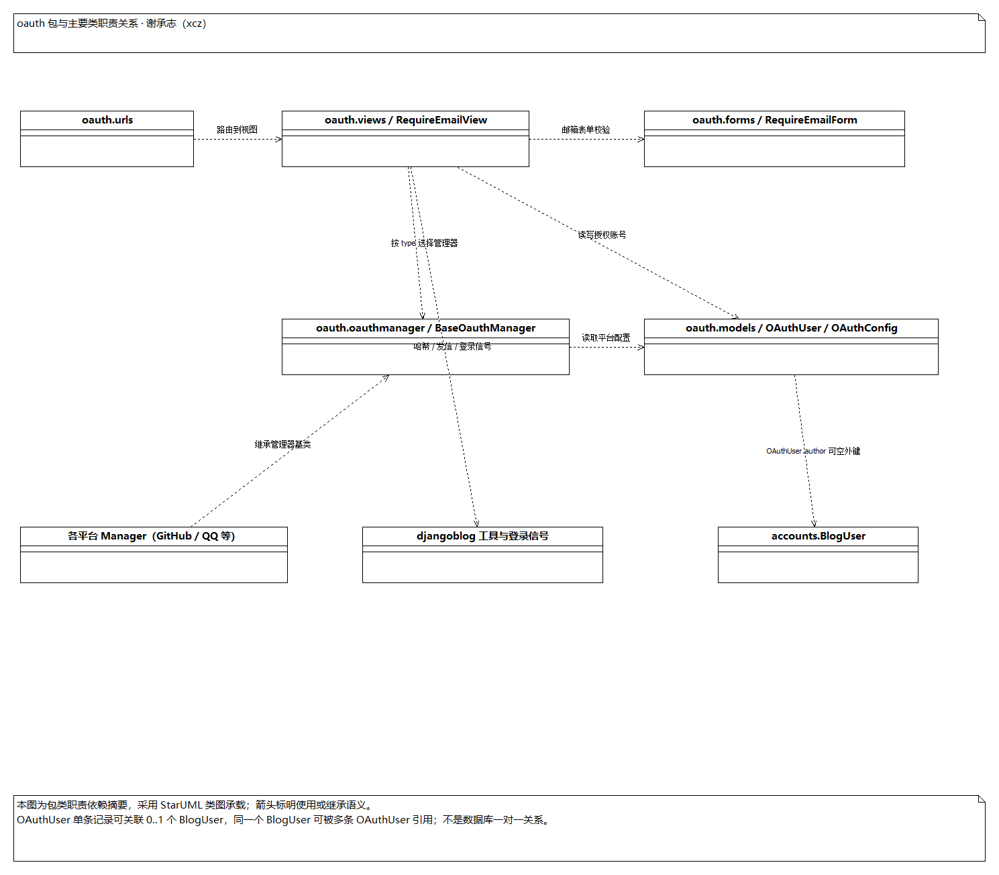

**servermanager（服务器运维）**：负责命令维护（`commands`）与邮件发送日志（`EmailSendLog`），并提供微信远程命令、会话缓存等运维能力。

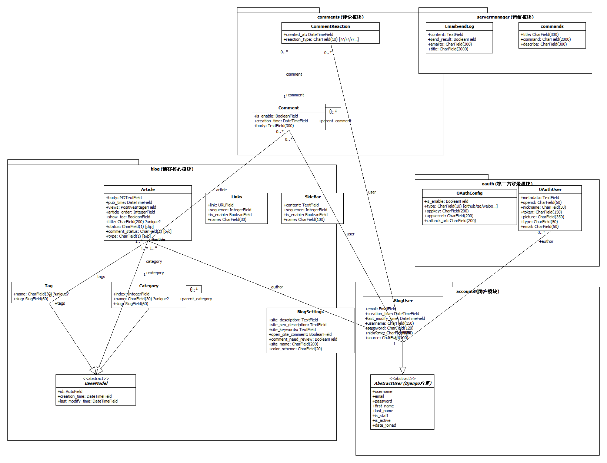

### 2.3 各包之间的依赖关系

1. **djangoblog → 业务应用**：`settings.py` 注册各 app，`urls.py` 把 URL 分发到各 app 的 `urls.py`，形成「总控 → 分支」的依赖关系。
2. **业务应用之间**：`blog → accounts`（文章 `author` 外键指向 `accounts.BlogUser`）；`comments → blog / accounts`（评论 `article` 外键指向文章、`author` 外键指向用户）；`oauth → accounts`（第三方账号 `OAuthUser.author` 可选绑定本地用户）。
3. **djangoblog → plugins**：`plugin_manage.loader` 按 `ACTIVE_PLUGINS` 动态加载 `plugins/` 下的插件。
4. **plugins → 业务应用**：插件通过 `hooks` 钩子（如 `article_bottom`、`sidebar`、`the_content`）把内容注入博客 / 评论页面。
5. **三方库依赖**：全文搜索依赖 `haystack`，Markdown 编辑依赖 `mdeditor`，静态资源压缩依赖 `compressor`。

## 3. 软件功能/用例与类间的对应关系

本次维护涉及 DjangoBlog 的 djangoblog、blog、accounts、comments、oauth 和 servermanager 六个主要子系统。各项功能基于 Django MVT 架构实现，通过模型、视图、表单、管理后台、中间件、模板标签及第三方平台管理器协同完成。

根据任务分工，将站点维护模式和全局公告栏作为一个站点维护配置功能点，因此本章按照 12 个功能点进行整理。第 5 章进一步按照具体维护事项拆分描述。

**表 1. 软件功能与类间的关系**

| 序号 | 功能名称 | 涉及的类/模块 | 涉及的类方法 | 涉及的模块级函数 |
|---|---|---|---|---|
| 1 | 站点维护模式与全局公告栏 | BlogSettings、MaintenanceModeMiddleware、BlogSettingsAdmin、seo_processor 模块 | MaintenanceModeMiddleware.__call()、BlogSettingsAdmin.save_model() | seo_processor() |
| 2 | 自定义错误页面（404、500、403、400） | error_views 模块、djangoblog URL 配置 | — | render_error_page()、page_not_found_view()、server_error_view()、permission_denied_view()、bad_request_view() |
| 3 | 文章累计阅读量与本周热门文章 | Article、ArticleWeeklyView、ViewCountPlugin、blog 模块 | Article.viewed()、ArticleWeeklyView.__str__()、ViewCountPlugin.register_hooks()、ViewCountPlugin.record_view() | get_weekly_hot_articles()、get_most_read_articles()、load_sidebar() |
| 4 | 后台文章单篇置顶与批量置顶 | Article、ArticlelAdmin、blog.admin 模块 | ArticlelAdmin.pin_toggle()、ArticlelAdmin.changelist_view() | _change_article_pin()、pin_articles()、unpin_articles() |
| 5 | 用户头像上传与个人资料编辑 | BlogUser、ProfileForm、ProfileView | ProfileForm.clean_avatar()、ProfileView.get_form_kwargs()、ProfileView.form_valid() | — |
| 6 | 已登录用户修改密码 | AccountPasswordChangeForm、AccountPasswordChangeView | AccountPasswordChangeForm.__init__()、AccountPasswordChangeView.get_form_kwargs()、AccountPasswordChangeView.form_valid() | — |
| 7 | 评论删除 | Comment、comments.views 模块 | — | delete_comment()、_clear_comment_caches() |
| 8 | 评论置顶与取消置顶 | Comment、ArticleDetailView、comments.views 模块 | ArticleDetailView.get_context_data() | toggle_comment_pin()、_clear_comment_caches() |
| 9 | Gitee 第三方登录 | OAuthConfig、OAuthUser、BaseOauthManager、GiteeOauthManager、oauthmanager/views 模块 | GiteeOauthManager.__init__()、GiteeOauthManager.get_authorization_url()、GiteeOauthManager.get_access_token_by_code()、GiteeOauthManager.get_oauth_userinfo()、GiteeOauthManager.get_picture() | get_oauth_apps()、get_manager_by_type()、oauthlogin()、authorize() |
| 10 | GitHub OAuth 回调地址修复 | GitHubOauthManager、BaseOauthManager、oauthmanager/views 模块 | GitHubOauthManager.get_authorization_url()、GitHubOauthManager.get_access_token_by_code() | oauthlogin()、authorize() |
| 11 | 站点数据统计面板 | SiteStatisticsService、servermanager.views 模块 | SiteStatisticsService.collect() | site_statistics() |
| 12 | 邮件发送失败重试 | EmailSendLog、EmailService、EmailSendLogAdmin、Command | EmailService.retry_failed()、EmailService.retry()、EmailService._attempt()、EmailService._finish()、EmailSendLogAdmin.retry_failed()、Command.add_arguments()、Command.handle() | — |

> 注：类方法采用“类名.方法名()”形式表示；模块级函数单独列出。模块、配置文件和模型类分别按其实际职责列示。

### 3.1 各子系统功能与类的关系说明

#### （1）djangoblog 子系统

站点维护模式与全局公告栏主要依赖 BlogSettings 模型保存站点配置。MaintenanceModeMiddleware 在请求处理阶段读取维护模式配置；当维护模式开启时，对普通访客展示维护提示页面并返回 HTTP 503，具有工作人员权限的用户仍可正常访问。

BlogSettingsAdmin 负责后台站点配置管理，save_model() 在配置保存后清理缓存，保证配置变更能够及时生效。全局公告栏通过 seo_processor() 将 BlogSettings 中的 announcement 字段传递至模板上下文，统一基础模板根据公告内容决定是否展示公告栏。

自定义错误页面由 error_views 模块中的 render_error_page() 统一负责页面渲染。page_not_found_view()、server_error_view()、permission_denied_view() 和 bad_request_view() 分别处理 404、500、403 和 400 错误，并通过项目 URL 配置注册对应处理器。

#### （2）blog 子系统

文章阅读量统计由 ViewCountPlugin 插件接入原有文章详情加载流程。ViewCountPlugin.register_hooks() 注册 after_article_body_get 钩子，record_view() 在钩子触发后调用 Article.viewed()。Article.viewed() 在数据库事务中使用 F 表达式更新 Article 原有 views 字段，同时创建或更新 ArticleWeeklyView 记录。周统计按照站点时区计算自然周起始日期，并通过 article 与 week_start 的唯一约束避免同一文章同一周出现重复统计记录。

侧边栏通过 get_most_read_articles() 查询累计热门文章，通过 get_weekly_hot_articles() 查询本周热门文章，最后由 load_sidebar() 组织模板数据并完成展示。

文章置顶功能复用 Article 原有 article_order 字段，不增加重复的置顶状态字段。后台 ArticlelAdmin 提供单篇置顶按钮及批量操作入口。_change_article_pin() 负责更新排序值，pin_articles() 和 unpin_articles() 负责批量操作，pin_toggle() 和 changelist_view() 负责单篇操作及权限检查。

#### （3）accounts 子系统

BlogUser 模型在原有用户信息基础上增加 avatar 和 bio 字段，分别保存用户头像和个人简介。ProfileForm 负责个人资料表单及头像文件校验，ProfileView 通过 get_form_kwargs() 将当前登录用户绑定到表单实例，并通过 form_valid() 保存资料和清理相关侧栏缓存。

AccountPasswordChangeForm 继承 Django 原生 PasswordChangeForm，复用旧密码校验及密码强度验证机制。AccountPasswordChangeView 通过 get_form_kwargs() 传递当前用户，并在 form_valid() 中保存新密码、更新当前会话认证哈希，避免修改密码后当前用户被强制退出。

#### （4）comments 子系统

Comment 模型新增 is_top 字段，用于记录评论置顶状态。delete_comment() 负责评论删除操作，要求用户已登录并使用 POST 请求。评论作者可以删除自己的评论，工作人员可以执行管理删除。删除操作完成后调用 _clear_comment_caches() 清理相关缓存。

toggle_comment_pin() 负责评论置顶和取消置顶，仅允许工作人员操作已公开的顶层评论。ArticleDetailView.get_context_data() 在评论分页之前按照置顶状态和评论 ID 排序，使置顶评论优先展示。

#### （5）oauth 子系统

GiteeOauthManager 继承 BaseOauthManager，实现 Gitee 平台授权地址生成、授权码换取访问令牌、用户信息读取和头像信息获取。OAuthConfig 提供 Gitee 平台配置，get_oauth_apps() 和 get_manager_by_type() 负责 OAuth 平台管理器的加载和选择。oauthlogin() 和 authorize() 负责统一的第三方登录授权流程及回调处理。

GitHub OAuth 修复主要调整 GitHubOauthManager 的授权回调地址构造逻辑。授权请求和授权码换取令牌时均使用后台配置的 callback_url，避免错误拼接 next_url 导致回调地址不一致。

#### （6）servermanager 子系统

SiteStatisticsService 负责汇总站点核心数据，collect() 返回统计面板所需的文章、评论、用户、OAuth 用户、分类、标签和邮件发送数据，并提供热门文章及最近失败邮件记录。site_statistics() 负责统计面板访问权限检查和页面渲染，仅允许超级管理员访问。

邮件失败重试由 EmailService 统一实现，支持单条及批量重试。EmailSendLogAdmin 提供后台批量重试入口，管理命令 Command 提供独立的命令行重试入口。两种入口均复用 EmailService，避免重复实现邮件发送逻辑。

## 4. 开源软件的代码标注

小组在前期（第六周起）对各 app 进行了代码标注，新增代码注释统一采用 `#姓名缩写:` 标识（张月 `#zy:`、黄梓涵 `#hzh:`、侍文博 `#swb:`、刘雨婷 `#lyt:`、谢承志 `#xcz:`、朱亮宇 `#zly:`），第九、十周新增维护代码延续同一约定。按当前 `src/` 源码统计各包标注分布如下。

**表 2. 代码标注分布**

| 序号 | 包名称 | 主要标注类 / 模块 | 标注的代码行数（`#缩写:` 注释行） | 负责标注的组员 |
|---|---|---|---|---|
| 1 | djangoblog | settings、urls、error_views、base_views、mixins、utils 等 | 66 | 张月 |
| 2 | blog | Article、ArticleWeeklyView、views、admin、templatetags | 82 | 黄梓涵 |
| 3 | accounts | BlogUser、forms、views、admin | 78 | 侍文博 |
| 4 | comments | Comment、views、models、templatetags | 34 | 刘雨婷 |
| 5 | oauth | oauthmanager、models、views | 104 | 谢承志 |
| 6 | servermanager | models、services、statistics、views、admin、management | 248 | 朱亮宇 |
| 共计 | **6 个包** | — | **612 行** | — |

> 说明：标注行数按 `src/` 下 Python 文件中 `#缩写:` 注释的出现行数统计（`grep -rE '#(zy|hzh|swb|lyt|xcz|zly):' src/ --include="*.py"`），覆盖第六周起的代码标注与第九、十周新增维护代码标注。

## 5. 开源软件的维护

本次维护针对 DjangoBlog 原有系统的功能不足和使用体验问题，对六个子系统进行了功能新增与完善。维护工作以复用现有业务逻辑为基础，尽量避免重复建设已有功能，同时通过模型、视图、表单、后台管理、中间件和模板之间的协作实现功能扩展。

**表 3. 开源软件维护的要素**

| 序号 | 维护类别（新增功能/修改缺陷） | 名称 | 维护的细节描述 | 负责该维护的组员 |
|---|---|---|---|---|
| 1 | 新增功能 | 站点维护模式 | 在 BlogSettings 中增加 is_maintenance 配置项，并新增 MaintenanceModeMiddleware。管理员开启维护模式后，普通访客访问前台页面时展示维护提示页面并返回 HTTP 503；工作人员仍可访问管理功能，避免维护期间无法管理站点。 | 张月 |
| 2 | 新增功能 | 全局公告栏 | 在 BlogSettings 中增加 announcement 字段，支持管理员配置全站公告。通过 seo_processor() 将公告内容传递至模板上下文，由公共基础模板统一展示；公告内容为空时不显示公告栏。 | 张月 |
| 3 | 修改缺陷/完善 | 自定义错误页面 | 统一错误页面渲染逻辑，通过 render_error_page() 处理页面展示，并完善 404、500、403、400 错误处理函数及 URL 配置，修正原有错误处理器配置问题，改善异常访问时的用户体验。 | 张月 |
| 4 | 修改缺陷/完善 | 文章阅读量展示与本周热门文章 | 复用 Article 原有 views 字段记录累计阅读量，新增 ArticleWeeklyView 模型记录每周阅读量。通过 Article.viewed() 同步更新累计阅读量与本周阅读量，使用事务和 F 表达式降低并发计数丢失风险；侧边栏分别展示累计热门文章和本周热门文章，并完善缓存失效逻辑。 | 黄梓涵 |
| 5 | 新增功能/完善 | 后台文章单篇置顶与批量置顶 | 复用 Article 原有 article_order 字段实现文章置顶排序，在后台新增单篇置顶、取消置顶以及批量置顶、批量取消置顶操作。通过统一辅助函数更新排序值，并在数据变化后清理缓存，不需要增加重复的置顶字段。 | 黄梓涵 |
| 6 | 新增功能 | 用户头像上传与个人资料编辑 | 扩展 BlogUser 模型，新增 avatar 和 bio 字段，实现用户个人资料编辑页面，支持修改昵称、简介及上传本地头像。通过 ProfileForm 限制头像文件扩展名和文件大小，ProfileView 将当前登录用户绑定到表单，防止用户通过请求参数修改他人资料。 | 侍文博 |
| 7 | 新增功能 | 已登录用户修改密码 | 新增独立的修改密码页面，复用 Django PasswordChangeForm 验证旧密码、两次新密码一致性及密码强度策略。修改成功后调用 update_session_auth_hash() 更新当前会话认证哈希，避免用户修改密码后被强制退出。 | 侍文博 |
| 8 | 新增功能 | 评论删除 | 新增评论删除接口，允许评论作者删除自己的评论，工作人员可以执行管理删除。操作要求用户登录并通过 POST 请求提交；删除父评论时沿用原有外键级联规则处理回复，并清理文章评论及侧栏缓存。 | 刘雨婷 |
| 9 | 新增功能 | 评论置顶与取消置顶 | 在 Comment 模型中新增 is_top 字段，允许工作人员对已公开的顶层评论执行置顶或取消置顶操作。普通用户不能置顶，楼中楼回复不能单独置顶；文章详情页在分页前优先排列置顶评论，并同步清理缓存。 | 刘雨婷 |
| 10 | 新增功能 | Gitee 第三方登录 | 在 OAuthConfig 中增加 Gitee 平台类型，并实现 GiteeOauthManager，完成授权地址生成、授权码换取访问令牌、用户信息读取及头像信息获取。将 Gitee 接入原有 OAuth 管理器加载机制，使其复用现有第三方登录、用户绑定及会话建立流程。 | 谢承志 |
| 11 | 修改缺陷/完善 | GitHub OAuth 回调地址修复 | 修复 GitHub OAuth 授权地址中错误拼接 next_url 导致回调地址不符合第三方平台配置的问题。改为直接使用后台配置的 callback_url，并在授权码换取访问令牌时保持回调地址一致，提高 GitHub 第三方登录的稳定性。 | 谢承志 |
| 12 | 新增功能 | 站点数据统计面板 | 新增 SiteStatisticsService 统计服务，集中汇总文章总数、发布文章、草稿、阅读量、评论、用户、OAuth 用户、分类、标签及邮件发送情况，并提供热门文章和最近失败邮件数据。新增统计面板页面，通过登录及超级管理员权限检查限制访问。 | 朱亮宇 |
| 13 | 新增功能/完善 | 邮件发送失败重试 | 扩展 EmailSendLog，新增重试次数、最后重试时间及失败原因字段；新增 EmailService，支持单条和批量重试失败邮件。在后台增加失败邮件重试操作，并提供 retry_failed_emails 管理命令，支持通过 --limit 参数限制单次重试数量。 | 朱亮宇 |

### 5.1 blog 子系统维护重点

blog 是本次维护的核心子系统之一，主要完成文章阅读量统计及后台置顶管理两方面的完善。

**（1）文章累计阅读量与本周阅读量**

原系统已经存在 Article.views 字段，能够记录文章累计阅读量。本次维护没有重复增加累计阅读量字段，而是新增 ArticleWeeklyView 模型，将文章 ID、每周起始日期及该周阅读次数独立保存。文章详情加载后，ViewCountPlugin 通过 after_article_body_get 钩子调用 Article.viewed()。该方法在数据库事务中同步更新累计阅读量和周阅读量，避免两个统计指标分别更新而产生不一致。周统计按照站点时区确定自然周起始日期，并通过唯一约束限制同一篇文章在同一周只能存在一条统计记录。

在展示方面，get_most_read_articles() 根据累计阅读量排序，get_weekly_hot_articles() 根据本周阅读量排序，load_sidebar() 将两组数据传递给侧边栏模板。此外，对首页第一页阅读量缓存进行失效处理，避免文章阅读次数增加后仍然展示旧数据。

**（2）后台文章单篇与批量置顶**

原系统已经存在 Article.article_order 排序字段。本次维护直接复用该字段，通过大于普通文章排序值的优先级实现置顶效果。后台 ArticlelAdmin 新增单篇置顶按钮和批量置顶操作。单篇操作由 pin_toggle() 和 changelist_view() 处理，批量操作由 pin_articles() 和 unpin_articles() 处理。_change_article_pin() 统一负责置顶状态对应的排序值更新。由于 QuerySet 批量更新不会自动触发模型保存信号，因此在数据发生变化后主动清理缓存，确保前台文章排序及时更新。

### 5.2 本次维护的总体说明

本次维护共覆盖六个主要子系统，按照任务分工归纳为 12 个功能点；按照具体维护事项拆分后，第 5 章表 3 共包含 13 项维护记录。其中，站点维护模式与全局公告栏在功能对应表中作为一个站点维护配置功能点，在维护要素表中分别列出。

各项维护尽量沿用原有系统的数据模型、业务流程和 Django 框架能力。例如，blog 复用 views 和 article_order 字段，accounts 复用 Django 用户认证和密码修改机制，comments 沿用原有评论自关联结构，oauth 复用统一的第三方登录管理器，servermanager 则将统计和邮件重试逻辑集中封装为服务类。通过上述维护，系统在文章内容管理、用户资料管理、评论管理、第三方登录、站点维护和后台运维等方面得到进一步完善，同时保持了原有系统的整体架构和业务流程。

## 6. 开源软件维护所产生的设计

本次维护对六个子系统的包 / 类进行了新增与调整。类图统一采用「绿色标示新增类、橙色（或黄色）标示修改类、灰色标示复用类」的方式区分维护产生的设计变更。

### 6.1 djangoblog 子系统

本次维护对 djangoblog 相关包/类做了如下调整：

- **新增类 1 个**：`MaintenanceModeMiddleware`（`blog/middleware.py`）——维护模式中间件，方法 `__init__(get_response)`、`__call__(request)`；在请求进入视图前读取 `BlogSettings.is_maintenance`，命中维护态且非管理员时直接渲染维护页。
- **修改类 1 个**：`BlogSettings`（`blog/models.py`）——新增字段 `is_maintenance`（布尔，维护模式开关）、`announcement`（文本，全局公告，最大 1000 字符）。
- **修改函数若干**：`seo_processor` 新增 `ANNOUNCEMENT` 上下文项；`error_views` 四个错误处理器提示语中文化；`urls.py` 修正 `handler403`/补充 `handler400`；`settings.py` 注册维护模式中间件。

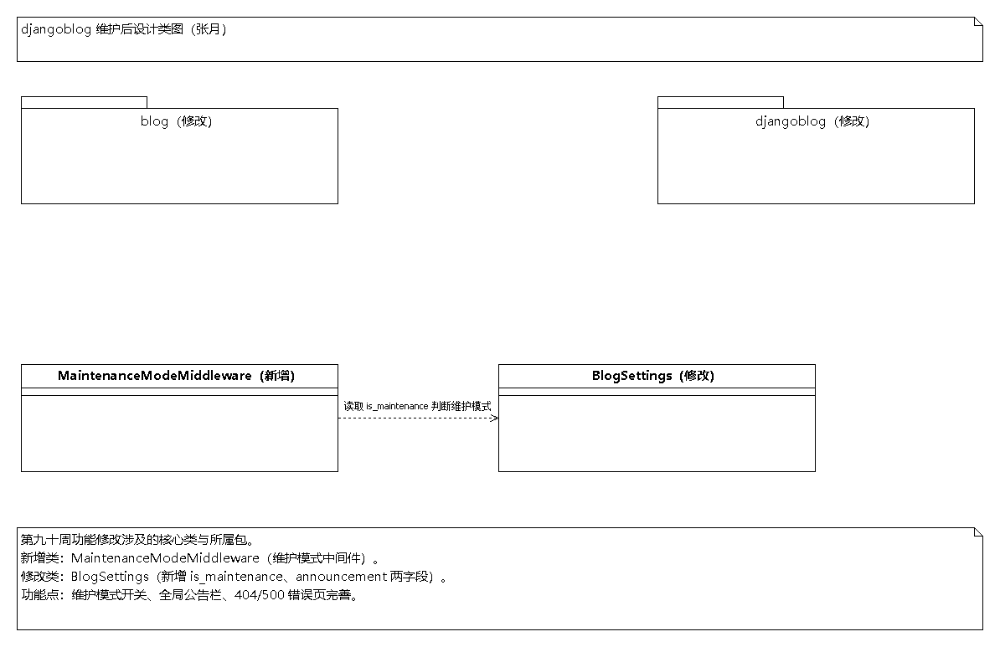

图 6-1. 经维护后 djangoblog 子系统的设计类图（张月）

> 说明：`MaintenanceModeMiddleware` 依赖 `BlogSettings`（读取 `is_maintenance` 字段判断是否进入维护模式）；`blog` 与 `djangoblog` 两个包均发生修改。源工程：`StarUML工程-张月/djangoblog-maintain-classmodel-zy.uml`。

### 6.2 blog 子系统

本次 blog 子系统维护主要围绕文章模型、阅读量统计、后台文章管理及热门文章展示展开。设计上优先复用原有模型字段和插件机制，仅对需要独立保存的数据增加相应模型，避免重复建设已有功能。

维护涉及的主要类及其职责：

- **Article 类**：复用原有 `views` 字段记录文章累计阅读量，复用 `article_order` 字段实现置顶文章排序。本次维护通过完善 `viewed()` 方法，实现累计阅读量和每周阅读量的同步更新。
- **ArticleWeeklyView 类**（新增）：用于独立记录文章每周阅读量，主要数据包括文章关联、每周起始日期和阅读次数。通过文章与周起始日期的唯一约束，避免同一文章在同一自然周产生重复统计记录。
- **ViewCountPlugin 类**：复用原有文章阅读量统计插件及其钩子机制，在 `record_view()` 中调用 `Article.viewed()`。
- **ArticlelAdmin 类**：扩展后台文章管理能力，提供单篇置顶、取消置顶以及批量置顶、批量取消置顶操作。

类之间的关系及协作过程：`Article` 与 `ArticleWeeklyView` 之间为一对多关系；阅读量统计过程中 `ViewCountPlugin` 通过插件钩子调用 `Article.viewed()`；文章置顶由 `ArticlelAdmin` 提供后台入口，模块级辅助函数负责排序值更新；前台展示由 `get_most_read_articles()` / `get_weekly_hot_articles()` / `load_sidebar()` 组织数据。

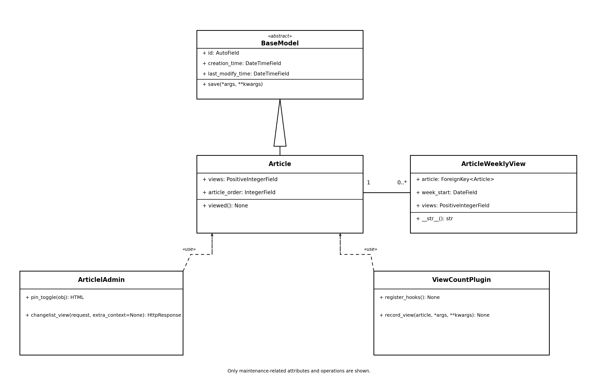

图 6-2. 经维护后 blog 子系统的设计类图（黄梓涵）

> 源工程：`StarUML工程-黄梓涵/blog-maintenance-classmodel-hzh.uml`。

### 6.3 accounts 子系统

`BlogUser` 继承 Django `AbstractUser` 并扩展头像与简介字段。`ProfileForm` 绑定当前 `BlogUser` 实例并校验头像；`ProfileView` 继承项目 `AuthenticatedFormView`，处理当前用户资料读写及缓存清理。`AccountPasswordChangeForm` 继承 Django `PasswordChangeForm`；`AccountPasswordChangeView` 继承 `AuthenticatedFormView`，将当前用户交给表单，并在保存成功后更新 session auth hash。accounts URL 将资料页和改密页映射到相应视图。

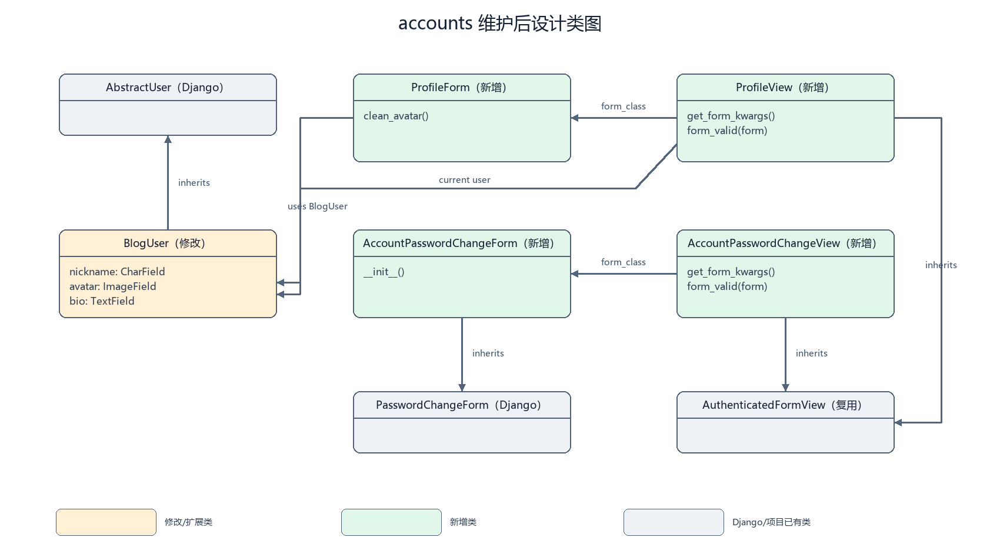

图 6-3. 经维护后 accounts 子系统的设计类图（侍文博）

> 源工程：`StarUML工程-侍文博/accounts-maintained-swb.uml`。

### 6.4 comments 子系统

本次修改了 `Comment` 实体、评论操作视图、URL 路由和文章详情页评论排序，没有新增独立业务类。`Comment.is_top` 保存置顶状态；`delete_comment` 和 `toggle_comment_pin` 分别负责权限校验及状态变更；`ArticleDetailView` 负责按置顶状态和评论 ID 组织顶层评论。删除和置顶入口由评论模板中的 POST 表单提供，表单携带 CSRF 令牌。

维护后类图展示 `Article 1 → * Comment`、`BlogUser 1 → * Comment` 和 `Comment 1 → * Comment`（父评论与回复）关系，并标出 `Comment.is_top` 为本次新增字段。

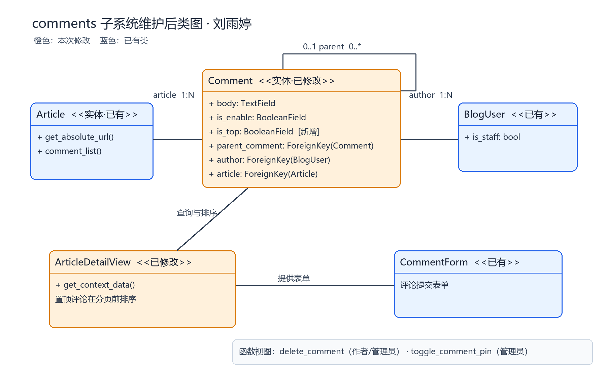

图 6-4. 经维护后 comments 子系统的设计类图（刘雨婷）

> 源工程：`StarUML工程-刘雨婷/comments-维护后.uml`。

### 6.5 oauth 子系统

新增 `GiteeOauthManager`，继承抽象基类 `BaseOauthManager`，实现 `get_authorization_url`、`get_access_token_by_code`、`get_oauth_userinfo`、`get_picture` 四个抽象方法即可接入新平台；`OAuthConfig` 的类型枚举新增 `gitee` 取值；`GitHubOauthManager` 修改授权地址的拼接逻辑（回调地址改为直接使用后台配置的 `callback_url`）。

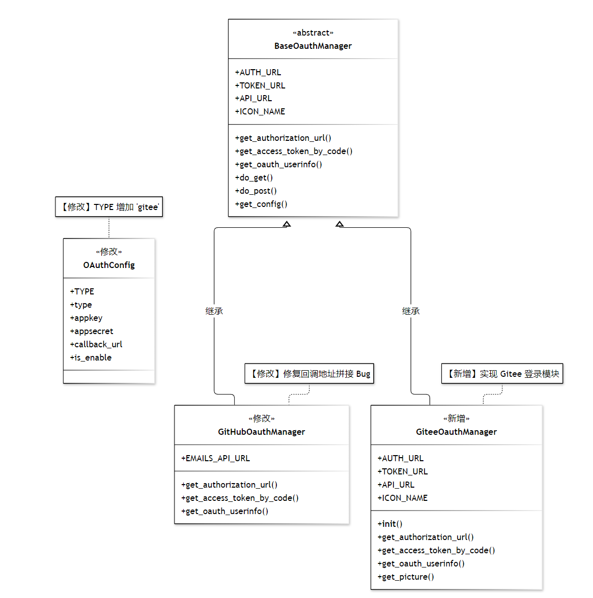

图 6-5. 经维护后 oauth 子系统的设计类图（谢承志）

> 说明：绿色标示新增的 `GiteeOauthManager`，橙色标示修改的 `OAuthConfig` 与 `GitHubOauthManager`，灰色标示既有基类与模型。源工程：`StarUML工程-谢承志/oauth-维护后.uml`。

### 6.6 servermanager 子系统

本次维护对 servermanager 相关类做了如下调整：

- **新增类 3 个**：`SiteStatisticsService`（统计聚合服务，方法 `collect()`）；`EmailService`（失败邮件重试服务，方法 `retry_failed()`、`retry()`、`_attempt()`、`_finish()`）；`RetryFailedEmailsCommand`（管理命令，复用 `EmailService`）。
- **新增视图函数 1 个**：`site_statistics`（校验超级管理员权限后调用 `SiteStatisticsService.collect()` 并渲染统计页）。
- **修改类 2 个**：`EmailSendLog`（新增 `retry_count`、`last_retry_time`、`error_message` 字段）；`EmailSendLogAdmin`（新增 `retry_failed()` 后台操作、结果筛选、搜索，并把重试字段设为只读）。
- **复用类**：Article、Comment、BlogUser、OAuthUser、Category、Tag 仅被统计服务只读查询，未修改。

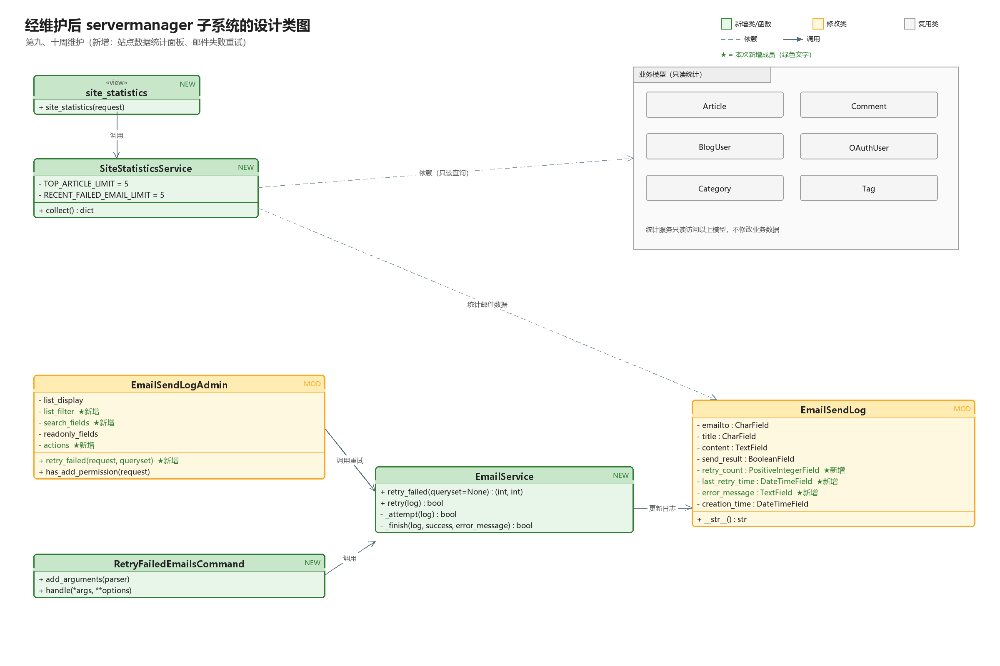

图 6-6. 经维护后 servermanager 子系统的设计类图（朱亮宇）

> 说明：绿色为新增类/函数、黄色为修改类、灰色为复用的业务模型；`★` 标注本次新增的字段/方法。源工程：`StarUML工程-朱亮宇/servermanager-维护后.uml`。

## 7. 维护代码数量及其质量情况

> 统计口径见 `第九十周维护代码量统计口径模板-朱亮宇.md`：新增/修改文件数、新增/修改行数分别统计，**受影响行数 = 新增行数 + 修改行数**；不含自动生成文件（`migrations` 自动迁移、`__pycache__`、`*.pyc`）。

截至 2026-11-06，6 个 app 的维护代码量数据已收齐，按统一口径汇总如下（均已扣除自动生成的迁移文件）：

**表 4-1. 维护代码量统计明细（按统一口径汇总）**

| app | 功能点 | 新增文件数 | 修改文件数 | 新增行数 | 修改行数 | 受影响行数 | 负责组员 | 备注 |
|---|---|---|---|---|---|---|---|---|
| djangoblog | 维护模式/公告栏、404/500 页面美化 | 1 | 9 | 131 | 9 | 140 | 张月 | 已扣除自动迁移 0009（23 行） |
| blog | 阅读量展示/本周热门、后台一键置顶及取消置顶 | 2 | 4 | 606 | 12 | 618 | 黄梓涵 | 已扣除自动迁移 29 行；含 2 份自动化测试文件；53 项测试通过 |
| accounts | 头像上传/资料编辑、修改密码 | 2 | 7 | 187 | 4 | 191 | 侍文博 | 另新增迁移文件 1 个（23 行），未计入上述行数 |
| comments | 评论删除、评论置顶 | 0 | 6 | 223 | 5 | 228 | 刘雨婷 | 另自动迁移文件 1 个（18 行），已扣除 |
| oauth | Gitee 登录、GitHub OAuth 修复 | 0 | 2 | 89 | 1 | 90 | 谢承志 | 迁移文件约 18 行，已扣除 |
| servermanager | 站点数据统计面板、邮件发送失败重试 | 7 | 6 | 663 | 14 | 677 | 朱亮宇 | 已扣除迁移 0003（29 行）；9 个单元测试通过 |
| **合计** | 6 个 app / 约 13 个功能点 | **12** | **34** | **1899** | **45** | **1944** | 朱亮宇汇总 | — |

> 说明：受影响行数 = 新增行数 + 修改行数；已按口径扣除各 app 自动生成的迁移文件（djangoblog 23 行、blog 29 行、accounts 23 行、comments 18 行、oauth 约 18 行、servermanager 29 行）。

**表 4. 开源软件维护的代码分析**

| 序号 | 维护类别 | 名称 | 受影响的代码行数 | 负责维护的组员 |
|---|---|---|---|---|
| 1 | 新增功能 | 站点维护模式（djangoblog） | 约 90 行 | 张月 |
| 2 | 新增功能 | 全局公告栏（djangoblog） | 约 21 行 | 张月 |
| 3 | 修改缺陷/完善 | 404/500/403/400 错误页（djangoblog） | 约 29 行 | 张月 |
| 4 | 新增功能 | 站点数据统计面板（servermanager） | 约 428 行 | 朱亮宇 |
| 5 | 修改缺陷/完善 | 邮件发送失败重试（servermanager） | 约 249 行 | 朱亮宇 |
| 6 | 新增功能 | 阅读量展示/本周热门、后台一键置顶及取消置顶（blog） | 618 行 | 黄梓涵 |
| 7 | 新增功能 | 头像上传/资料编辑、修改密码（accounts） | 191 行 | 侍文博 |
| 8 | 新增功能 | 评论删除、评论置顶（comments） | 228 行 | 刘雨婷 |
| 9 | 新增功能/修复 | Gitee 登录、GitHub OAuth 修复（oauth） | 90 行 | 谢承志 |
| **合计** | — | **6 个 app / 约 13 个功能点** | **1944 行** | — |

**维护代码质量情况**：

- 按分工要求，各 app 新增代码使用对应缩写注释（`#zy:`、`#hzh:`、`#swb:`、`#lyt:`、`#xcz:`、`#zly:`），遵守第七、八周定稿的《编码规范-谢承志.md》。
- 测试情况：blog 53 项相关测试全部通过；servermanager 9 个单元测试通过（统计面板权限/数据、邮件重试成功/失败/空收件人/批量/管理命令，成功路径用 mock 覆盖）；comments 47 项测试全部通过；accounts 提供测试记录（`accounts-test-record.md`）；djangoblog 完成本地冒烟测试（首页 200、404、维护模式 503、公告可见）。
- 工具检查：朱亮宇部分新增文件经 `ruff check` 通过；其余 app 的 ruff/flake8/pylint 结果与 comments/accounts/oauth 的功能测试记录，见谢承志的质量过程评审意见。

## 8. 维护后的软件原型

### 8.1 djangoblog

- 图 8-1. 经维护后 DjangoBlog「站点维护模式」界面原型（维护提示页，HTTP 503）

  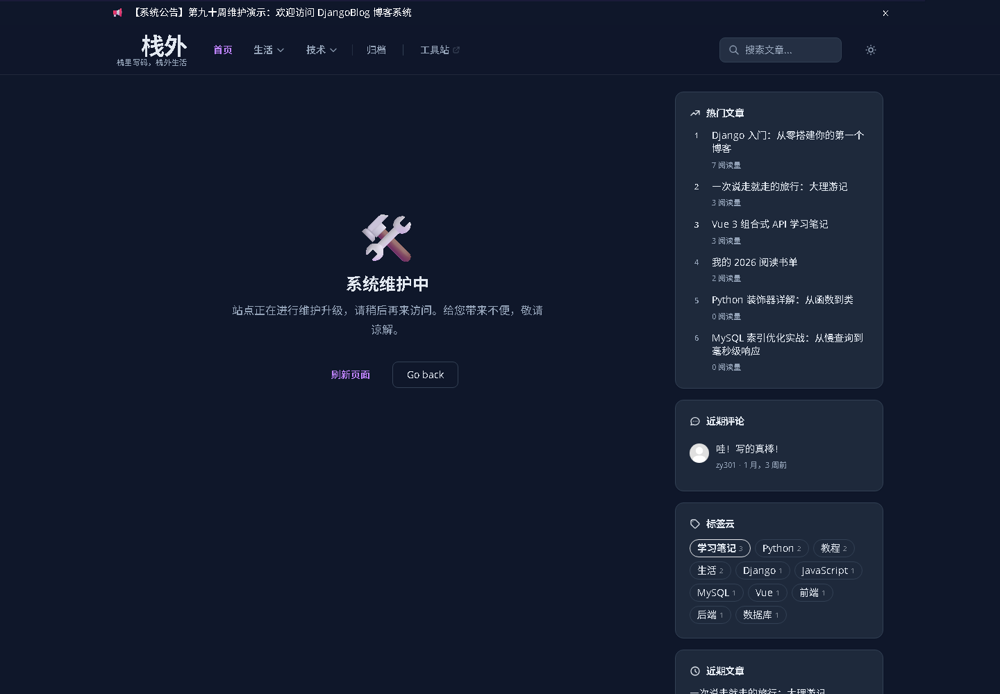

- 图 8-2. 经维护后 DjangoBlog「全局公告栏」界面原型（首页顶部公告横幅）

  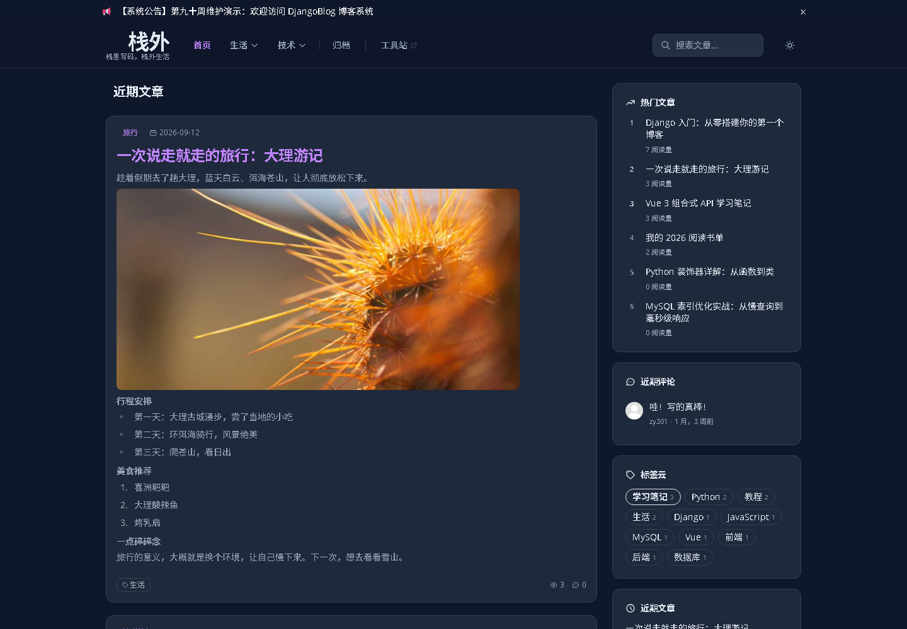

- 图 8-3. 经维护后 DjangoBlog「404 错误页」界面原型（中文提示 + 搜索框）

  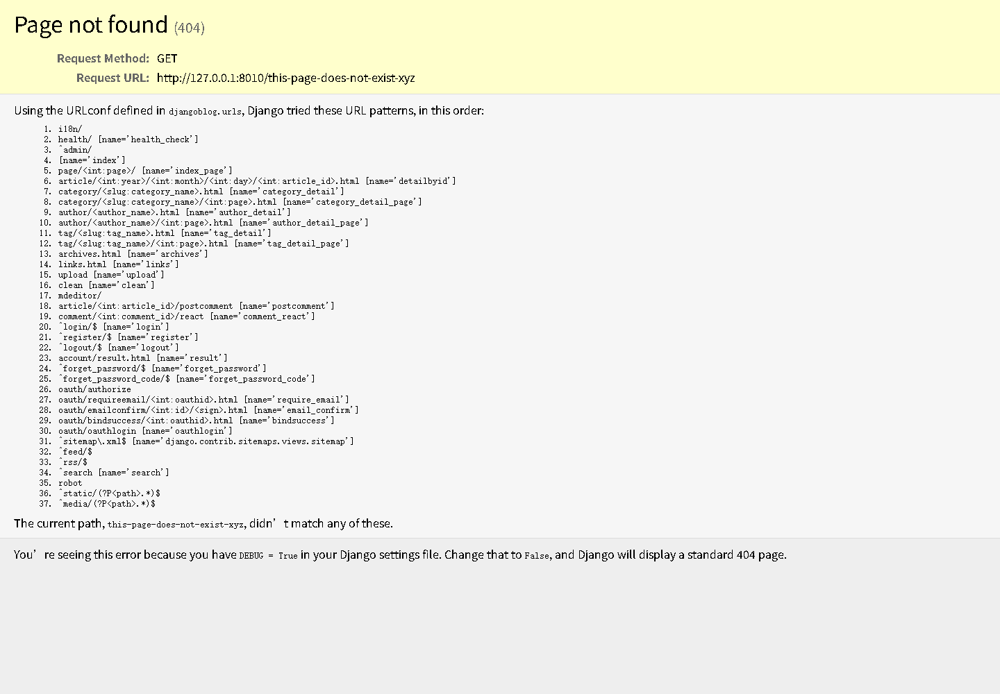

### 8.2 blog

- 图 8-4. 前台热门文章及阅读量展示：前台首页右侧分别展示本周热门文章和累计热门文章，显示文章排名及对应阅读量。

  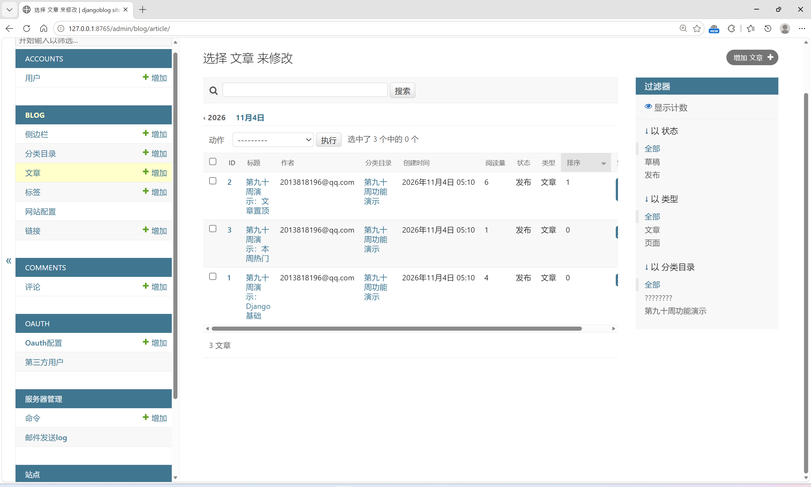

- 图 8-5. 后台文章管理及置顶排序：后台文章列表展示文章标题、阅读量和排序字段，置顶文章排序值为 1，其他文章为 0。

  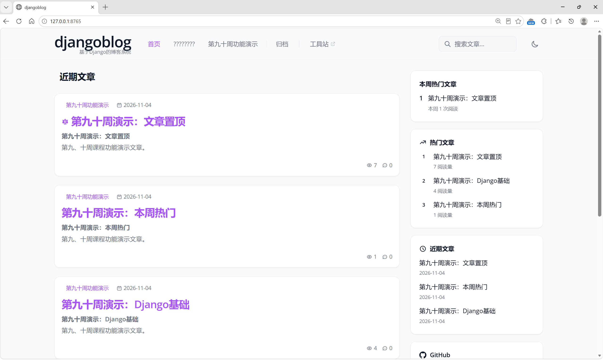

### 8.3 accounts

个人资料页提供昵称、个人简介和头像文件输入项，提交后显示保存提示；修改密码页提供旧密码、新密码和确认输入项，成功后显示更新提示。（按本次提交要求，未附界面截图。）

### 8.4 comments

文章详情页的顶层评论显示「置顶」标记；作者可见自己评论的「删除」按钮，管理员还可见顶层评论的「置顶／取消置顶」按钮。

- 图 8-6. 两条顶层评论同时置顶，均显示「置顶」标记及「取消置顶」按钮。

  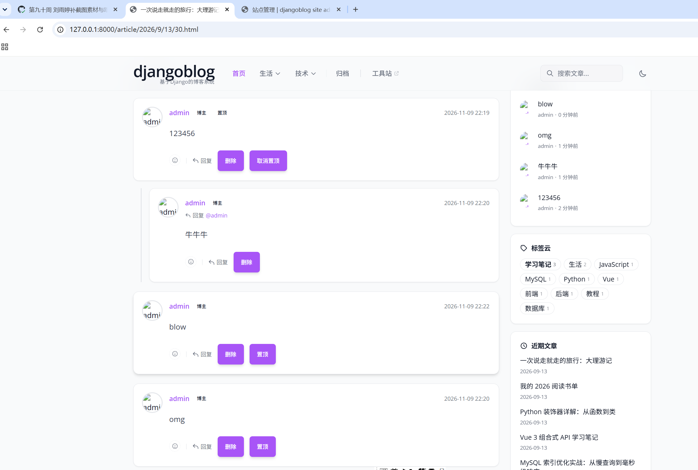

- 图 8-7. 取消其中一条评论的置顶后，该评论不再显示置顶标记，另一条仍保持置顶，说明两条评论的置顶状态相互独立。

  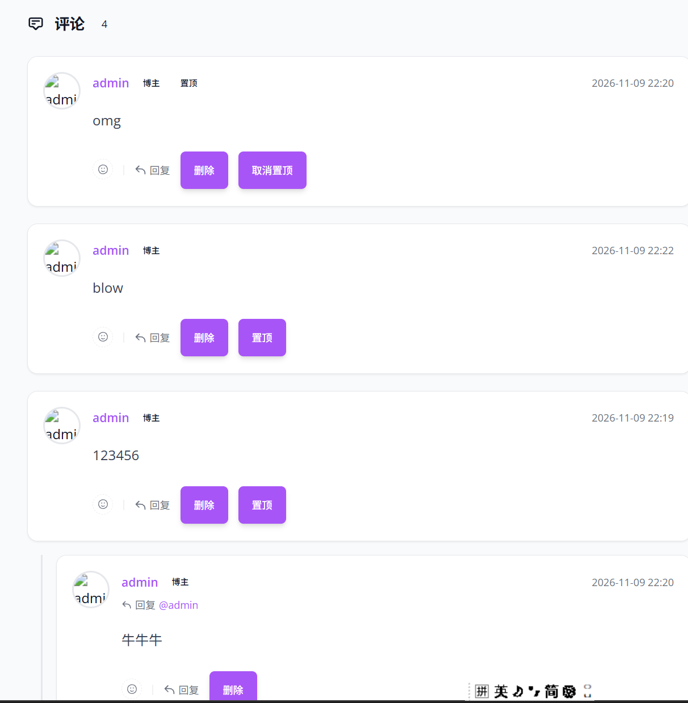

- 图 8-8. 点击「删除」时，浏览器先提示是否同时删除该评论及其回复，避免误操作。

  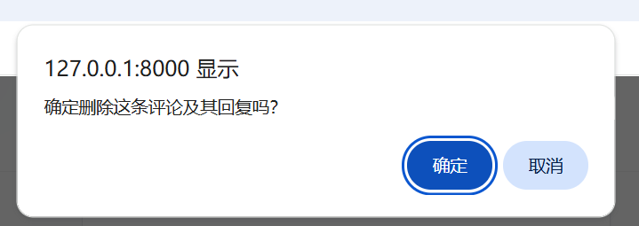

- 图 8-9. 确认删除后，页面中的评论数量减少，仅保留未删除的评论。

  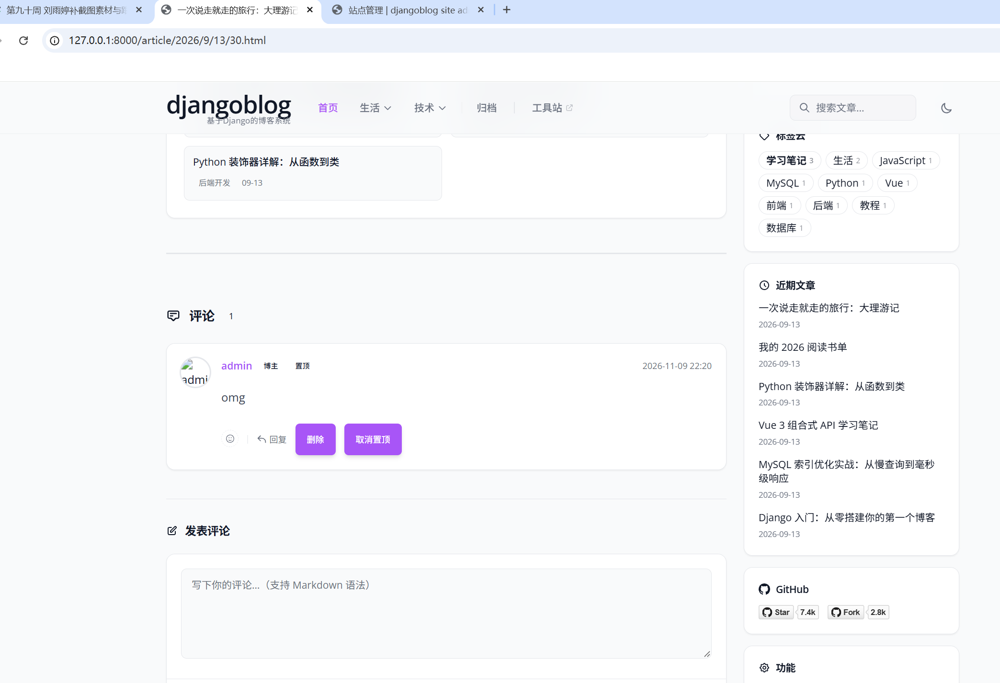

### 8.5 oauth

- 图 8-10. 经维护后 DjangoBlog「Gitee 第三方登录」界面原型（Gitee 授权页）。

  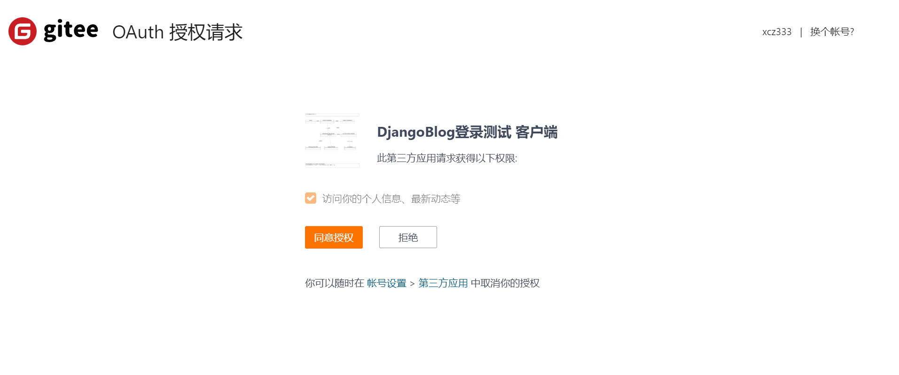

- 图 8-11. 经维护后 DjangoBlog「GitHub 第三方登录」界面原型（回调修复后登录流程恢复正常）。

  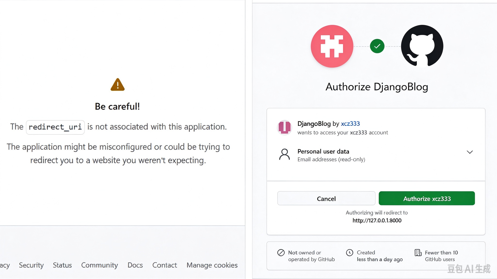

### 8.6 servermanager

- 图 8-12. 经维护后 DjangoBlog「站点数据统计」界面原型（文章/评论/用户/阅读量/邮件发送等指标；仅超级管理员可见）。

  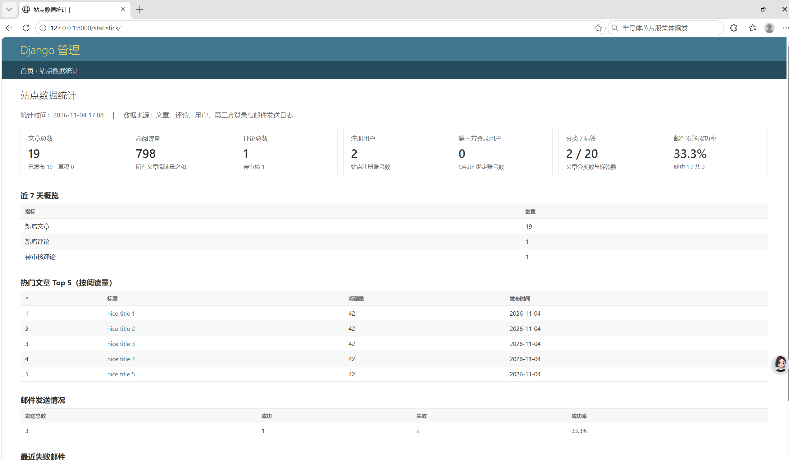

- 图 8-13. 经维护后 DjangoBlog「邮件发送失败重试」界面原型——重试前（失败记录的重试次数为 0）。

  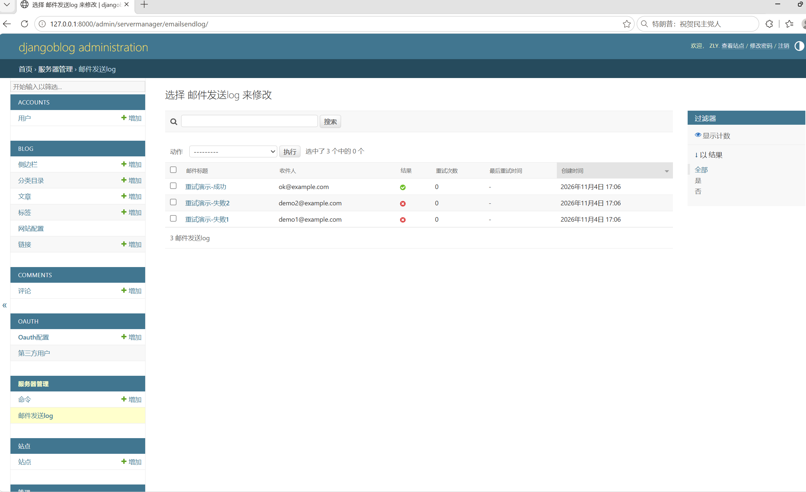

- 图 8-14. 执行“重试发送选中的失败邮件”后：页面提示重试结果，失败记录的重试次数 +1、最后重试时间更新。

  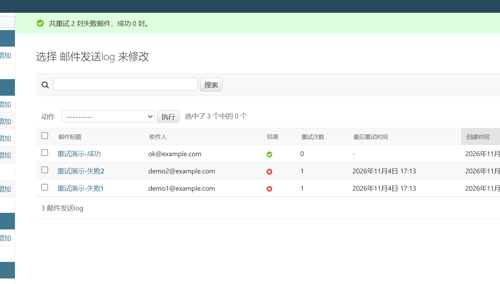

## 9. 实践收获和体会

### 9.1 张月（djangoblog）

- 收获 1：通过对 DjangoBlog 的维护，深入理解了 Django 的中间件机制——中间件在请求进入视图前、响应返回前提供统一的横切处理点，用 `MaintenanceModeMiddleware` 实现「一处开启、全站拦截」的维护模式，比在每个视图里加判断更干净、更易回退。
- 收获 2：学会了「读源码定位真实缺陷」的方法。本次顺带发现并修复了上游遗留的 `handle403` 拼写错误（导致自定义 403 页长期不生效），说明精读代码、对照框架约定能发现测试覆盖不到的隐性 bug。
- 问题 1：维护模式中间件需要区分「前台」与「后台/静态资源/健康检查」，一开始容易把 `/admin`、`/static`、`/media` 也一并拦掉，把管理员锁在门外，最终通过白名单路径放行解决。
- 问题 2：公告栏内容通过模板上下文全局注入，涉及缓存（`seo_processor` 有 10 小时缓存），修改公告后需要清除缓存才能立即生效，提醒我在后续维护中注意「配置类字段与缓存失效」的联动。

### 9.2 黄梓涵（blog）

本次实践主要负责 blog 模块，完成文章阅读量统计、每周热门文章展示以及后台文章置顶管理等维护工作。在开发过程中，首先阅读和分析了项目原有代码，了解文章模型、插件机制、后台管理和缓存处理方式，在尽量复用已有实现的基础上完成新功能，避免不必要的重复设计。

在文章阅读量统计方面，复用了 Article 原有的累计阅读量字段，新增 ArticleWeeklyView 模型记录文章每周的阅读次数，并结合原有 ViewCountPlugin 插件钩子同步更新累计阅读量和本周阅读量。在文章置顶方面，复用了 Article 原有的 article_order 字段，实现了后台单篇置顶、取消置顶以及批量置顶和取消置顶操作，同时处理相关缓存更新问题。

通过本次实践，进一步熟悉了 Django ORM、数据库模型与迁移、Admin 后台扩展、插件机制、缓存管理和自动化测试等技术，也更加理解了软件维护与独立开发新功能之间的区别——维护已有项目不仅需要实现需求，还需要充分理解原有架构，尽可能复用已有代码，控制修改范围，并通过测试检查新功能与原有功能之间的兼容性。

### 9.3 侍文博（accounts）

- 收获 1：头像上传让我实践了 Django 的媒体文件处理与 ModelForm 校验——在表单层限制扩展名和文件大小（JPG/PNG/GIF/WebP、不超过 5 MB），避免在视图层重复校验，也防止上传非法文件。
- 收获 2：修改密码复用 Django 的 `PasswordChangeForm`，并学会在改密成功后调用 `update_session_auth_hash()` 保持会话，避免用户修改密码后被强制退出。
- 问题：本地 MySQL 密码与项目默认不一致，需要显式配置环境变量才能跑通迁移和测试，提醒我维护开源项目时先确认本地运行环境。

### 9.4 刘雨婷（comments）

这次维护从评论模型、权限校验、路由、模板到文章页排序串起了完整流程。测试中发现只检查数据库状态还不够，还需要核对刷新后的页面和缓存；因此补充了实际 HTTP 表单操作与缓存相关测试。原项目使用的 MySQL 密码与本机实际密码不一致，修正当前终端的连接环境后完成了迁移和测试。

### 9.5 谢承志（oauth）

本次维护让我完整走了一遍「新增第三方登录平台 + 排查既有平台回调 Bug」的流程。Gitee 接入借助抽象基类 `BaseOauthManager`，只需实现四个方法即可接入一个新平台，体会到良好抽象对可扩展性的价值；GitHub 回调地址问题则是在本地复现后，通过对照平台文档与后台配置，定位到 `redirect_uri` 被错误拼接了 `next_url` 导致校验失败，体会到「先复现、再对照文档、最后小步修复」的排查思路。

### 9.6 朱亮宇（servermanager）

- 收获 1：通过统计面板的实现，理解了“跨 app 只读聚合”的设计方式——把 Article、Comment、BlogUser、OAuthUser、Category、Tag、EmailSendLog 的查询集中到 `SiteStatisticsService`，视图只负责权限与渲染，既避免视图层堆砌 ORM，也方便单独测试。
- 收获 2：邮件重试让我体会到“完善”与“重构”的边界——没有直接改原有邮件发送信号，而是基于已有的 `EmailSendLog` 增加补发能力，把重试逻辑收敛到 `EmailService`，后台操作和管理命令复用同一套代码，风险更小、也更容易回退。
- 问题 1：本地 MySQL 的账号密码与 `settings.py` 默认值不一致，`migrate` 和测试建库都报 1045；后来通过 `.env` 和终端环境变量显式传入密码才跑通。
- 问题 2：邮件重试的“成功路径”依赖真实 SMTP，本地没有邮箱配置时只能验证失败路径；最后用 mock 单元测试覆盖成功路径，让我意识到测试替身在外部依赖场景下的必要性。

---

> 本文档为第九、十周《开源软件维护报告（最终版）》，整合自各成员提交的维护报告板块、维护后类图与界面截图，第 1～9 章内容已核对齐全。
