# DjangoBlog 开源软件泛读报告——blog、界面分析部分

> 软工3班8组 · 黄梓涵（开发经理） · 分支：hzh_branch
> 日期：2026-10-14
> 源码基线：origin/develop `197393b`，合入个人分支后进行静态分析；本周仅新增 blog 注释，不改变业务逻辑。
> 本文只提交本人负责的功能分析、界面分析、blog 包类说明与功能—类对应关系。系统级用例、系统整体包图、数据流图、数据字典、数据模型章节及团队总结由对应负责人提供。

## 1. blog 功能描述

### 1.1 范围、参与者与用例图

blog 同时承担前台文章展示和后台内容管理。前台请求经项目 URL 配置进入 `blog.urls`，再交给类视图和模板；搜索入口单独配置在 `djangoblog.urls`。文章新增、编辑、删除通过 Django Admin 完成，不能描述成普通登录用户在前台发布文章。

| 参与者 | 能力与边界 |
|---|---|
| 访客 | 浏览文章列表、详情、分类、标签、作者、归档、友情链接以及提交搜索关键词；这些展示路由本身没有登录装饰器。 |
| 具备文章权限的后台用户 | 已获准访问管理站点，并具有相应的 Article 新增、修改或删除权限。`ArticlelAdmin.get_form()` 限定可选作者为超级用户，不等于所有后台操作者必须是超级用户。 |

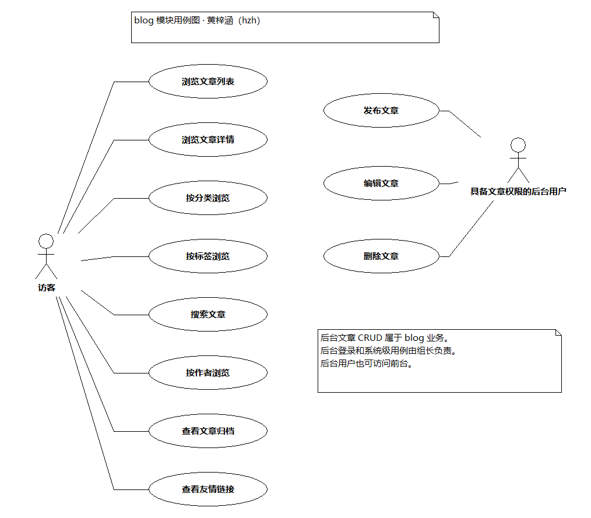

图由本机 StarUML 5.0.2 创建并保存，PNG 经 StarUML 导出位图后无损转换获得。可编辑工程本地保留，不列入本周提交文件。

以下各图是主成功流程的抽象，缓存命中、表单错误、权限不足等分支在说明表中列出。生命线可以代表视图、模型、缓存或模板等协作对象；图中方法名旁的括号是 StarUML 的消息显示格式，不表示所有自然语言步骤都是源码中同名的方法。

### 1.2 用例 UC-B01：浏览文章列表

| 项目 | 内容 |
|---|---|
| 参与者 | 访客 |
| 前置条件 | 站点可用；访问首页或对应分页路径。 |
| 后置条件 | 展示当前页已发布的普通文章及分页信息。 |
| 基本流程 | 1. 浏览器访问 `/` 或 `/page/<page>/`。 2. `IndexView` 通过 Mixin 取得页码及查询缓存键。 3. 未命中缓存时筛选 `type='a', status='p'`，预加载作者、分类和标签。 4. 缓存查询结果，依据模型排序和 `PAGINATE_BY` 分页。 5. 添加站点 SEO 上下文，渲染文章列表。 |
| 扩展流程 | 缓存命中时复用查询结果；无文章时显示空列表；无效或越界页码按 Django ListView 的分页规则处理。 |
| 源码对应 | `blog.views.IndexView`、`ArticleListView`，`djangoblog.mixins.CachedListViewMixin`、`PageNumberMixin`、`OptimizedArticleQueryMixin`。 |

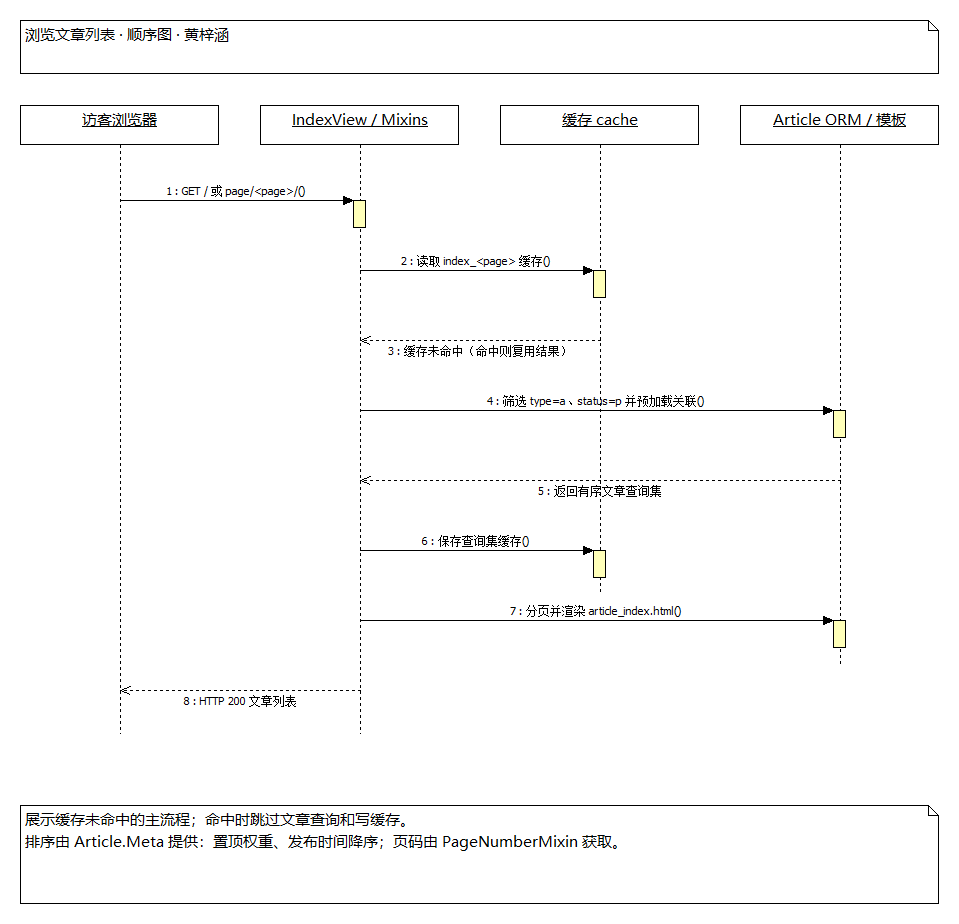

### 1.3 用例 UC-B02：浏览文章详情

| 项目 | 内容 |
|---|---|
| 参与者 | 访客 |
| 前置条件 | 请求包含文章 ID；目标文章存在。 |
| 后置条件 | 展示正文、标签、SEO 元数据、评论分页以及上一篇/下一篇入口。 |
| 基本流程 | 1. 访问文章详情地址。 2. `DetailView` 根据 `article_id` 获取 Article。 3. `ArticleDetailView.get_context_data()` 准备启用评论、评论分页、相邻文章及标签信息。 4. 生成 SEO 信息并运行文章详情插件钩子。 5. 模板与标签函数生成详情页面。 |
| 扩展流程 | 文章不存在返回 404；评论页码按视图逻辑规范化；评论提交转入 comments 模块。 |
| 实现边界 | 本类未重写默认查询集以限制 `status='p'`，因此不能声称详情请求已经拒绝草稿。URL 中的日期来自 `creation_time`，查找主要使用文章 ID。访问计数等插件行为须结合插件是否启用分析。 |
| 源码对应 | `ArticleDetailView`、`Article.comment_list()`、`next_article()`、`prev_article()`、`blog_tags`、`hooks`。 |

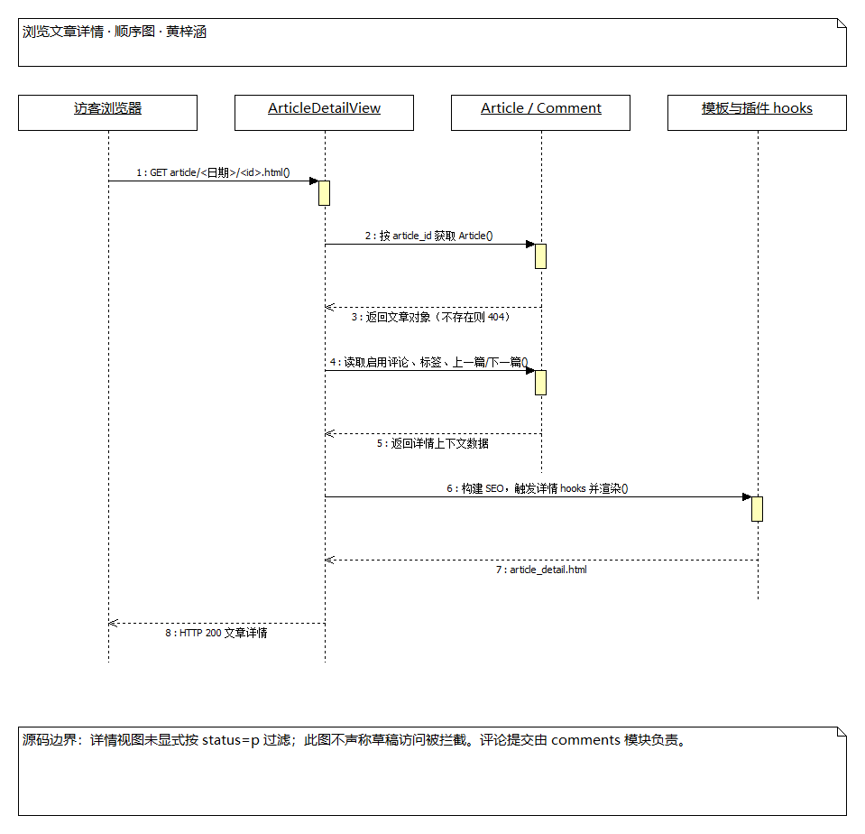

### 1.4 用例 UC-B03：按分类浏览

| 项目 | 内容 |
|---|---|
| 参与者 | 访客 |
| 前置条件 | 目标分类 slug 存在。 |
| 后置条件 | 展示当前分类及其子分类的已发布内容。 |
| 基本流程 | 1. 访问分类地址。 2. `SlugCachedMixin` 根据 URL 参数中的 slug 查找 Category，单次请求内复用对象。 3. `get_sub_categorys()` 展开当前分类和后代分类。 4. 根据分类名称集合、`status='p'` 获取文章查询结果并缓存。 5. 复用列表模板分页展示。 |
| 扩展流程 | 分类不存在返回 404；分类无文章显示空列表；查询缓存命中时复用结果。 |
| 实现边界 | 路由参数叫 `category_name`，对象查询实际使用 `slug`；分类文章查询没有额外限制 `type='a'`。 |
| 源码对应 | `CategoryDetailView`、`Category`、`SlugCachedMixin`、`ArticleListView`。 |

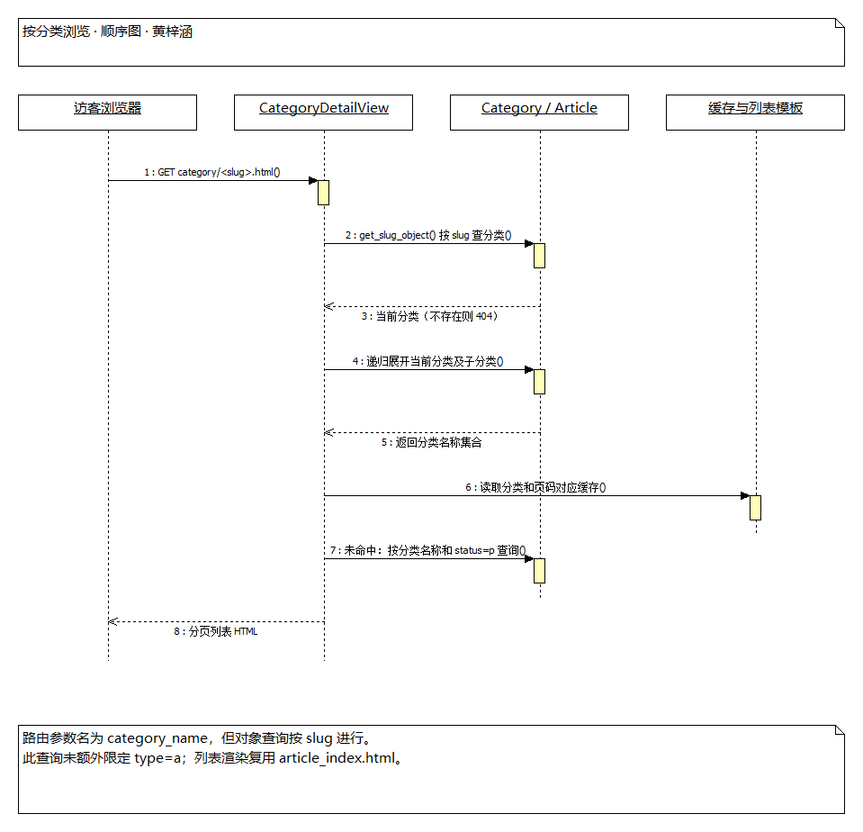

### 1.5 用例 UC-B04：按标签浏览

| 项目 | 内容 |
|---|---|
| 参与者 | 访客 |
| 前置条件 | 目标标签 slug 存在。 |
| 后置条件 | 展示具有指定标签的已发布普通文章。 |
| 基本流程 | 1. 访问标签地址。 2. 根据 slug 获取 Tag。 3. 按 `tags__name`、`type='a'`、`status='p'` 筛选 Article，并使用标签及页码构造缓存键。 4. 准备标签名称和 SEO 信息。 5. 分页渲染文章列表。 |
| 扩展流程 | 标签不存在返回 404；标签无匹配文章显示空列表；命中缓存时省略查询构造步骤。 |
| 源码对应 | `TagDetailView`、`Tag`、`Article.tags`、`SlugCachedMixin`。 |

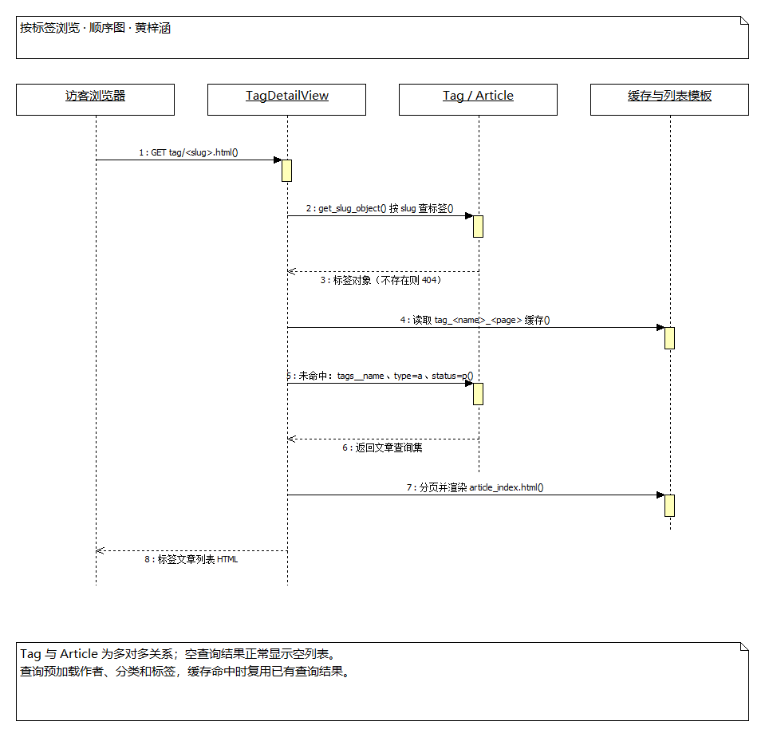

### 1.6 用例 UC-B05：搜索文章

| 项目 | 内容 |
|---|---|
| 参与者 | 访客 |
| 前置条件 | 搜索后端及索引可用；用户提供关键词。 |
| 后置条件 | 展示匹配结果、关键词高亮和分页信息；配置允许时展示拼写建议。 |
| 基本流程 | 1. 提交 `/search?q=关键词`。 2. 项目路由通过 `search_view_factory` 创建 `EsSearchView`，传入 `ElasticSearchModelSearchForm`。 3. 视图为 `SearchQuerySet` 启用高亮，表单调用 Haystack 搜索链路。 4. 搜索后端返回结果。 5. 构造结果分页和建议上下文，渲染搜索页面。 |
| 扩展流程 | 空查询或无结果由表单和模板提供提示；后端不可用应作为环境故障记录，不能把静态分析写成成功运行。 |
| 实现边界 | `blog.forms.BlogSearchForm` 存在，但不是当前 URL 显式传入的表单。`ArticleIndex.index_queryset()` 限制已发布文章；自定义 ArticleDocument 同步路径另有实现，不能据此保证所有索引都实时过滤草稿或删除旧文档。 |
| 源码对应 | `EsSearchView`、`ElasticSearchModelSearchForm`、`ElasticSearchEngine`、`ArticleIndex`、`ArticleDocument`。 |

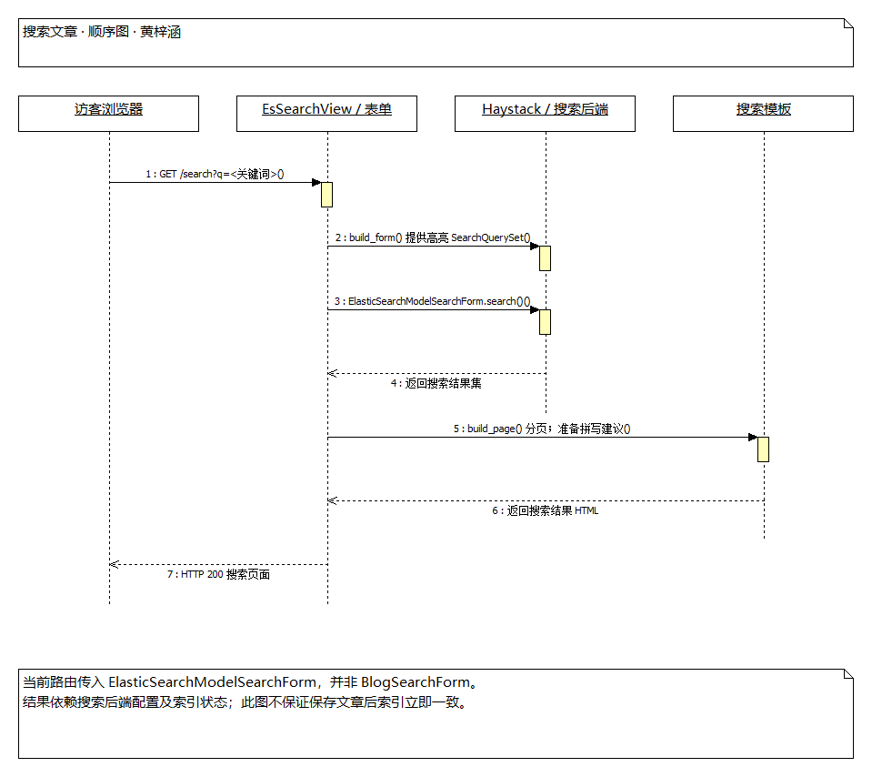

### 1.7 用例 UC-B06：按作者浏览

| 项目 | 内容 |
|---|---|
| 参与者 | 访客 |
| 前置条件 | 请求提供作者用户名。 |
| 后置条件 | 展示该用户名下已发布的普通文章。 |
| 基本流程 | 1. 访问作者文章路径。 2. 从 URL 获取 `author_name`。 3. 使用作者名经 slugify 后的值和页码生成缓存键。 4. 缓存未命中时按原始用户名、`type='a'`、`status='p'` 查询。 5. 添加作者页面上下文并分页展示。 |
| 扩展流程 | 作者不存在或无文章可返回空列表，不应描述为必然返回 404。 |
| 源码对应 | `AuthorDetailView`、`Article.author`、`ArticleListView`。 |

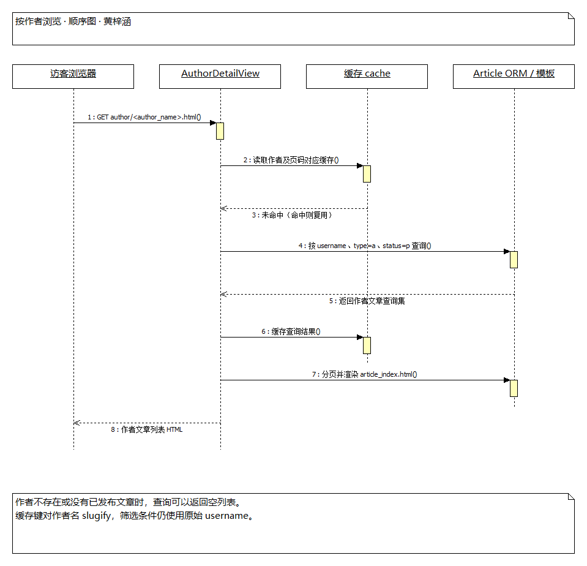

### 1.8 用例 UC-B07：查看文章归档

| 项目 | 内容 |
|---|---|
| 参与者 | 访客 |
| 前置条件 | 站点可用。 |
| 后置条件 | 在归档模板中集中展示已发布内容。 |
| 基本流程 | 1. 请求 `/archives.html`。 2. 路由级 `cache_page(3600)` 检查页面缓存。 3. 未命中时进入 `ArchivesView`，继续检查 `archives` 查询缓存。 4. 查询缓存未命中时按 `status='p'` 查询 Article。 5. 渲染 `article_archives.html` 并返回页面。 |
| 扩展流程 | 页面缓存命中直接返回缓存响应；查询缓存命中复用数据；无文章显示空归档。 |
| 实现边界 | `paginate_by=None`，不使用普通列表的分页；查询没有单独限定普通文章类型。 |
| 源码对应 | `ArchivesView`、`Article`、`cache_page`、`CachedListViewMixin`。 |

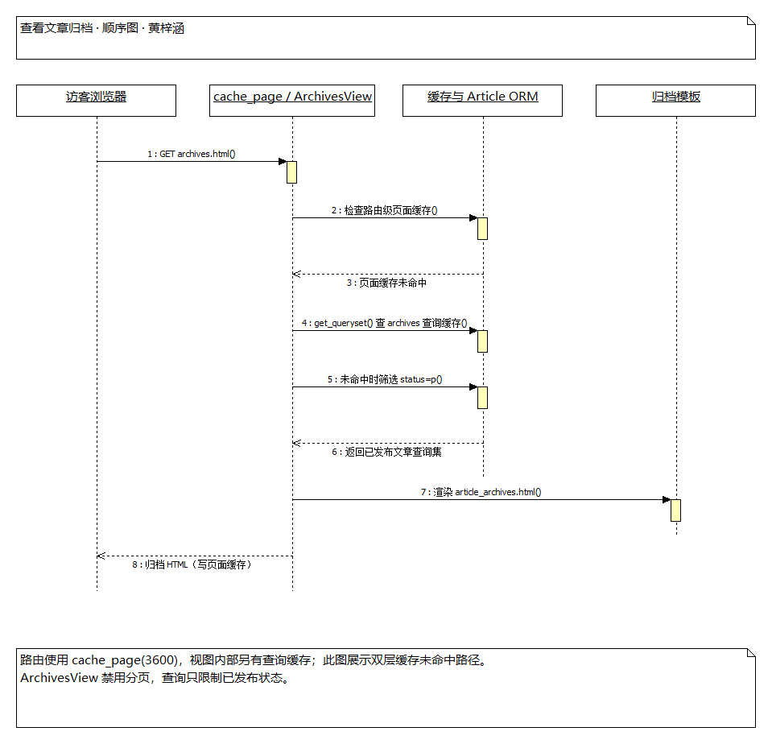

### 1.9 用例 UC-B08：查看友情链接

| 项目 | 内容 |
|---|---|
| 参与者 | 访客 |
| 前置条件 | 站点可用。 |
| 后置条件 | 展示已启用友情链接。 |
| 基本流程 | 1. 请求 `/links.html`。 2. `LinkListView.get_queryset()` 筛选 `is_enable=True`。 3. 模板展示友情链接名称和访问入口。 |
| 扩展流程 | 无启用链接时展示空列表；点击链接后访问目标外部站点。 |
| 源码对应 | `LinkListView`、`Links`、`links_list.html`。 |

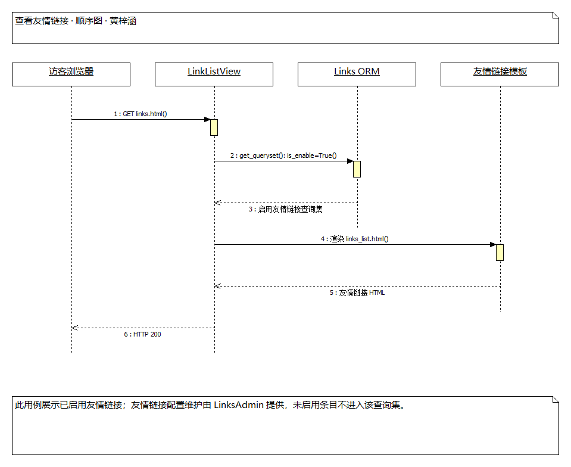

### 1.10 用例 UC-B09：发布文章

| 项目 | 内容 |
|---|---|
| 参与者 | 具备 Article 新增权限的后台用户 |
| 前置条件 | 已登录并获准访问后台；可选作者和分类存在。 |
| 后置条件 | 新增文章记录并保存分类、标签等关系；状态为 `p` 时可进入相应前台列表查询。 |
| 基本流程 | 1. 打开 `/admin/blog/article/add/`。 2. `ArticlelAdmin` 准备 `ArticleForm`，作者候选限定超级用户。 3. 填写标题、正文、作者、分类、标签和发布状态。 4. 后台校验权限与表单。 5. `save_model()` 委托父类保存 Article，模型保存触发适用信号。 6. 后台后续保存多对多关系、记录操作并重定向。 |
| 扩展流程 | 权限不足不保存；必填字段缺失或标题重复等校验错误回显表单；选择 `d` 保存草稿。已有文章还可用批量 action 改为已发布。 |
| 实现边界 | `makr_article_publish()` 直接 `QuerySet.update(status='p')`，不等同于逐个调用 `save()`，不能认为必然触发保存信号。缓存或搜索索引的一致性应另行验证。 |
| 源码对应 | `ArticlelAdmin`（源码原名）、`ArticleForm`、`Article`、`BaseModel`、`makr_article_publish`。 |

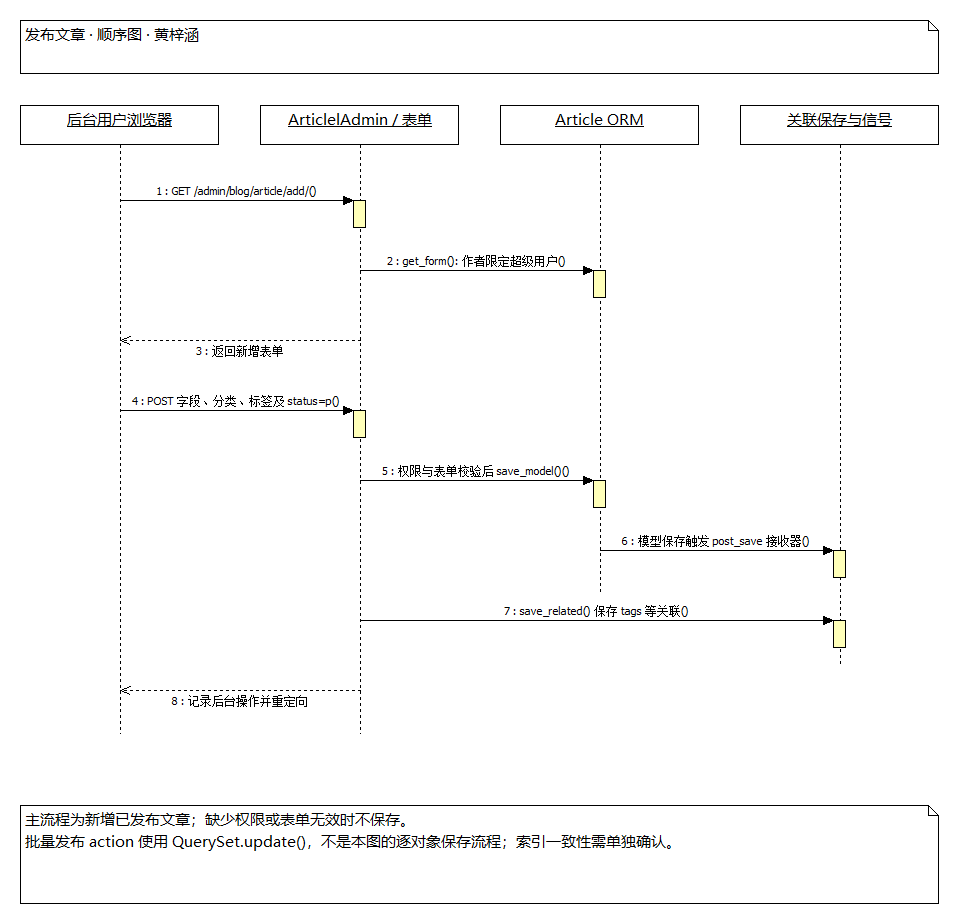

### 1.11 用例 UC-B10：编辑文章

| 项目 | 内容 |
|---|---|
| 参与者 | 具备 Article 修改权限的后台用户 |
| 前置条件 | 已登录后台；目标文章存在。 |
| 后置条件 | 经校验的文章字段及关联关系更新。 |
| 基本流程 | 1. 打开 `/admin/blog/article/<id>/change/`。 2. 后台加载目标文章及现有表单数据。 3. 修改内容并提交。 4. 后台校验权限与表单。 5. 保存文章、后续保存标签关系，执行适用信号与操作日志。 6. 返回后台列表或继续编辑。 |
| 扩展流程 | 目标不存在不更新；无权限拒绝；表单错误保留用户输入并提示。 |
| 实现边界 | `BaseModel.save()` 没有主动刷新 `last_modify_time`，不能将“编辑自动更新时间”写成已实现保证。 |
| 源码对应 | `ArticlelAdmin`、`ArticleForm`、`Article.save()`、`BaseModel.save()`。 |

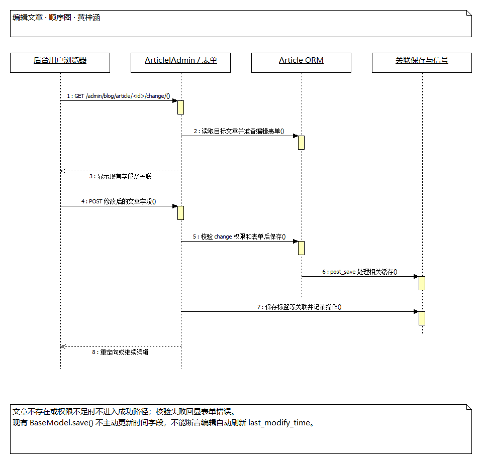

### 1.12 用例 UC-B11：删除文章

| 项目 | 内容 |
|---|---|
| 参与者 | 具备 Article 删除权限的后台用户 |
| 前置条件 | 已登录后台；目标文章存在；关联对象满足删除约束。 |
| 后置条件 | 文章及按数据库关系规则需要删除的数据被删除，后台记录相应操作。 |
| 基本流程 | 1. 打开文章删除页面。 2. 后台读取文章并展示关联删除影响。 3. 用户确认删除。 4. 后台检查权限及关联约束、记录删除操作。 5. 调用标准删除机制，返回文章列表。 |
| 扩展流程 | 取消确认保留文章；权限不足或受保护关联不进入成功删除流程。 |
| 实现边界 | `ArticlelAdmin` 没有自定义删除视图。当前 `blog_signals.py` 未见对应 `post_delete` 接收器，不能把删除后清理缓存和搜索文档画成已证实的步骤。 |
| 源码对应 | `ArticlelAdmin`、Django `ModelAdmin`、`Article` 及 ORM 删除机制。 |

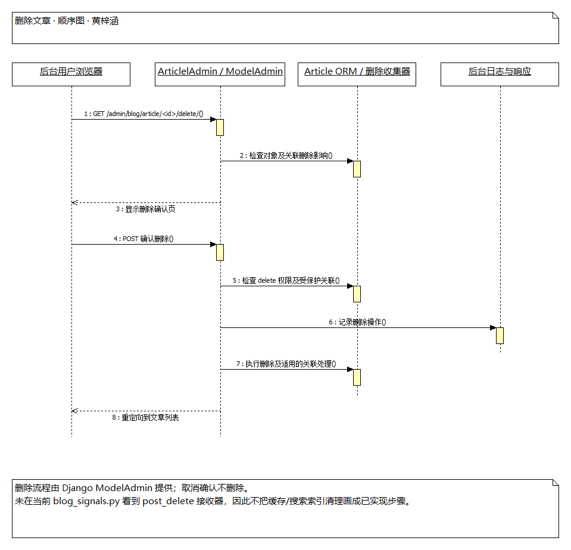

## 2. 界面分析（本人负责部分）

### 2.1 既有成果的引用范围

沿用第四周的 [界面设计分析](../第四周/界面设计分析.md)、[软件界面设计说明书](../第四周/软件界面设计说明书.md) 中与 blog 相关的展示页面，结合当前路由、视图和模板核对。原图是第四周历史截图，本周没有把旧截图标记为重新运行取证；认证界面的详细分析由 accounts 负责人提供。

| 界面 | 路由 / 入口 | 主要元素和用户操作 | 对应实现 | 历史图片 |
|---|---|---|---|---|
| 首页及分页 | `/`、`/page/<page>/` | 文章卡片、标题、摘要、阅读入口、导航、侧栏、分页 | `IndexView`；`blog/article_index.html` | [第四周首页](../第四周/界面截图/01_首页.png) |
| 文章详情 | `/article/<year>/<month>/<day>/<id>.html` | 正文、作者、分类、标签、相邻文章、评论显示；评论提交属于 comments | `ArticleDetailView`；`blog/article_detail.html` | [第四周详情](../第四周/界面截图/02_文章详情.png) |
| 分类列表 | `/category/<slug>.html` | 分类名称、当前分类及后代内容列表、分页 | `CategoryDetailView`；共用列表模板 | [第四周分类页](../第四周/界面截图/03_分类页_技术.png) |
| 标签列表 | `/tag/<slug>.html` | 标签名、匹配文章及分页 | `TagDetailView`；共用列表模板 | [第四周标签页](../第四周/界面截图/04_标签页_Python.png) |
| 作者列表 | `/author/<author_name>.html` | 作者名称、该作者文章列表 | `AuthorDetailView`；共用列表模板 | 当前模板静态分析，未补拍 |
| 文章归档 | `/archives.html` | 历史文章集合、时间信息和详情入口 | `ArchivesView`；`blog/article_archives.html` | [第四周归档](../第四周/界面截图/05_归档页.png) |
| 搜索结果 | `/search?q=关键词` | 搜索框、结果、高亮、分页、空结果提示 | `EsSearchView`；`search/search.html` | [第四周搜索](../第四周/界面截图/08_搜索页.png) |
| 友情链接 | `/links.html` | 友链列表和外部链接 | `LinkListView`；`blog/links_list.html` | [第四周友链](../第四周/界面截图/10_友链页.png) |
| 后台文章列表与表单 | `/admin/blog/article/` | 标题/正文搜索、状态/类型/分类筛选、批量操作；新增/编辑表单与删除确认 | `ArticlelAdmin`、`ArticleForm`、Django Admin 模板 | 第四周仅有后台登录截图，不作为文章编辑页证据 |

### 2.2 界面流转与架构对应

前台用户从首页标题进入文章详情，也可由分类、标签、作者、归档或搜索结果进入同一个详情视图。首页、分类、标签和作者页面复用 `article_index.html`，通过不同查询条件与上下文区分内容，体现“查询差异封装在视图、展示结构复用在模板”的设计。分页标签、文章元信息、面包屑和侧栏由 `blog.templatetags.blog_tags` 提供。

后台用户进入文章管理列表后，可以新增文章、编辑指定记录或查看删除确认页面。是否有权操作由后台机制检查；作者选择范围是表单层额外约束。前台登录并不自动赋予后台文章管理权限。

### 2.3 界面分析结论与可核对问题

| 观察 | 架构解释 / 建议 |
|---|---|
| 列表布局复用 | 同一模板配合不同视图和查询条件，降低重复展示逻辑。 |
| 内容与导航关联清楚 | Article 的分类、标签和作者关系形成多个阅读入口，模型反向 URL 与模板标签连接展示和路由。 |
| 搜索需要独立环境 | 数据库文章存在不等于全文搜索可用，需核对搜索配置、索引与错误提示。 |
| 已发布过滤存在差异 | 首页、标签、作者限制普通文章且已发布；分类、归档只限制已发布；详情未显式限制发布状态。界面描述应保留差异。 |
| 历史截图有边界 | 旧图用于引用已有分析；本周真实操作截图另存钉钉，不据旧图宣称新一轮运行验证。 |

## 4. blog 软件架构及包、类作用

### 4.1 MTV 与请求链路

本项目遵循 Django MTV 分工：Model 用 ORM 表达数据与关系；Template 负责页面结构；View 接收路由请求、组织查询和上下文。URL 配置决定请求入口，Mixin 复用缓存、分页和预加载，模板标签复用展示逻辑，中间件围绕请求/响应进行性能统计。

典型前台链路为：浏览器 → `djangoblog.urls` → `blog.urls` → 具体视图 → 缓存或 ORM → 上下文 → 模板及模板标签 → HTTP 响应。文章管理链路为：浏览器 → 管理站点 → `ArticlelAdmin`/`ArticleForm` → 模型与关系保存 → 后台响应。整体 UML 包图由张月提供，本节说明 blog 在架构中的位置及依赖。

### 4.2 包与主要类说明

| 包 / 文件 | 主要类或函数 | 作用 |
|---|---|---|
| `blog.models` | `BaseModel` | 抽象公共主键与时间字段；生成 slug、反向 URL；浏览量专用更新路径。 |
| `blog.models` | `Article` | 核心文章实体；保存标题、正文、状态、类型、作者、分类、标签及排序信息；提供评论和相邻文章辅助查询。 |
| `blog.models` | `Category`、`Tag` | 分类及分类树、标签实体；分别形成文章的外键和多对多分类组织。 |
| `blog.models` | `Links`、`SideBar`、`BlogSettings`、`LinkShowType` | 友情链接、侧栏、站点配置与链接展示类型枚举。 |
| `blog.views` | `ArticleListView`、`IndexView` | 列表公共配置与首页筛选，复用项目 Mixin。 |
| `blog.views` | `ArticleDetailView` | 详情上下文、评论显示分页、SEO 与插件钩子。 |
| `blog.views` | `CategoryDetailView`、`TagDetailView`、`AuthorDetailView` | 分类、标签、作者维度的列表查询与页面上下文。 |
| `blog.views` | `ArchivesView`、`LinkListView` | 归档与启用友链展示。 |
| `blog.views` | `EsSearchView` | Haystack 搜索视图扩展，启用高亮并组织分页、建议。 |
| `blog.views` | `fileupload`、`clean_cache_view` | 签名检查后的文件上传；直接清理站点缓存的接口。属于技术辅助入口，权限边界须单独核对。 |
| `blog.admin` | `ArticleForm`、`ArticlelAdmin` | 文章后台表单及配置，提供列表、筛选、作者选择和批量 action。保留源码中的类名拼写。 |
| `blog.admin` | `CategoryAdmin`、`TagAdmin`、`LinksAdmin`、`SideBarAdmin`、`BlogSettingsAdmin` | 各内容实体和站点配置的后台管理。 |
| `blog.forms` | `BlogSearchForm` | 已定义的 Haystack 表单扩展；当前搜索路由未显式使用此类。 |
| `blog.search_indexes` | `ArticleIndex` | Haystack 搜索索引结构；索引查询集筛选已发布文章。 |
| `blog.documents` | `ArticleDocument`、`ArticleDocumentManager` | 自定义 Elasticsearch 文章映射及同步管理，区别于 Haystack 索引定义。 |
| `blog.documents` | `ElapsedTimeDocument`、`ElaspedTimeDocumentManager`、`GeoIp`、`UserAgent` 等 | 页面耗时日志与访问设备/地理信息结构；管理器类名按源码保留。 |
| `blog.middleware` | `OnlineMiddleware` | 调用下游处理请求，统计耗时；配置启用时尝试写性能日志并替换页面占位符。 |
| `blog.context_processors` | `seo_processor` | 向模板提供站点级 SEO 上下文。 |
| `blog.templatetags` | `blog_tags`、`vite_tags` 内函数 | Markdown、目录、标签、侧栏、分页、插件资源与前端资源展示。函数不能误称为模型类。 |
| `blog.apps` | `BlogConfig` | 应用启动初始化和搜索索引检查。 |
| `blog.management.commands` | 各命令 `Command` | 索引构建、缓存清理等维护操作；不同文件中的同名 Command 按模块区分。 |

### 4.3 外部依赖与职责边界

| 依赖包 | blog 的使用方式 | 边界 |
|---|---|---|
| `accounts` | Article.author 引用配置的用户模型 | 用户注册、登录和资料维护由 accounts 负责。 |
| `comments` | 详情视图使用 CommentForm、评论模型及关联查询 | 本节分析评论展示；评论提交、审核和回复细节由 comments 负责人提供。 |
| `djangoblog.mixins` / `utils` | 列表缓存、页码、预加载、站点设置及 Markdown 工具 | 这些类/函数属于项目核心包，不能列成 blog 自定义类。 |
| `djangoblog.plugin_manage` | 详情钩子及内容展示扩展 | 具体插件作用与装载流程由插件负责人说明。 |
| `djangoblog.elasticsearch_backend` | 当前搜索表单与自定义后端 | 搜索实际行为依赖配置及已建立索引。 |
| Django Admin / ORM / 模板引擎 | 标准管理表单、权限、保存删除、数据查询和模板渲染 | 框架机制与项目自定义代码应明确区分。 |

## 5. 功能与类的对应关系

### 5.1 blog 对应表

| 功能 | 对应类 / 函数 | 所属包 | 说明 |
|---|---|---|---|
| 浏览文章列表 | `IndexView`、`ArticleListView`、`Article` | blog | 复用查询缓存、预加载和分页 Mixin。 |
| 浏览文章详情 | `ArticleDetailView`、`Article`；`blog_tags` 函数 | blog | 评论显示调用 comments；插件调用核心 hooks。 |
| 按分类浏览 | `CategoryDetailView`、`Category`、`Article` | blog | 当前分类和后代分类筛选。 |
| 按标签浏览 | `TagDetailView`、`Tag`、`Article` | blog | 依托标签多对多关系。 |
| 按作者浏览 | `AuthorDetailView`、`Article` | blog | 作者身份模型来自 accounts。 |
| 搜索文章 | `EsSearchView`、`ArticleIndex`、`ArticleDocument`、`ArticleDocumentManager` | blog | 搜索视图、Haystack 索引及独立文档同步职责不同。 |
| 当前搜索表单与引擎 | `ElasticSearchModelSearchForm`、`ElasticSearchEngine` | djangoblog | 外部依赖，并非 BlogSearchForm。 |
| 归档 | `ArchivesView`、`Article` | blog | 使用归档模板及两层缓存。 |
| 友情链接 | `LinkListView`、`Links`、`LinksAdmin` | blog | 展示启用链接与后台维护。 |
| 发布 / 编辑文章 | `ArticlelAdmin`、`ArticleForm`、`Article`、`BaseModel` | blog | 后台标准保存链路；多对多关系由后续阶段保存。 |
| 批量发布 / 草稿操作 | `makr_article_publish`、`draft_article` | blog.admin | 函数 action，直接批量更新状态。 |
| 删除文章 | `ArticlelAdmin`、`Article`，Django `ModelAdmin` | blog / Django | 框架提供确认和删除流程，未自定义删除视图。 |
| 评论开关 | `open_article_commentstatus`、`close_article_commentstatus` | blog.admin | 修改文章评论开关，评论业务由 comments 处理。 |
| 站点、侧栏配置 | `BlogSettings`、`SideBar` 及对应 Admin | blog | 展示数据由上下文处理器和模板标签使用。 |
| 页面性能统计 | `OnlineMiddleware`、`ElapsedTimeDocument`、`ElaspedTimeDocumentManager` | blog | 条件启用的性能日志，不是文章检索流程。 |

### 5.2 功能—类汇总表（开发经理整理，阶段版）

本表是本人承担的汇总产出，只整理功能与实现对应关系，不并入其他人的报告章节。blog 详细关系见上表；以下依据已提交的成员材料和实际源码统一归属。函数与类明确区分，待交材料不写成完成。

| 功能 | 对应类 / 函数 | 所属包 | 说明 |
|---|---|---|---|
| 注册与邮箱激活 | `RegisterView`、`RegisterForm`、`BlogUser`、`account_result()` | accounts | 视图和表单注册用户，结果入口处理激活；按侍文博材料归纳。 |
| 用户名 / 邮箱登录 | `LoginView`、`LoginForm`、`EmailOrUsernameModelBackend` | accounts | 认证、会话与返回地址处理。 |
| 退出登录 | `LogoutView` | accounts | 会话、缓存和 Cookie 清理。 |
| 找回密码 | `ForgetPasswordEmailCode`、`ForgetPasswordView`、对应 Form、`BlogUser` | accounts | 验证码申请、缓存与密码校验更新。 |
| 用户资料后台维护 | `BlogUserAdmin`、`BlogUser` | accounts | 不能据模型资料字段推断存在普通用户自助编辑页。 |
| 评论发表与回复 | `CommentForm`、`CommentPostView`、`Comment` | comments | 关联文章、作者、父评论并依据设置确定审核状态。 |
| 评论显示和审核 | `CommentAdmin`、`Comment`、`parse_commenttree()`、`show_comment_item()` | comments | 后台审核与模板标签展示；函数不是类。 |
| 评论表情反应 | `CommentReactionView`、`CommentReaction` | comments | JSON 入口与用户—评论—表情记录。 |
| 评论邮件通知 | `send_comment_email()` | comments | 通知评论者本人及适用的被回复者，不误写为必然通知文章作者。 |
| 微信文章搜索、分类及最新文章 | `BlogApi`、`robot.search()`、`category()`、`recents()` | servermanager | 接收消息并调用文章查询、组织回复。 |
| 微信 AI 对话 | `MessageHandler`、`ChatGPT` | servermanager | 具体服务和返回质量依赖实际配置，不据函数调用宣称运行成功。 |
| 命令配置与执行 | `commands`、`CommandsAdmin`、`CommandHandler`、`WxUserInfo` | servermanager | 后台维护、会话确认与命令处理是不同阶段。 |
| 邮件发送日志 | `EmailSendLog`、`EmailSendLogAdmin` | servermanager | 保存与展示邮件发送记录。 |
| 会话缓存 | `MemcacheStorage` | servermanager | 机器人会话存储适配。 |
| 正文版权、阅读时间、外链及图片处理 | `ArticleCopyrightPlugin`、`ReadingTimePlugin`、`ExternalLinksPlugin`、`ImageOptimizationPlugin` | plugins | 通过内容钩子扩展展示。 |
| 浏览计数、SEO 及推荐 | `ViewCountPlugin`、`SeoOptimizerPlugin`、`ArticleRecommendationPlugin` | plugins | 对应详情后续动作、head_meta 和详情加载等钩子。 |
| CDN 缓存处理 | `CloudflareCachePlugin`、`CloudflareCacheHandler`、`CloudflareAPI` | plugins | 配置启用时按信号和 URL 处理缓存。 |
| 核心路由与应用装载 | `DjangoblogAppConfig`、项目 `urlpatterns` | djangoblog | 路由表是配置，不是类；AppConfig 就绪时调用插件加载。 |
| 操作日志展示 | `LogEntryAdmin` | djangoblog | 在对应后台界面限制写入和删除。 |
| 搜索引擎及插件基座 | `ElasticSearchEngine`、`ElasticSearchModelSearchForm`、`BasePlugin`、`load_plugins()`、hooks 函数 | djangoblog | 基座归核心包，具体插件归 plugins。 |
| 第三方登录 | 待谢承志第六周材料确认 | oauth | 不用旧周源码代替本周正式交付；补交后完成汇总。 |

汇总来源快照：侍文博 `953d0fb` 的 `第六周需提交材料-泛读报告模板.md` 中 accounts 表；刘雨婷 `d1cc6e8` 的 `开源软件泛读报告-comments-总结部分-刘雨婷.md`；朱亮宇 `8b3c288` 的 `开源软件泛读报告-servermanager、plugins部分、数据字典、数据模型分析-朱亮宇.md`；张月 `197393b` 的系统架构报告及核心源码。均通过远程分支对象只读查看，未把这些文件合入个人报告。完整总表待 oauth 材料及各成员修订确认后交组长定稿。

### 5.3 本周标注与验证范围

本周在 `src/blog/views.py`、`models.py`、`admin.py` 继续添加架构说明，覆盖请求入口、缓存和查询差异、默认详情查询边界、模型 URL、批量 update 与 save 的区别以及后台关联保存阶段。上述改动仅为注释；未借本次标注修改原业务风险。图和报告经过源码交叉核对，工程经 StarUML 保存和重新加载，PNG 经过显示检查。本次没有运行数据库、全文搜索或完整浏览器业务验证，不将静态阅读结论称为运行成功。

个人《TSPi》6–9 章阅读另由本人完成并记录；本报告不代替阅读，也不虚报阅读状态。
