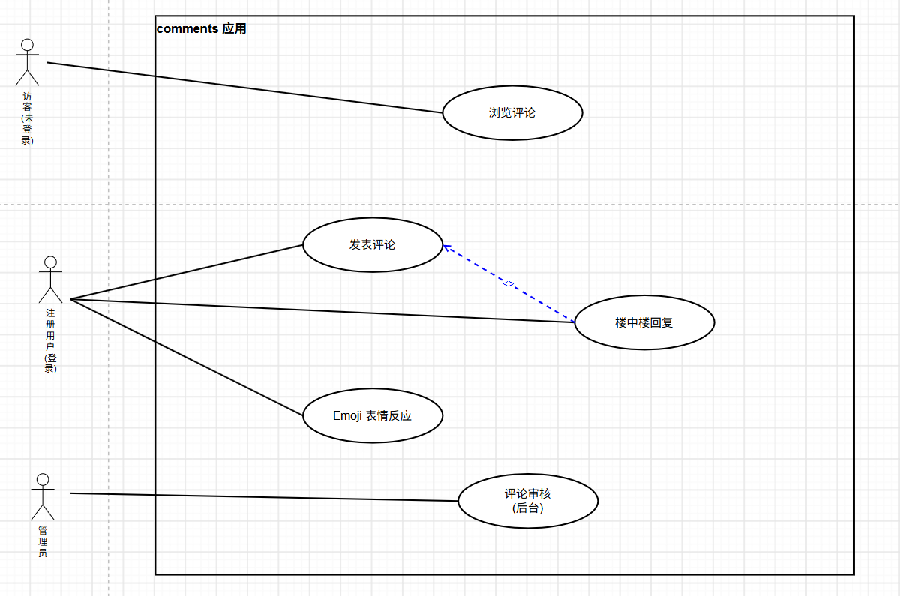
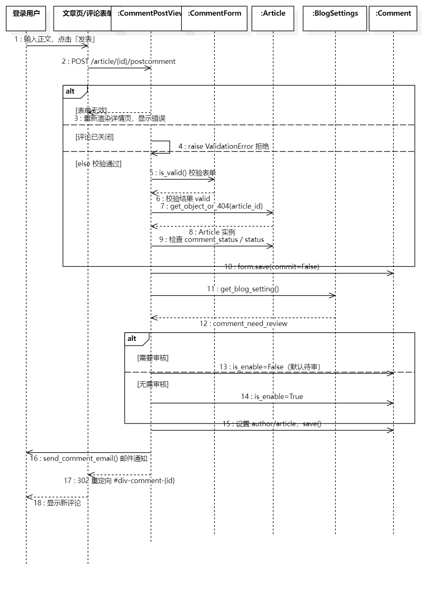
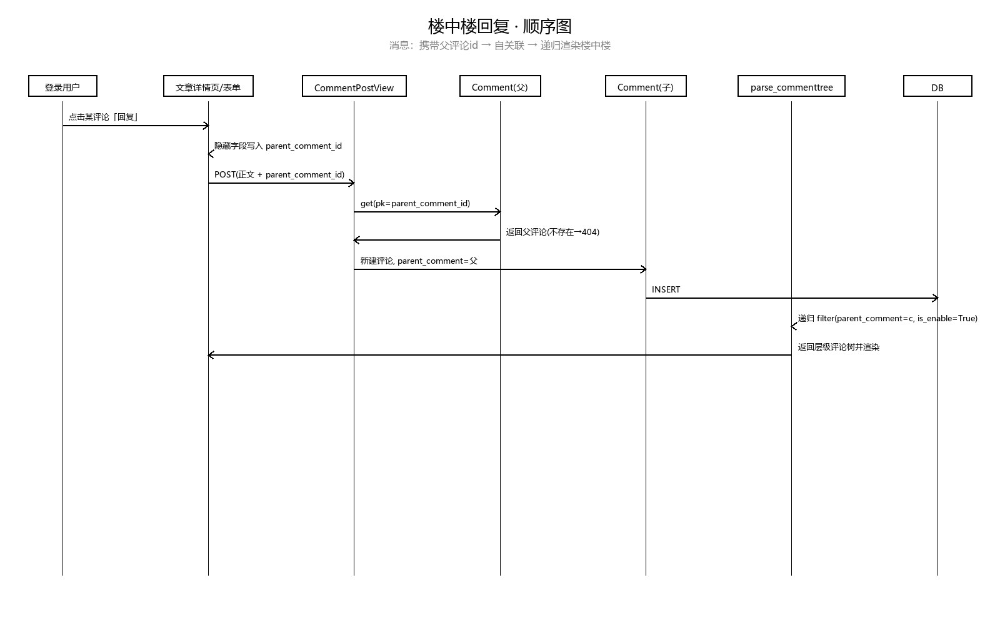
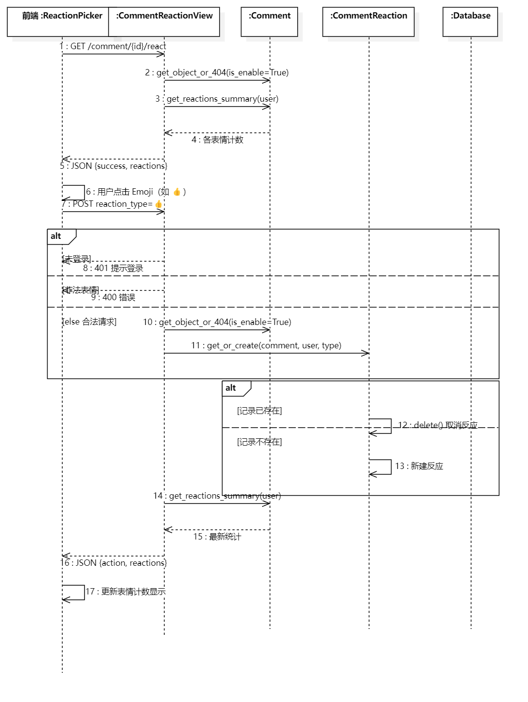
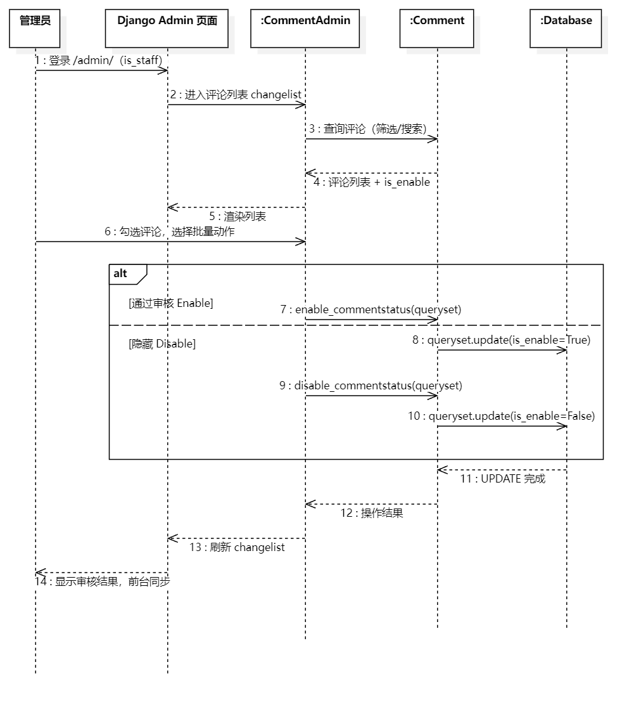

# 开源软件泛读报告 —— comments 部分 / 总结部分

> 负责人：刘雨婷（计划经理 · comments 应用，分支 lyt_branch）
> 本文件对应泛读报告「1.1 comments 用例图 / 用例说明 / 顺序图」「4 comments 包和类的作用」「5 comments 功能与类的对应关系」与「6 总结」四个板块。
> 依据代码：`src/comments/` 下 models.py、views.py、forms.py、admin.py、urls.py、utils.py、templatetags/comments_tags.py。

---

## 一、comments 功能描述（对应模板 §1.1）

comments 应用负责「栈外」博客的评论子系统，支持三类功能：
1. 文章详情页的评论浏览、发表评论与**楼中楼回复**（`parent_comment` 自关联）；
2. 评论的 **Emoji 表情反应**（8 种表情，可再次点击取消）；
3. 管理员在 Django 后台对评论进行**审核**（启用 / 禁用）。

### 1.1 comments 用例图

comments 模块共有三类参与者：

| 参与者（Actor） | 说明 |
|---|---|
| 访客（未登录游客） | 只能浏览已审核评论、查看 Emoji 统计 |
| 注册用户（登录用户） | 发表评论、楼中楼回复、对评论发表 Emoji 反应 |
| 管理员 | 登录后台审核评论（启用 / 禁用）、管理评论反应 |

> 图中包含 5 个用例：浏览评论、发表评论、楼中楼回复、Emoji 表情反应、评论审核。
> 其中「发表评论」与「楼中楼回复」共用提交视图 `CommentPostView`，回复通过隐藏字段 `parent_comment_id` 区分。

### 1.2 comments 用例说明

#### 用例 1：浏览评论

| 项目 | 内容 |
|---|---|
| 用例名称 | 浏览评论 |
| 参与者（Actor） | 访客、注册用户 |
| 前置条件 | 文章已发布且存在；评论已通过审核（`is_enable=True`） |
| 后置条件 | 文章详情页按楼层展示评论；未审核评论不显示 |
| 基本流程 | 1. 用户访问文章详情页；2. 视图查询该文章 `is_enable=True` 的评论；3. 模板标签 `parse_commenttree` 递归组织楼中楼；4. `show_comment_item` 渲染每条评论 |
| 扩展流程 | 1a. 评论 `is_enable=False`（待审/违规）→ 不进入公开列表 |

#### 用例 2：发表评论

| 项目 | 内容 |
|---|---|
| 用例名称 | 发表评论 |
| 参与者（Actor） | 注册用户 |
| 前置条件 | 用户已登录；文章评论开放（`comment_status='o'` 且文章未关闭） |
| 后置条件 | 生成一条评论记录；按站点设置决定是否需审核；发送邮件通知 |
| 基本流程 | 1. 用户在文章详情页评论框输入正文；2. 表单 POST 到 `comments:postcomment`（携带 article_id）；3. `CommentForm` 校验正文非空；4. `CommentPostView` 取当前用户与文章；5. 校验评论开关；6. 生成 `Comment` 实例并设置 `author`、`article`；7. 读取站点设置 `comment_need_review`，无需审核则 `is_enable=True`；8. 保存入库并发送邮件；9. 重定向到 `#div-comment-<id>` |
| 扩展流程 | 1a. 未登录 → 重定向到登录页；2a. 正文为空 → `form_invalid` 回显错误；3a. 文章评论已关闭 → 抛出 `ValidationError`；4a. 开启审核 → 评论 `is_enable=False`，待管理员审核后才显示 |
| 顺序图 | 见「图 1：发表评论顺序图」 |

#### 用例 3：楼中楼回复

| 项目 | 内容 |
|---|---|
| 用例名称 | 楼中楼回复 |
| 参与者（Actor） | 注册用户 |
| 前置条件 | 用户已登录；被回复的父评论存在 |
| 后置条件 | 新评论的 `parent_comment` 指向被回复评论，形成嵌套层级 |
| 基本流程 | 1. 用户点击某条评论的「回复」；2. 表单隐藏字段自动填入 `parent_comment_id`；3. 提交后视图判断该字段非空；4. 查出父评论并设置 `comment.parent_comment`；5. 保存入库；6. 前端用 `parse_commenttree` 递归展示该评论下的所有子回复 |
| 扩展流程 | 1a. 父评论 id 不存在 → 查询失败返回 404；2a. 不填父评论 id → 视为顶层评论 |
| 顺序图 | 见「图 2：楼中楼回复顺序图」 |

#### 用例 4：Emoji 表情反应

| 项目 | 内容 |
|---|---|
| 用例名称 | Emoji 表情反应（点赞 / 取消） |
| 参与者（Actor） | 注册用户（POST 表态）；访客（GET 查看） |
| 前置条件 | 目标评论已通过审核（`is_enable=True`）；表情类型在系统允许的 8 种之内 |
| 后置条件 | 表态结果写入 `comments_commentreaction`；评论表情计数更新 |
| 基本流程 | 1. 页面加载时 GET `/comment/<id>/react` 取表情统计；2. 登录用户点击某表情 POST 提交 `reaction_type`；3. 校验登录与表情合法性；4. `get_or_create` 查找记录；5. 不存在则新建（点赞），已存在则删除（再点一次取消）；6. 返回最新统计 JSON；7. 前端更新计数 |
| 扩展流程 | 1a. 未登录 POST → 返回 401；2a. 非法表情 → 返回 400；3a. 评论不存在或未启用 → 返回 404；4a. 同一用户对同一评论重复点同一表情 → 受 `unique_together` 约束，表现为「取消点赞」 |
| 顺序图 | 见「图 3：Emoji 表情反应顺序图」 |

#### 用例 5：评论审核（后台）

| 项目 | 内容 |
|---|---|
| 用例名称 | 评论审核 |
| 参与者（Actor） | 管理员 |
| 前置条件 | 管理员已登录 Django 后台（`/admin/`） |
| 后置条件 | 评论的 `is_enable` 被更新，前台展示随之变化 |
| 基本流程 | 1. 进入「评论」列表；2. 查看评论正文、作者、所属文章、状态、时间；3. 勾选待审评论；4. 执行批量动作「启用 / 禁用」；5. 列表与前台状态同步更新 |
| 扩展流程 | 1a. 可按 `is_enable` 筛选、按正文搜索；2a. 作者 / 文章用原始 id 输入（raw_id_fields）避免下拉加载过多 |
| 顺序图 | 见「图 4：后台评论审核顺序图」 |

### 1.3 comments 顺序图

> 以下四张顺序图需在 StarUML 中绘制，导出 PNG 后放入 `doc/第六周/imgs/`，文件名与下方引用一致。每张图后的「消息序列」可直接照着在 StarUML 中拖对象与消息箭头。

#### 图 1：发表评论顺序图（comments-sequence-post-lyt.png）

参与对象（生命线）：登录用户、文章详情页/表单、CommentPostView、CommentForm、Article、BlogSettings、Comment、邮件工具、数据库。

消息序列：
1. 用户 → 表单：输入正文，提交；
2. 表单 → CommentPostView：`POST /article/{id}/postcomment`；
3. CommentPostView → CommentForm：校验数据；
   - 分支（校验失败）：返回错误 → CommentPostView 重新渲染文章页；
4. CommentPostView → Article：`get_object_or_404(article_id)`；
5. CommentPostView → Article：检查 `comment_status` / `status`（关闭则抛 `ValidationError`）；
6. CommentPostView → Comment：`form.save(False)` 生成实例（暂不入库）；
7. CommentPostView → BlogSettings：`get_blog_setting()` 读取 `comment_need_review`；
   - 分支：无需审核 → `is_enable=True`；需要审核 → `is_enable=False`（默认待审）；
8. CommentPostView → Comment：设置 `author`、`article`，调用 `save()`；
9. Comment → 数据库：INSERT 评论记录；
10. CommentPostView → 邮件工具：`send_comment_email()` 发送通知；
11. CommentPostView → 用户：302 重定向到 `#div-comment-<id>`。

#### 图 2：楼中楼回复顺序图（comments-sequence-reply-lyt.png）

参与对象：登录用户、文章详情页/表单、CommentPostView、Comment（父）、Comment（子）、数据库、模板标签 parse_commenttree。

消息序列：
1. 用户点击某条评论「回复」→ 表单隐藏字段写入 `parent_comment_id = 父评论 id`；
2. 表单 → CommentPostView：POST 提交（正文 + parent_comment_id）；
3. CommentPostView → Comment（父）：`Comment.objects.get(pk=parent_comment_id)`；
   - 分支：父评论不存在 → 404；
4. CommentPostView → Comment（子）：新建评论并 `parent_comment = 父评论`；
5. Comment（子）→ 数据库：INSERT；
6. 页面渲染时 → parse_commenttree：从父评论递归 `filter(parent_comment=c, is_enable=True)` 取全部子回复；
7. 返回层级化的评论树并渲染。

#### 图 3：Emoji 表情反应顺序图（comments-sequence-reaction-lyt.png）

参与对象：登录用户、前端表情按钮、CommentReactionView、Comment、CommentReaction、数据库。

消息序列：
1. 页面加载：前端 → CommentReactionView：`GET /comment/{id}/react`；
2. CommentReactionView → Comment：`get_object_or_404(is_enable=True)`；
3. CommentReactionView → Comment：`get_reactions_summary()` 返回各表情计数（含当前用户是否已表态）；
4. 用户点击表情 → 前端 → CommentReactionView：`POST reaction_type=👍`；
5. CommentReactionView：校验登录（失败 → 401）；
6. CommentReactionView：校验 `reaction_type` 在 8 种之内（非法 → 400）；
7. CommentReactionView → CommentReaction：`get_or_create(comment, user, reaction_type)`；
   - 分支：记录已存在 → `delete()` 取消点赞（action=removed）；不存在 → 新建（action=added）；
8. CommentReactionView → Comment：`get_reactions_summary()` 重新统计；
9. CommentReactionView → 前端：返回 JSON（action、reactions）；
10. 前端更新表情计数与高亮。

#### 图 4：后台评论审核顺序图（comments‑sequence‑audit‑lyt.png）

参与对象：管理员、Django Admin、CommentAdmin、Comment、数据库。

消息序列：
1. 管理员登录 `/admin/`；
2. 进入「评论」列表（CommentAdmin 提供正文、作者、文章、状态、时间列）；
3. 勾选待审评论，选择批量动作「启用 / 禁用」；
4. CommentAdmin → Comment：`enable_commentstatus` / `disable_commentstatus` 执行 `queryset.update(is_enable=...)`；
5. Comment → 数据库：UPDATE；
6. 前台文章页评论列表随之显示 / 隐藏。

---

## 二、comments 软件架构及包 / 类的作用（对应模板 §4）

### 2.1 comments 包的作用

comments 是一个相对独立的 Django 业务应用（app），采用 MVT 分层：
- **M（模型层）**：`models.py` 定义评论与表情反应两张表；
- **V（视图层）**：`views.py` 处理评论提交与表情反应请求；
- **T（模板层）**：通过 `templatetags/comments_tags.py` 向文章详情页提供评论渲染标签；
- 另由 `forms.py`（表单）、`admin.py`（后台审核）、`utils.py`（邮件通知）、`urls.py`（路由）协同。

### 2.2 comments 包内主要类与作用

| 文件 | 主要类 / 函数 | 作用 |
|---|---|---|
| `models.py` | **Comment** | 评论模型：正文、创建/修改时间、作者、所属文章、父评论（自关联实现楼中楼）、`is_enable` 审核开关；含 `get_reactions_summary()` 统计表情 |
| `models.py` | **CommentReaction** | 表情反应模型：记录「用户—评论—表情」，限定 8 种 Emoji，`unique_together` 防止重复点赞 |
| `forms.py` | **CommentForm** | 评论表单：只暴露正文 `body`，含隐藏字段 `parent_comment_id` 用于回复 |
| `views.py` | **CommentPostView** | 评论提交视图（继承 `AuthenticatedFormView`，需登录 + CSRF）：校验、组装评论、按设置决定是否审核、保存、重定向 |
| `views.py` | **CommentReactionView** | 表情反应 JSON 接口：GET 公开取统计，POST 登录后切换（点赞 / 取消） |
| `admin.py` | **CommentAdmin** | 评论后台：列表列、筛选、搜索、批量启用/禁用动作 |
| `admin.py` | **CommentReactionAdmin** | 表情反应后台：按表情、时间筛选，时间分层浏览 |
| `admin.py` | `enable_commentstatus` / `disable_commentstatus` | 后台批量动作：批量启用 / 禁用评论 |
| `utils.py` | `send_comment_email()` | 评论后发送感谢邮件；若为回复，再通知被回复者 |
| `templatetags/comments_tags.py` | `parse_commenttree` | 递归取出某条评论的全部子回复（楼中楼），simple_tag |
| `templatetags/comments_tags.py` | `show_comment_item` | 渲染单条评论 HTML 片段（inclusion_tag） |
| `urls.py` | `urlpatterns` | 两条路由：`postcomment`、`comment_react` |
| `apps.py` | **CommentsConfig** | 应用配置，注册 comments 应用 |

### 2.3 comments 与其他包的关系

1. **comments → blog**：`Comment.article` 外键指向 `blog.Article`，一篇文章可有 0..N 条评论（N:1）；
2. **comments → accounts**：`Comment.author`、`CommentReaction.user` 外键指向 `accounts.BlogUser`（N:1）；
3. **comments → comments（自关联）**：`Comment.parent_comment` 指向自身，实现楼中楼（0..N:1）；
4. 评论区通过模板 `include` 嵌入文章详情页（`detail → comment_list_modern / post_comment_modern`）。

---

## 三、comments 功能与类的对应关系（对应模板 §5）

| 功能 | 对应类 / 函数 | 所属包 | 说明 |
|---|---|---|---|
| 浏览评论 | `Comment`、`parse_commenttree`、`show_comment_item` | comments | 只查 `is_enable=True` 的评论，递归组织楼中楼并渲染 |
| 发表评论 | `CommentForm`、`CommentPostView`、`Comment` | comments | 表单校验、关联作者/文章、按审核设置决定是否展示 |
| 楼中楼回复 | `Comment.parent_comment`、`CommentPostView`、`parse_commenttree` | comments | 隐藏字段携带父评论 id，自关联实现嵌套回复 |
| Emoji 表情反应 | `CommentReaction`、`CommentReactionView`、`get_reactions_summary` | comments | `get_or_create` 实现点赞/取消切换，8 种表情唯一约束 |
| 评论审核 | `CommentAdmin`、`Comment.is_enable`、`enable/disable_commentstatus` | comments | 后台批量启用/禁用，控制前台可见性 |
| 邮件通知 | `send_comment_email` | comments | 评论后通知作者；回复时通知被回复者 |
| 路由分发 | `comments/urls.py` | comments | 提交评论、表情反应两个入口 |

---

## 四、总结（对应模板 §6）

> 本部分由计划经理刘雨婷基于前一阶段（第一至第六周）的小组协作情况撰写。

### 4.1 前一阶段协作收获

1. **工程协作能力**：小组按角色分工（组长、开发经理、计划经理、质量/过程经理、支持经理），以 Git 分支（每人一支 `*_branch`）+ PR 审核的方式协作，完成了 DjangoBlog 的架构熟悉、代码标注、数据模型设计与系统架构建模；本人对 `fetch / merge / commit / push / PR` 的完整流程已能独立操作。
2. **对 Django MVT 的理解**：通过负责 comments 模块，掌握了模型（Model）、视图（View）、模板（Template）分层，以及 URL 路由、表单、后台管理、模板标签、邮件通知等机制；尤其通过 `Comment` 的三个外键（文章、作者、父评论自关联）理解了表与表之间的关联关系和「楼中楼」数据结构。
3. **建模能力**：学会用 UML 用例图、顺序图、包图表达系统的功能、交互与结构，把「读代码」上升为「建模型」。
4. **计划与进度管理**：作为计划经理，通过《任务跟踪表》维护全员进度、依赖与截止时间，体会到任务分解、依赖梳理（如支持经理先导出表结构、其他人再填字段类型）对推进协作的重要性。

### 4.2 存在的问题

1. **Git 操作与网络环境不熟练**：初期有成员混淆分支、误在根目录提交文件、遇到代理配置导致的 `fetch` 失败却继续 `merge`，拿到的是旧缓存而非最新远程内容；说明对「fetch 联网更新引用」与「merge 本地合并」的区别理解不够。
2. **存在依赖链的任务进度容易卡**：第五周数据模型设计依赖支持经理先导出表结构，第六周泛读报告依赖组长先发模板，若上游延迟，下游只能先起草、后核对，对计划经理的跟踪与催办提出了更高要求。
3. **Django 底层理解有差异**：部分成员对 ORM 外键 `on_delete`、自关联、模板 `include`、模板标签等概念掌握不牢，需要在标注与建模中反复回看。
4. **命名与目录规范初期不统一**：早期出现过文件放根目录、docx 与 md 混用、文件命名不带姓名的情况，后来通过明确《文件命名规范》统一解决。

### 4.3 下一步改进计划

1. **计划与跟踪**：每日固定更新一次《任务跟踪表》，在组会、上游交付、下游评审等关键节点增加检查频率；对依赖任务明确「谁先做、谁等谁」，卡住时在群里按「已完成 XX，等 XX 做 XX」格式报备。
2. **统一协作规范**：持续执行文件命名（带姓名）、只交 md、统一放入 `doc/第N周/`、图片用相对路径并随 md 一起提交等规范；对新成员补充一份 Git 常见问题（含代理、网络失败不要继续 merge）指引。
3. **技术学习**：后续重点复习 ORM 外键与自关联、模板继承与标签、Django 表单与视图基类，并结合第七、八周的代码精读与质量评估深入理解。
4. **角色衔接**：配合开发经理完成核心流程整合、配合质量/过程经理完成评审，确保泛读报告各板块能按时合并、整体 E-R 图与包图无遗漏。

---

> 附：本模块需提交的图片清单（放 `doc/第六周/imgs/`）：
> - `comments-usecase-lyt.png`（comments 用例图）
> - `comments-sequence-post-lyt.png`（发表评论顺序图）
> - `comments-sequence-reply-lyt.png`（楼中楼回复顺序图）
> - `comments-sequence-reaction-lyt.png`（Emoji 表情反应顺序图）
> - `comments-sequence-audit-lyt.png`（后台评论审核顺序图）

