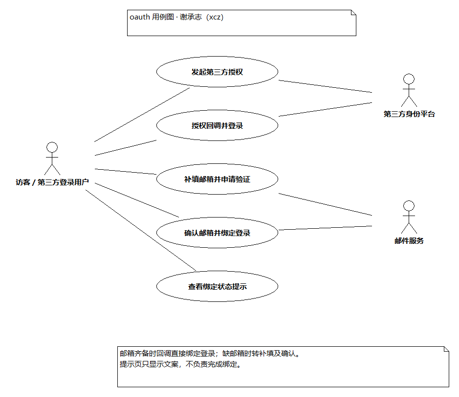
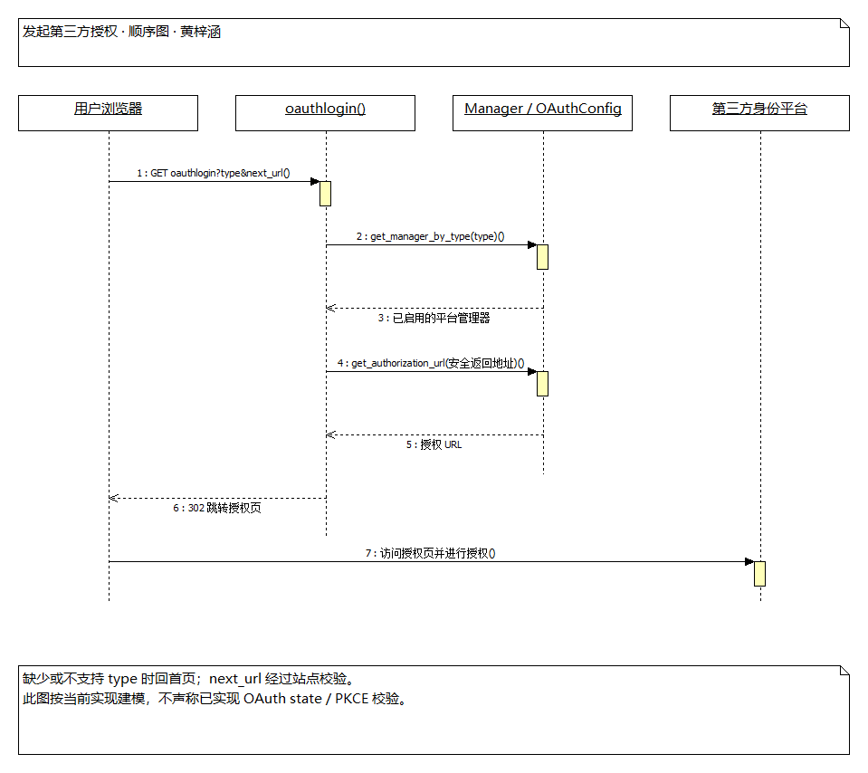
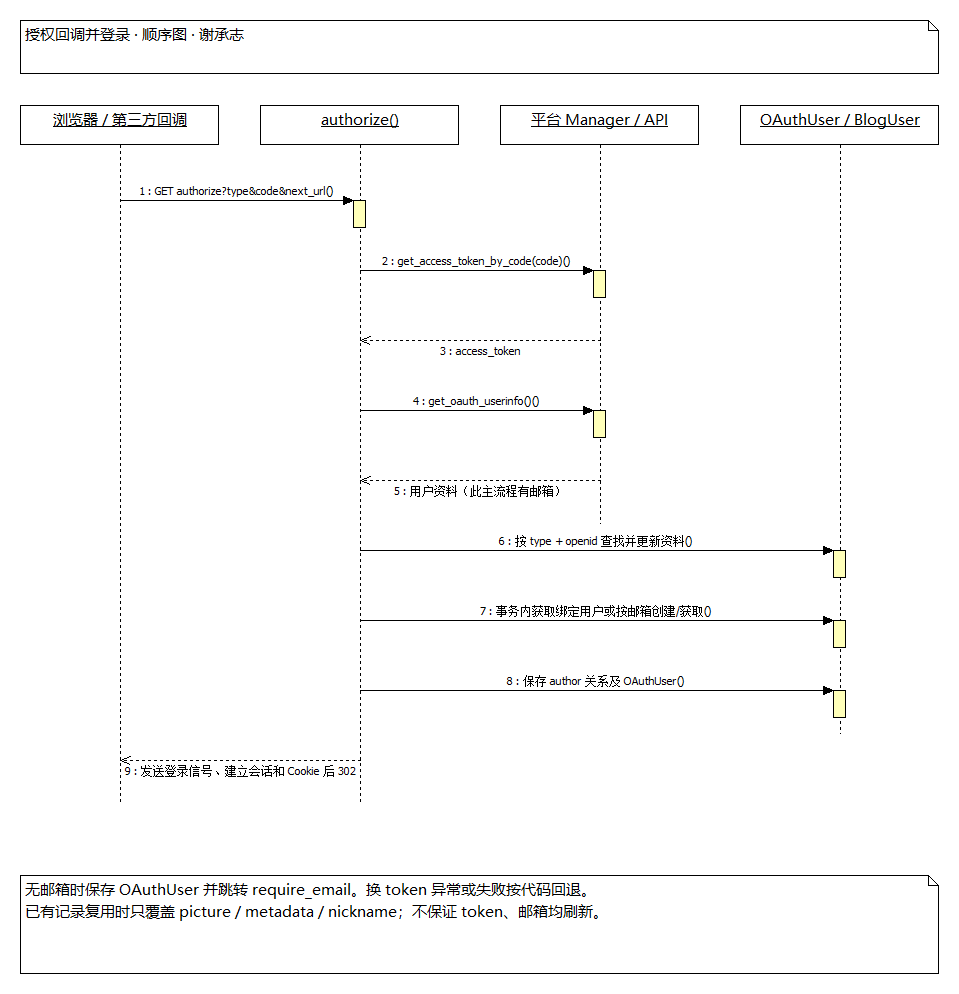
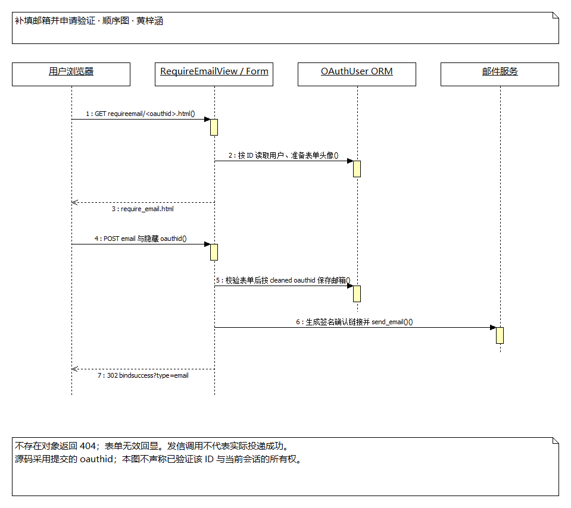
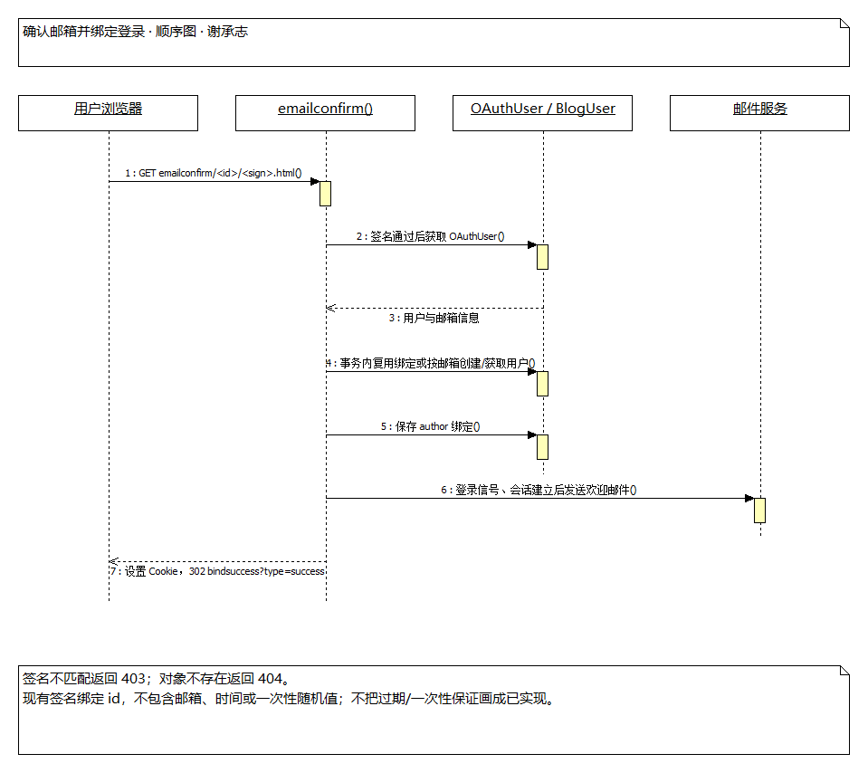
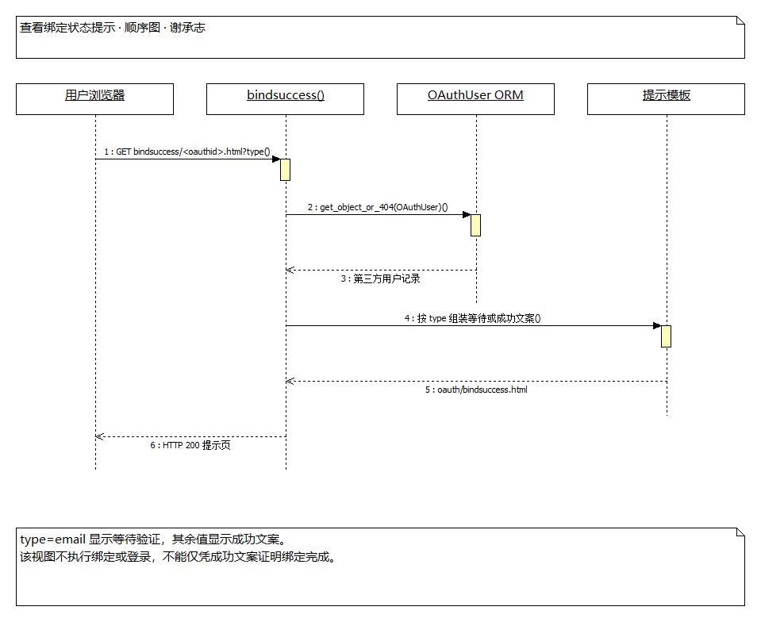
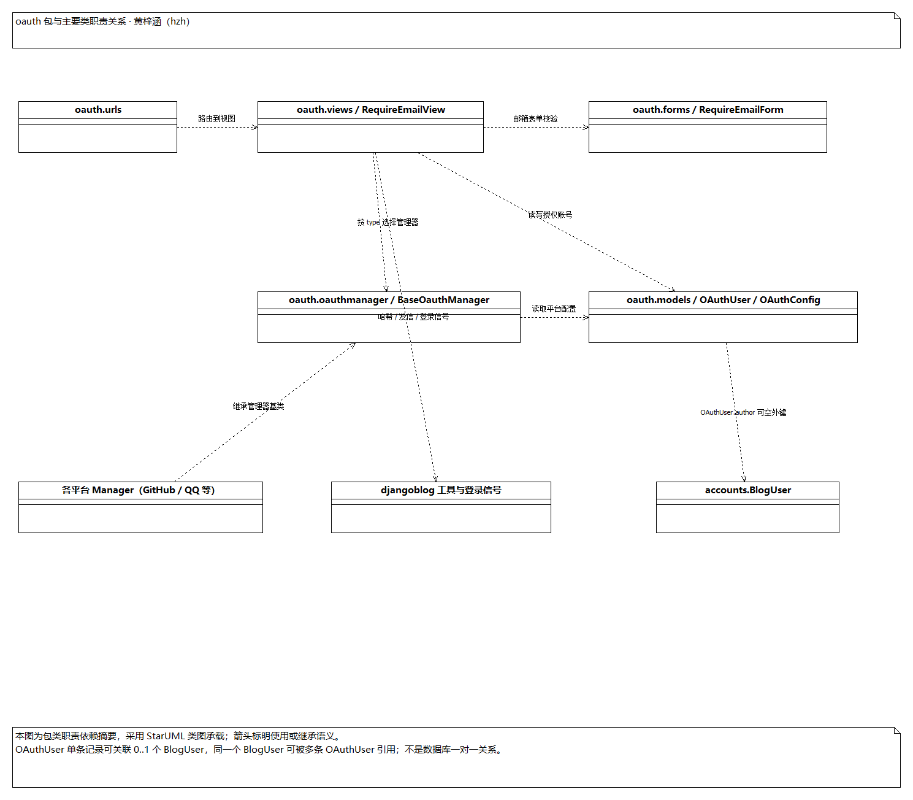
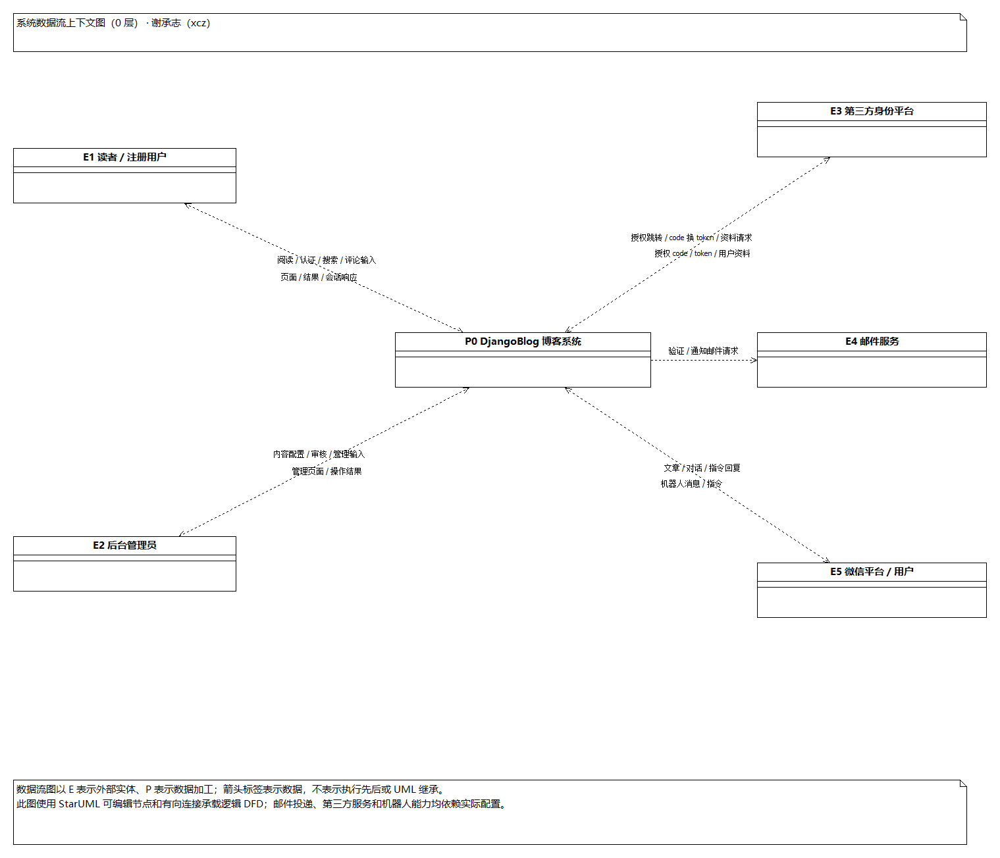
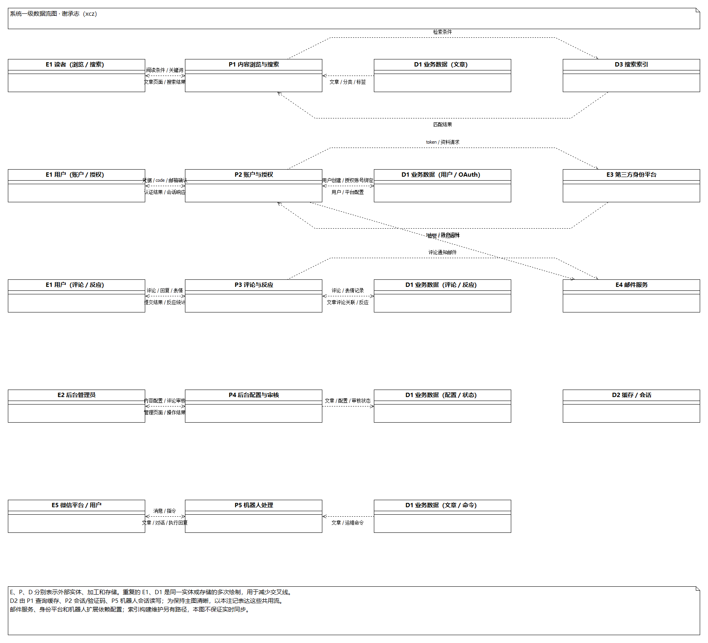

# 开源软件泛读报告——oauth、数据流图部分（图及说明）

> 负责板块：谢承志；黄梓涵协助制图及整理说明，按组长安排提交至 hzh_branch。
> 制图日期：2026-10-15；源码基线：develop `6f875e4` 同步后的源码。
> 本文件仅含本次协助完成的图及对应说明，不代替谢承志本周代码标注或质量过程评审。依据源码静态分析，未调用真实第三方授权、邮件或机器人服务。

## 1. oauth 用例图与说明

参与者包括使用第三方账号登录的访客、第三方身份平台和邮件服务。后台 OAuthConfig 维护属于系统管理范围，未在此重复系统后台用例。当前路由支持以下五个用例；“邮箱齐备的回调登录”与“无邮箱后补填及确认”是两条不同路径。

### UC-O01 发起第三方授权

| 项目 | 内容 |
|---|---|
| 参与者 | 访客、第三方身份平台 |
| 前置条件 | 对应 OAuthConfig 已启用，平台类型可匹配管理器。 |
| 后置条件 | 浏览器重定向第三方授权地址。 |
| 基本流程 | 1. 请求 `oauth/oauthlogin?type=github&next_url=…`。 2. `get_manager_by_type()` 查找管理器。 3. `get_redirecturl()` 校验登录后返回地址。 4. 管理器组装授权 URL。 5. 返回 302，浏览器访问授权页面。 |
| 扩展流程 | 未传 type 或无可用管理器时返回首页；非法 next_url 回退 `/`。 |
| 实现边界 | 当前图反映源码流程，不声称项目已实现 state 或 PKCE 校验。 |

### UC-O02 授权回调并登录

| 项目 | 内容 |
|---|---|
| 参与者 | 访客、第三方身份平台 |
| 前置条件 | 收到平台回调，具有有效 type 和可换取 token 的 code。 |
| 后置条件 | 邮箱齐备的主流程保存授权账号绑定、建立本地登录会话并跳转。 |
| 基本流程 | 1. `authorize()` 选择管理器。 2. code 换 token，再获取用户资料。 3. 按 type 和 openid 查找已有 OAuthUser，更新相关资料。 4. 在事务内复用已绑定用户，或按邮箱获取/创建 BlogUser。 5. 保存 author 关系及 OAuthUser，发送登录信号。 6. Django login、设置会话期限与登录 Cookie，再重定向。 |
| 扩展流程 | token 异常返回首页或重新授权；无用户资料按代码回退；无邮箱时保存 OAuthUser 并进入补填邮箱页面。 |
| 实现边界 | 已有记录复用时显式更新的是 picture、metadata、nickname，不保证 token 和邮箱也刷新。`transaction.atomic()` 约束数据库操作，不使第三方 API、Cookie 或发信获得数据库事务语义。 |

### UC-O03 补填邮箱并申请验证

| 项目 | 内容 |
|---|---|
| 参与者 | 第三方登录用户、邮件服务 |
| 前置条件 | 已有待绑定 OAuthUser；第三方流程未取得邮箱。 |
| 后置条件 | 保存提交邮箱，调用发信函数，显示等待邮箱验证提示。 |
| 基本流程 | 1. GET `requireemail/<oauthid>.html` 加载表单和头像。 2. 用户 POST 邮箱及隐藏 oauthid。 3. RequireEmailForm 校验字段。 4. RequireEmailView 按表单中的 ID 获取对象并保存邮箱。 5. 生成签名确认链接并调用 send_email。 6. 跳转 `bindsuccess?type=email`。 |
| 扩展流程 | 对象不存在返回 404；表单不合法回显。 |
| 实现边界 | 表单隐藏 ID 不等于会话所有权校验；代码采用 cleaned_data 中的 oauthid，本图不虚构额外绑定校验。调用发信不等于实际投递成功。 |

### UC-O04 确认邮箱并绑定登录

| 项目 | 内容 |
|---|---|
| 参与者 | 第三方登录用户、邮件服务 |
| 前置条件 | 用户持有包含 ID 和签名的确认链接。 |
| 后置条件 | 绑定本地用户，建立登录会话，调用欢迎邮件发送并跳转成功提示页。 |
| 基本流程 | 1. `emailconfirm()` 校验签名。 2. 获取 OAuthUser。 3. 事务内复用绑定用户或按邮箱创建/获取用户。 4. 保存 author 关联。 5. 发出登录信号并登录，设置会话期限。 6. 调用欢迎邮件发送，设置 Cookie 并跳转。 |
| 扩展流程 | 签名错误返回 403，对象不存在返回 404。 |
| 实现边界 | 签名由 SECRET_KEY、ID 计算，没有包含邮箱、有效期或一次性随机值；不能将“一次性链接、过期验证”写为已实现能力。 |

### UC-O05 查看绑定状态提示

| 项目 | 内容 |
|---|---|
| 参与者 | 第三方登录用户 |
| 前置条件 | 请求中的 OAuthUser ID 存在。 |
| 后置条件 | 返回等待验证或成功文案页面。 |
| 基本流程 | 1. `bindsuccess()` 获取 OAuthUser。 2. type=email 时显示等待验证，其他值显示成功文案。 3. 渲染 `oauth/bindsuccess.html`。 |
| 扩展流程 | 对象不存在返回 404。 |
| 实现边界 | 该页面只展示提示，不执行绑定、登录，也不单独证明绑定已经完成。 |

## 2. oauth 包类关系图

本图采用 StarUML 类图承载包与主要类的职责依赖摘要；连接标签区分使用与继承语义。系统整体 UML 包图仍以组长材料为准。

| 文件 / 包 | 主要类或函数 | 作用 |
|---|---|---|
| oauth.urls / views | oauthlogin、authorize、emailconfirm、bindsuccess、RequireEmailView | 路由与授权、绑定、提示请求编排；前四项为函数，不是类。 |
| oauth.forms | RequireEmailForm | 邮箱和隐藏 ID 的字段校验及表单组件。 |
| oauth.models | OAuthUser | 保存平台身份、token、邮箱、元数据及可选本地用户外键。单条记录关联 0..1 个 BlogUser，一个 BlogUser 可对应多条 OAuthUser。 |
| oauth.models | OAuthConfig | 平台类型、应用配置、回调 URL、启用状态；clean() 校验同类型配置重复。 |
| oauth.oauthmanager | BaseOauthManager、GitHubOauthManager、GoogleOauthManager、WBOauthManager、QQOauthManager、FaceBookOauthManager | 平台适配、授权 URL、token 获取、用户资料映射；ProxyManagerMixin 为部分管理器提供请求代理适配。 |
| oauth.oauthmanager | get_oauth_apps、get_manager_by_type | 按启用配置选择平台管理器。 |
| accounts / djangoblog | BlogUser、登录信号、哈希与邮件工具 | 本地身份、附加登录处理、确认链接与发信能力；归属外部包。 |

## 3. 系统数据流图

### 3.1 系统上下文图（0 层）

P0 表示整个 DjangoBlog 系统。外部实体为读者/注册用户、后台管理员、第三方身份平台、邮件服务和微信平台/用户。箭头说明跨系统边界的数据交换，内部数据库及缓存在一级图展开。认证资料、授权凭据和邮箱等仅表示数据类别，图中没有真实凭据。

### 3.2 一级数据流图

| 标记 | 内容及源码依据 |
|---|---|
| P1 内容浏览与搜索 | blog 视图、模板及搜索后端；输入阅读条件和关键词，输出文章及检索结果。 |
| P2 账户与授权 | accounts、oauth 视图和表单；输入认证资料、授权码、邮箱确认信息，输出登录结果及会话。 |
| P3 评论与反应 | comments 视图与模型；输入评论、父评论 ID 和表情，输出提交结果及统计。 |
| P4 后台内容配置与审核 | Admin 注册及后台类；输入文章、配置和审核操作，保存业务数据。 |
| P5 机器人处理 | servermanager 的 /robot 回调与处理器；输入消息/命令，输出查询、对话或执行结果。外部 AI 等扩展调用从此过程展开，依赖配置。 |
| D1 MySQL 业务数据 | 逻辑合并 Article、Category、Tag、BlogUser、OAuthUser、OAuthConfig、Comment、commands 和日志等表，不代表单张数据库表。 |
| D2 缓存与会话 | 文章查询缓存、验证码及配置的会话/机器人存储；并不保证所有存储使用同一个后端。 |
| D3 搜索索引 | 配置的 Haystack 后端及相关索引；索引构建维护另有命令/同步路径。 |

图中 E、P、D 分别表示外部实体、数据加工和数据存储。使用 StarUML 可编辑类节点及有向连接表达逻辑 DFD，箭头含义是数据流，不是类继承或执行时序。一级图是核心业务概览，不穷举每个内部函数；插件在内容加工中调用 hooks，属于内部扩展。图中不保证保存或删除业务数据后索引立即一致，也不将配置服务的可用性表述为运行验证成功。

## 4. 源文件与交付范围

9 张 PNG 位于 `imgs/`，9 个对应的同名 `.uml` 位于 [StarUML工程-黄梓涵](StarUML工程-黄梓涵/)。文件名均使用英文并带 hzh 后缀。各源文件保留对应的一张图，供打开、修改及再次导出。此文件作为协助制图材料供组长整合；谢承志其他个人任务由其继续完成。
