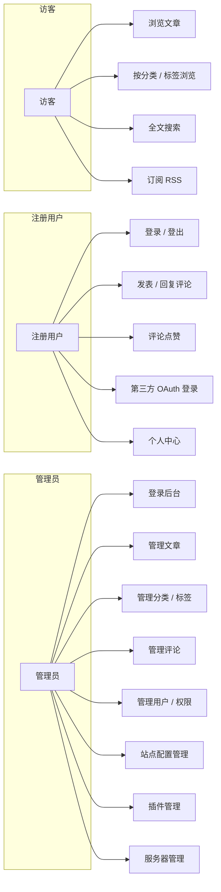
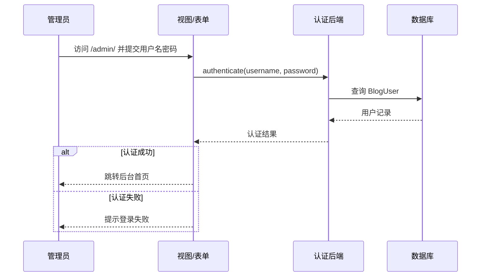
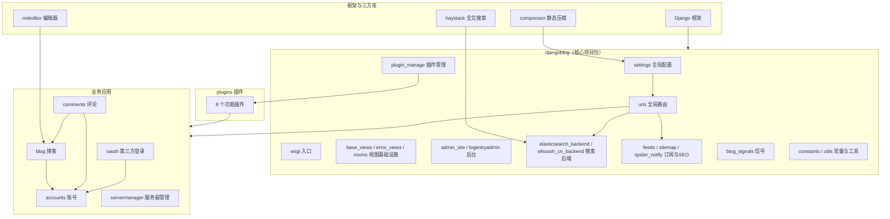

# 开源软件泛读报告 —— 系统架构图部分

> 负责人：张月（组长 · djangoblog 核心包）
> 本文件对应泛读报告「1.1 系统级用例与整体用例图」和「4 软件架构及各个包和类的作用（整体架构图）」两个板块。

---

## 一、系统级用例

### 1.1 系统整体用例图

系统共有三类参与者：**访客**（未登录游客）、**注册用户**、**管理员**。

### 1.2 系统级用例说明（管理后台用例）

以下为系统级 / 管理后台用例说明（app 级用例由各 app 负责人在各自板块补充）。

**用例：登录后台**

| 项目 | 内容 |
|------|------|
| 用例名称 | 登录后台 |
| 参与者（Actor）| 管理员 |
| 前置条件 | 管理员已拥有后台账号 |
| 后置条件 | 进入 Django 后台首页，可执行授权范围内的管理操作 |
| 基本流程 | 1. 管理员访问 `/admin/`；2. 输入用户名密码；3. 系统校验通过后进入后台 |
| 扩展流程 | 1a. 账号密码错误 → 提示登录失败；2a. 非管理员账号 → 拒绝进入 |
| 顺序图 | 见下方「示例顺序图」 |

**用例：管理文章**

| 项目 | 内容 |
|------|------|
| 用例名称 | 管理文章 |
| 参与者（Actor）| 管理员 |
| 前置条件 | 已登录后台 |
| 后置条件 | 文章列表/内容按操作结果更新 |
| 基本流程 | 1. 进入「文章」列表；2. 新增/编辑/删除文章；3. 保存后文章状态更新 |
| 扩展流程 | 1a. 删除操作 → 走回收/软删除逻辑；2a. 文章关联评论/标签时 → 级联处理 |

**用例：管理分类 / 标签**

| 项目 | 内容 |
|------|------|
| 用例名称 | 管理分类 / 标签 |
| 参与者（Actor）| 管理员 |
| 前置条件 | 已登录后台 |
| 后置条件 | 分类 / 标签树更新 |
| 基本流程 | 1. 进入「分类 / 标签」管理；2. 新增 / 编辑 / 删除；3. 保存 |

**用例：管理评论**

| 项目 | 内容 |
|------|------|
| 用例名称 | 管理评论 |
| 参与者（Actor）| 管理员 |
| 前置条件 | 已登录后台 |
| 后置条件 | 评论可见性 / 状态更新 |
| 基本流程 | 1. 进入「评论」列表；2. 审核 / 删除 / 置顶评论；3. 保存 |

**用例：管理用户 / 权限**

| 项目 | 内容 |
|------|------|
| 用例名称 | 管理用户 / 权限 |
| 参与者（Actor）| 管理员 |
| 前置条件 | 已登录后台且有权限 |
| 后置条件 | 用户状态 / 权限变更生效 |
| 基本流程 | 1. 进入「用户」管理；2. 修改用户信息 / 分配权限；3. 保存 |

**用例：站点配置管理**

| 项目 | 内容 |
|------|------|
| 用例名称 | 站点配置管理 |
| 参与者（Actor）| 管理员 |
| 前置条件 | 已登录后台 |
| 后置条件 | 站点标题、侧栏、友情链接等配置生效 |
| 基本流程 | 1. 进入「站点设置 / 侧栏 / 链接」；2. 修改配置项；3. 保存后前台即时生效 |

**用例：插件管理**

| 项目 | 内容 |
|------|------|
| 用例名称 | 插件管理 |
| 参与者（Actor）| 管理员（通过 `settings.ACTIVE_PLUGINS` 配置）|
| 前置条件 | 插件已放入 `plugins/` 目录并写入启用列表 |
| 后置条件 | 应用启动时自动加载已启用插件 |
| 基本流程 | 1. 在 `plugins/` 下开发插件；2. 加入 `ACTIVE_PLUGINS`；3. 应用启动时 `plugin_manage.loader` 自动加载 |
| 扩展流程 | 1a. 插件缺少 `plugin.py` → 跳过并记录日志 |

### 1.3 示例顺序图（登录后台）

---

## 二、系统架构图（UML 包图）

### 2.1 系统整体包图

系统采用 Django 的「核心项目包 + 业务应用（app）」分层：`djangoblog` 核心包负责全局配置、路由与基础设施，6 个业务应用各自独立承担一个功能模块，`plugins` 通过插件钩子按需扩展业务应用。

### 2.2 djangoblog 核心包各模块与主要类的作用

| 模块 | 作用 | 主要类 / 函数 |
|------|------|---------------|
| `settings.py` | 全局配置：应用注册、中间件、数据库、搜索引擎、插件、日志等 | `INSTALLED_APPS`、`MIDDLEWARE`、`env_to_bool()` |
| `urls.py` | 全局路由入口，把 URL 分发给各 app | `urlpatterns`、`i18n_patterns()`、`health_check()` |
| `wsgi.py` | 部署时的 WSGI 入口 | `application` |
| `apps.py` | 应用配置，启动时加载插件 | `DjangoblogAppConfig.ready()` |
| `base_views.py` | 带装饰器的视图基类（CSRF/登录/禁缓存）| `SecureFormView`、`AuthenticatedFormView`、`LoginFormView`、`LogoutRedirectView`、`NoCacheFormView` |
| `error_views.py` | 统一错误页渲染 | `render_error_page()`、`page_not_found_view()`、`server_error_view()`、`permission_denied_view()`、`bad_request_view()` |
| `mixins.py` | 可复用混入类（时间戳/缓存/分页/查询优化）| `TimeStampedModel`、`SlugCachedMixin`、`OptimizedArticleQueryMixin`、`CachedListViewMixin`、`PageNumberMixin`、`ArticleListMixin` |
| `constants.py` | 全局常量：缓存超时、缓存键、状态码、分页 | `CacheTimeout`、`CacheKey`、`HttpStatus`、`Pagination` |
| `utils.py` | 工具函数（缓存封装等）| `cache()` 等 |
| `admin_site.py` | 自定义后台站点 | `admin_site` |
| `logentryadmin.py` | 后台操作日志的只读展示 | `LogEntryAdmin` |
| `blog_signals.py` | 文章相关信号处理（索引同步等）| 信号接收函数 |
| `feeds.py` | RSS / Atom 订阅 | `DjangoBlogFeed` |
| `sitemap.py` | 站点地图（SEO）| `ArticleSiteMap`、`CategorySiteMap`、`TagSiteMap`、`UserSiteMap`、`StaticViewSitemap` |
| `spider_notify.py` | 向搜索引擎主动推送 URL | `SpiderNotify` |
| `elasticsearch_backend.py` | Elasticsearch 搜索后端 | `ElasticSearchEngine`、`ElasticSearchModelSearchForm` |
| `whoosh_cn_backend.py` | Whoosh 中文搜索后端 | `WhooshEngine` |
| `plugin_manage/` | 插件加载与钩子机制 | `BasePlugin`、`load_plugins()`、`hooks.register()` |

### 2.3 各包之间的依赖关系说明

1. **djangoblog → 业务应用**：`settings.py` 注册各 app，`urls.py` 把 URL 分发到各 app 的 `urls.py`，是「总控 → 分支」的依赖关系。
2. **业务应用之间**：
   - `blog → accounts`：文章的 `author` 外键指向 `accounts.BlogUser`；
   - `comments → blog、accounts`：评论的 `article` 外键指向文章、`author` 外键指向用户；
   - `oauth → accounts`：第三方账号 `OAuthUser.author` 可选绑定本地用户。
3. **djangoblog → plugins**：`plugin_manage.loader` 按 `ACTIVE_PLUGINS` 动态加载 `plugins/` 下的插件。
4. **plugins → 业务应用**：插件通过 `hooks` 钩子（如 `article_bottom`、`sidebar`、`the_content`）把内容注入到博客/评论等页面。
5. **djangoblog → 搜索后端**：`settings.py` 根据环境变量在 Whoosh 与 Elasticsearch 之间二选一，二者均以 `haystack` 引擎形式接入。
6. **三方库**：全文搜索依赖 `haystack`，Markdown 编辑依赖 `mdeditor`，静态资源压缩依赖 `compressor`。
