# "DjangoBlog"开源软件系统的泛读报告

组号：8

小组成员：张月、黄梓涵、侍文博、刘雨婷、谢承志、朱亮宇

## 1. 开源软件的功能描述

### 1.1 用例图和用例图说明

#### 系统级用例与整体用例图

##### 系统整体用例图

系统共有三类参与者：**访客**（未登录游客）、**注册用户**、**管理员**。

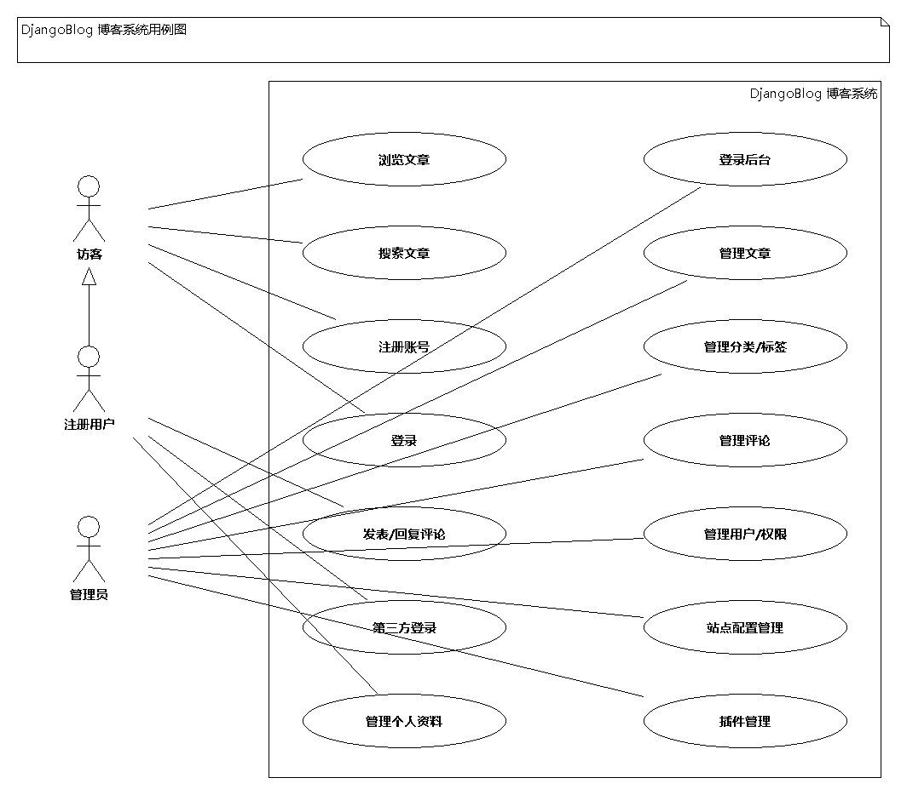

##### 系统级用例说明（管理后台用例）

以下为系统级 / 管理后台用例说明（app 级用例由各 app 负责人在各自板块补充）。

**用例：登录后台**

| 项目 | 内容 |
|------|------|
| 用例名称 | 登录后台 |
| 参与者（Actor）| 管理员 |
| 前置条件 | 管理员已拥有后台账号 |
| 后置条件 | 进入 Django 后台首页，可执行授权范围内的管理操作 |
| 基本流程 | 1. 管理员访问 `/admin/`；2. 输入用户名密码；3. 系统校验通过后进入后台 |
| 扩展流程 | 1a. 账号密码错误 → 提示登录失败；2a. 非管理员账号 → 拒绝进入 |
| 顺序图 | 见下方「示例顺序图」 |

**用例：管理文章**

| 项目 | 内容 |
|------|------|
| 用例名称 | 管理文章 |
| 参与者（Actor）| 管理员 |
| 前置条件 | 已登录后台 |
| 后置条件 | 文章列表/内容按操作结果更新 |
| 基本流程 | 1. 进入「文章」列表；2. 新增/编辑/删除文章；3. 保存后文章状态更新 |
| 扩展流程 | 1a. 删除操作 → 走回收/软删除逻辑；2a. 文章关联评论/标签时 → 级联处理 |

**用例：管理分类 / 标签**

| 项目 | 内容 |
|------|------|
| 用例名称 | 管理分类 / 标签 |
| 参与者（Actor）| 管理员 |
| 前置条件 | 已登录后台 |
| 后置条件 | 分类 / 标签树更新 |
| 基本流程 | 1. 进入「分类 / 标签」管理；2. 新增 / 编辑 / 删除；3. 保存 |

**用例：管理评论**

| 项目 | 内容 |
|------|------|
| 用例名称 | 管理评论 |
| 参与者（Actor）| 管理员 |
| 前置条件 | 已登录后台 |
| 后置条件 | 评论可见性 / 状态更新 |
| 基本流程 | 1. 进入「评论」列表；2. 审核 / 删除 / 置顶评论；3. 保存 |

**用例：管理用户 / 权限**

| 项目 | 内容 |
|------|------|
| 用例名称 | 管理用户 / 权限 |
| 参与者（Actor）| 管理员 |
| 前置条件 | 已登录后台且有权限 |
| 后置条件 | 用户状态 / 权限变更生效 |
| 基本流程 | 1. 进入「用户」管理；2. 修改用户信息 / 分配权限；3. 保存 |

**用例：站点配置管理**

| 项目 | 内容 |
|------|------|
| 用例名称 | 站点配置管理 |
| 参与者（Actor）| 管理员 |
| 前置条件 | 已登录后台 |
| 后置条件 | 站点标题、侧栏、友情链接等配置生效 |
| 基本流程 | 1. 进入「站点设置 / 侧栏 / 链接」；2. 修改配置项；3. 保存后前台即时生效 |

**用例：插件管理**

| 项目 | 内容 |
|------|------|
| 用例名称 | 插件管理 |
| 参与者（Actor）| 管理员（通过 `settings.ACTIVE_PLUGINS` 配置）|
| 前置条件 | 插件已放入 `plugins/` 目录并写入启用列表 |
| 后置条件 | 应用启动时自动加载已启用插件 |
| 基本流程 | 1. 在 `plugins/` 下开发插件；2. 加入 `ACTIVE_PLUGINS`；3. 应用启动时 `plugin_manage.loader` 自动加载 |
| 扩展流程 | 1a. 插件缺少 `plugin.py` → 跳过并记录日志 |

##### 示例顺序图（登录后台）

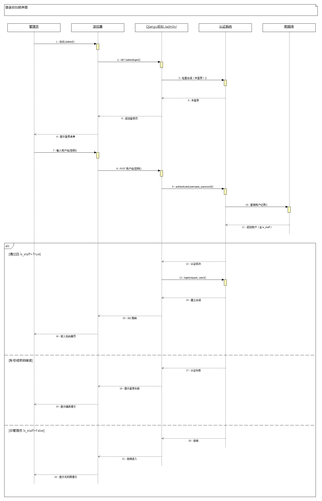

---

#### blog 用例

##### 范围、参与者与用例图

blog 同时承担前台文章展示和后台内容管理。前台请求经项目 URL 配置进入 `blog.urls`，再交给类视图和模板；搜索入口单独配置在 `djangoblog.urls`。文章新增、编辑、删除通过 Django Admin 完成，不能描述成普通登录用户在前台发布文章。

| 参与者 | 能力与边界 |
|---|---|
| 访客 | 浏览文章列表、详情、分类、标签、作者、归档、友情链接以及提交搜索关键词；这些展示路由本身没有登录装饰器。 |
| 具备文章权限的后台用户 | 已获准访问管理站点，并具有相应的 Article 新增、修改或删除权限。`ArticlelAdmin.get_form()` 限定可选作者为超级用户，不等于所有后台操作者必须是超级用户。 |

##### 用例 UC-B01：浏览文章列表

| 项目 | 内容 |
|---|---|
| 参与者 | 访客 |
| 前置条件 | 站点可用；访问首页或对应分页路径。 |
| 后置条件 | 展示当前页已发布的普通文章及分页信息。 |
| 基本流程 | 1. 浏览器访问 `/` 或 `/page/<page>/`。 2. `IndexView` 通过 Mixin 取得页码及查询缓存键。 3. 未命中缓存时筛选 `type='a', status='p'`，预加载作者、分类和标签。 4. 缓存查询结果，依据模型排序和 `PAGINATE_BY` 分页。 5. 添加站点 SEO 上下文，渲染文章列表。 |
| 扩展流程 | 缓存命中时复用查询结果；无文章时显示空列表；无效或越界页码按 Django ListView 的分页规则处理。 |
| 源码对应 | `blog.views.IndexView`、`ArticleListView`，`djangoblog.mixins.CachedListViewMixin`、`PageNumberMixin`、`OptimizedArticleQueryMixin`。 |

##### 用例 UC-B02：浏览文章详情

| 项目 | 内容 |
|---|---|
| 参与者 | 访客 |
| 前置条件 | 请求包含文章 ID；目标文章存在。 |
| 后置条件 | 展示正文、标签、SEO 元数据、评论分页以及上一篇/下一篇入口。 |
| 基本流程 | 1. 访问文章详情地址。 2. `DetailView` 根据 `article_id` 获取 Article。 3. `ArticleDetailView.get_context_data()` 准备启用评论、评论分页、相邻文章及标签信息。 4. 生成 SEO 信息并运行文章详情插件钩子。 5. 模板与标签函数生成详情页面。 |
| 扩展流程 | 文章不存在返回 404；评论页码按视图逻辑规范化；评论提交转入 comments 模块。 |
| 实现边界 | 本类未重写默认查询集以限制 `status='p'`，因此不能声称详情请求已经拒绝草稿。URL 中的日期来自 `creation_time`，查找主要使用文章 ID。访问计数等插件行为须结合插件是否启用分析。 |
| 源码对应 | `ArticleDetailView`、`Article.comment_list()`、`next_article()`、`prev_article()`、`blog_tags`、`hooks`。 |

##### 用例 UC-B03：按分类浏览

| 项目 | 内容 |
|---|---|
| 参与者 | 访客 |
| 前置条件 | 目标分类 slug 存在。 |
| 后置条件 | 展示当前分类及其子分类的已发布内容。 |
| 基本流程 | 1. 访问分类地址。 2. `SlugCachedMixin` 根据 URL 参数中的 slug 查找 Category，单次请求内复用对象。 3. `get_sub_categorys()` 展开当前分类和后代分类。 4. 根据分类名称集合、`status='p'` 获取文章查询结果并缓存。 5. 复用列表模板分页展示。 |
| 扩展流程 | 分类不存在返回 404；分类无文章显示空列表；查询缓存命中时复用结果。 |
| 实现边界 | 路由参数叫 `category_name`，对象查询实际使用 `slug`；分类文章查询没有额外限制 `type='a'`。 |
| 源码对应 | `CategoryDetailView`、`Category`、`SlugCachedMixin`、`ArticleListView`。 |

##### 用例 UC-B04：按标签浏览

| 项目 | 内容 |
|---|---|
| 参与者 | 访客 |
| 前置条件 | 目标标签 slug 存在。 |
| 后置条件 | 展示具有指定标签的已发布普通文章。 |
| 基本流程 | 1. 访问标签地址。 2. 根据 slug 获取 Tag。 3. 按 `tags__name`、`type='a'`、`status='p'` 筛选 Article，并使用标签及页码构造缓存键。 4. 准备标签名称和 SEO 信息。 5. 分页渲染文章列表。 |
| 扩展流程 | 标签不存在返回 404；标签无匹配文章显示空列表；命中缓存时省略查询构造步骤。 |
| 源码对应 | `TagDetailView`、`Tag`、`Article.tags`、`SlugCachedMixin`。 |

##### 用例 UC-B05：搜索文章

| 项目 | 内容 |
|---|---|
| 参与者 | 访客 |
| 前置条件 | 搜索后端及索引可用；用户提供关键词。 |
| 后置条件 | 展示匹配结果、关键词高亮和分页信息；配置允许时展示拼写建议。 |
| 基本流程 | 1. 提交 `/search?q=关键词`。 2. 项目路由通过 `search_view_factory` 创建 `EsSearchView`，传入 `ElasticSearchModelSearchForm`。 3. 视图为 `SearchQuerySet` 启用高亮，表单调用 Haystack 搜索链路。 4. 搜索后端返回结果。 5. 构造结果分页和建议上下文，渲染搜索页面。 |
| 扩展流程 | 空查询或无结果由表单和模板提供提示；后端不可用应作为环境故障记录，不能把静态分析写成成功运行。 |
| 实现边界 | `blog.forms.BlogSearchForm` 存在，但不是当前 URL 显式传入的表单。`ArticleIndex.index_queryset()` 限制已发布文章；自定义 ArticleDocument 同步路径另有实现，不能据此保证所有索引都实时过滤草稿或删除旧文档。 |
| 源码对应 | `EsSearchView`、`ElasticSearchModelSearchForm`、`ElasticSearchEngine`、`ArticleIndex`、`ArticleDocument`。 |

##### 用例 UC-B06：按作者浏览

| 项目 | 内容 |
|---|---|
| 参与者 | 访客 |
| 前置条件 | 请求提供作者用户名。 |
| 后置条件 | 展示该用户名下已发布的普通文章。 |
| 基本流程 | 1. 访问作者文章路径。 2. 从 URL 获取 `author_name`。 3. 使用作者名经 slugify 后的值和页码生成缓存键。 4. 缓存未命中时按原始用户名、`type='a'`、`status='p'` 查询。 5. 添加作者页面上下文并分页展示。 |
| 扩展流程 | 作者不存在或无文章可返回空列表，不应描述为必然返回 404。 |
| 源码对应 | `AuthorDetailView`、`Article.author`、`ArticleListView`。 |

##### 用例 UC-B07：查看文章归档

| 项目 | 内容 |
|---|---|
| 参与者 | 访客 |
| 前置条件 | 站点可用。 |
| 后置条件 | 在归档模板中集中展示已发布内容。 |
| 基本流程 | 1. 请求 `/archives.html`。 2. 路由级 `cache_page(3600)` 检查页面缓存。 3. 未命中时进入 `ArchivesView`，继续检查 `archives` 查询缓存。 4. 查询缓存未命中时按 `status='p'` 查询 Article。 5. 渲染 `article_archives.html` 并返回页面。 |
| 扩展流程 | 页面缓存命中直接返回缓存响应；查询缓存命中复用数据；无文章显示空归档。 |
| 实现边界 | `paginate_by=None`，不使用普通列表的分页；查询没有单独限定普通文章类型。 |
| 源码对应 | `ArchivesView`、`Article`、`cache_page`、`CachedListViewMixin`。 |

##### 用例 UC-B08：查看友情链接

| 项目 | 内容 |
|---|---|
| 参与者 | 访客 |
| 前置条件 | 站点可用。 |
| 后置条件 | 展示已启用友情链接。 |
| 基本流程 | 1. 请求 `/links.html`。 2. `LinkListView.get_queryset()` 筛选 `is_enable=True`。 3. 模板展示友情链接名称和访问入口。 |
| 扩展流程 | 无启用链接时展示空列表；点击链接后访问目标外部站点。 |
| 源码对应 | `LinkListView`、`Links`、`links_list.html`。 |

##### 用例 UC-B09：发布文章

| 项目 | 内容 |
|---|---|
| 参与者 | 具备 Article 新增权限的后台用户 |
| 前置条件 | 已登录并获准访问后台；可选作者和分类存在。 |
| 后置条件 | 新增文章记录并保存分类、标签等关系；状态为 `p` 时可进入相应前台列表查询。 |
| 基本流程 | 1. 打开 `/admin/blog/article/add/`。 2. `ArticlelAdmin` 准备 `ArticleForm`，作者候选限定超级用户。 3. 填写标题、正文、作者、分类、标签和发布状态。 4. 后台校验权限与表单。 5. `save_model()` 委托父类保存 Article，模型保存触发适用信号。 6. 后台后续保存多对多关系、记录操作并重定向。 |
| 扩展流程 | 权限不足不保存；必填字段缺失或标题重复等校验错误回显表单；选择 `d` 保存草稿。已有文章还可用批量 action 改为已发布。 |
| 实现边界 | `makr_article_publish()` 直接 `QuerySet.update(status='p')`，不等同于逐个调用 `save()`，不能认为必然触发保存信号。缓存或搜索索引的一致性应另行验证。 |
| 源码对应 | `ArticlelAdmin`（源码原名）、`ArticleForm`、`Article`、`BaseModel`、`makr_article_publish`。 |

##### 用例 UC-B10：编辑文章

| 项目 | 内容 |
|---|---|
| 参与者 | 具备 Article 修改权限的后台用户 |
| 前置条件 | 已登录后台；目标文章存在。 |
| 后置条件 | 经校验的文章字段及关联关系更新。 |
| 基本流程 | 1. 打开 `/admin/blog/article/<id>/change/`。 2. 后台加载目标文章及现有表单数据。 3. 修改内容并提交。 4. 后台校验权限与表单。 5. 保存文章、后续保存标签关系，执行适用信号与操作日志。 6. 返回后台列表或继续编辑。 |
| 扩展流程 | 目标不存在不更新；无权限拒绝；表单错误保留用户输入并提示。 |
| 实现边界 | `BaseModel.save()` 没有主动刷新 `last_modify_time`，不能将“编辑自动更新时间”写成已实现保证。 |
| 源码对应 | `ArticlelAdmin`、`ArticleForm`、`Article.save()`、`BaseModel.save()`。 |

##### 用例 UC-B11：删除文章

| 项目 | 内容 |
|---|---|
| 参与者 | 具备 Article 删除权限的后台用户 |
| 前置条件 | 已登录后台；目标文章存在；关联对象满足删除约束。 |
| 后置条件 | 文章及按数据库关系规则需要删除的数据被删除，后台记录相应操作。 |
| 基本流程 | 1. 打开文章删除页面。 2. 后台读取文章并展示关联删除影响。 3. 用户确认删除。 4. 后台检查权限及关联约束、记录删除操作。 5. 调用标准删除机制，返回文章列表。 |
| 扩展流程 | 取消确认保留文章；权限不足或受保护关联不进入成功删除流程。 |
| 实现边界 | `ArticlelAdmin` 没有自定义删除视图。当前 `blog_signals.py` 未见对应 `post_delete` 接收器，不能把删除后清理缓存和搜索文档画成已证实的步骤。 |
| 源码对应 | `ArticlelAdmin`、Django `ModelAdmin`、`Article` 及 ORM 删除机制。 |

#### accounts 用例

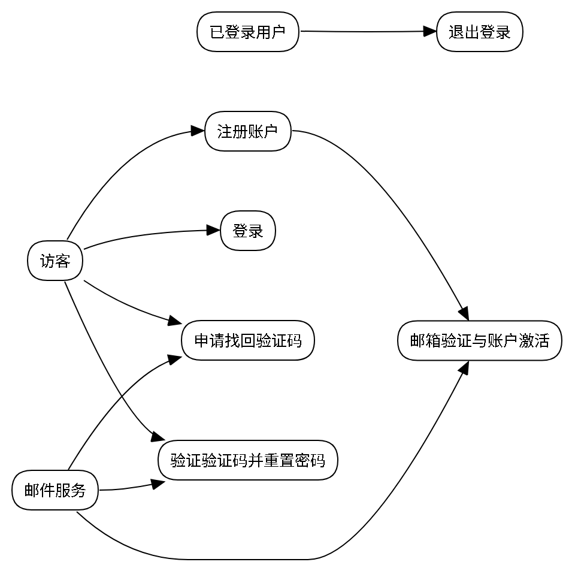

依据 `accounts/urls.py`、`views.py`、`forms.py`、`utils.py` 绘制。访客可注册、登录和找回密码，用户可退出登录；新账户需邮箱验证后激活。找回密码包括获取验证码和提交新密码。accounts 未实现普通用户自助资料编辑页面；`BlogUser` 提供资料字段，`BlogUserAdmin` 支持后台管理。

| 用例名称 | 参与者 | 前置条件 | 后置条件 | 基本流程 | 扩展流程 | 顺序图 |
|---|---|---|---|---|---|---|
| 注册并验证邮箱 | 访客、邮件服务 | 邮箱未注册且可用 | 验证成功后账户激活 | 填写注册信息；校验并保存未激活账户；发送带签名链接的邮件；访问链接并验签激活。 | 邮箱重复或表单错误时提示；签名错误时拒绝激活。 | 见下图 1 |
| 登录 | 用户 | 账户已激活 | 建立登录会话并跳转 | 输入用户名或邮箱及密码；认证凭据；建立会话并设置登录标记。 | 凭据错误返回表单；非法外站 next 回退首页；支持记住登录。 | 见下图 2 |
| 退出登录 | 已登录用户 | 当前会话已认证 | 会话、登录标记和侧栏缓存清除 | 请求退出路由，清理会话、缓存和 Cookie，跳转登录页。 | 无。 | 见下图 3 |
| 找回密码 | 已登记邮箱用户、邮件服务 | 邮箱关联现有账户 | 更新密码后跳转登录 | 申请验证码；发送并缓存五分钟；提交邮箱、验证码和两次新密码；校验后更新密码哈希。 | 邮箱未登记、验证码错误/过期或密码校验失败时返回错误。 | 见下图 4 |

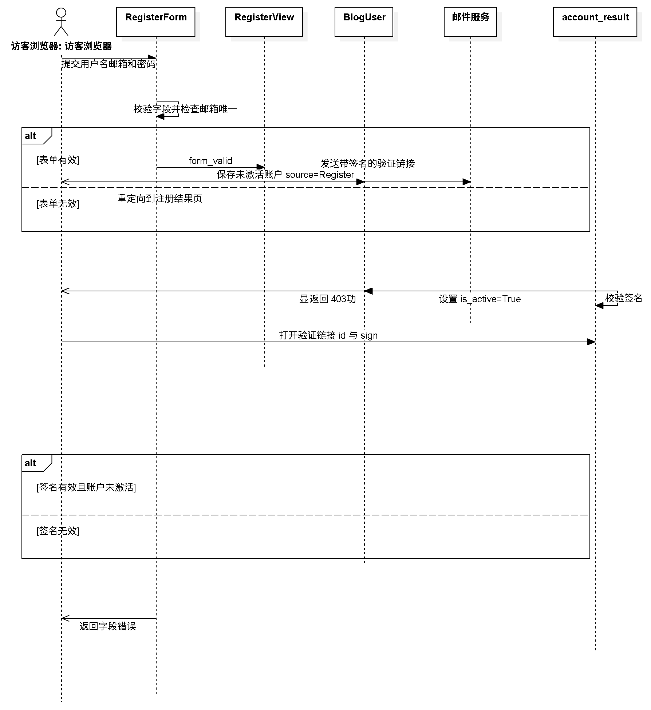

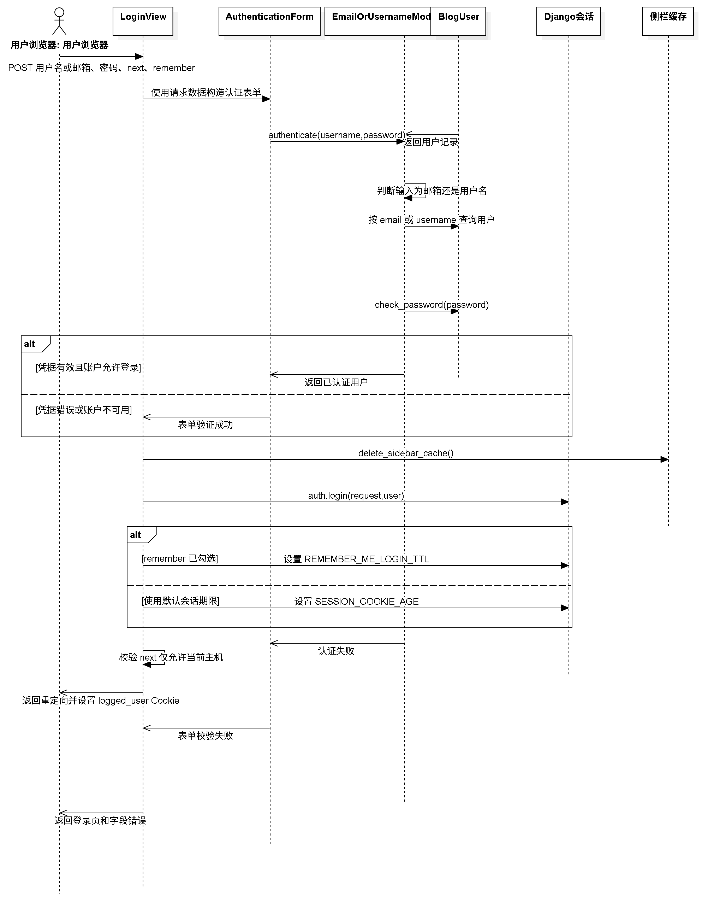

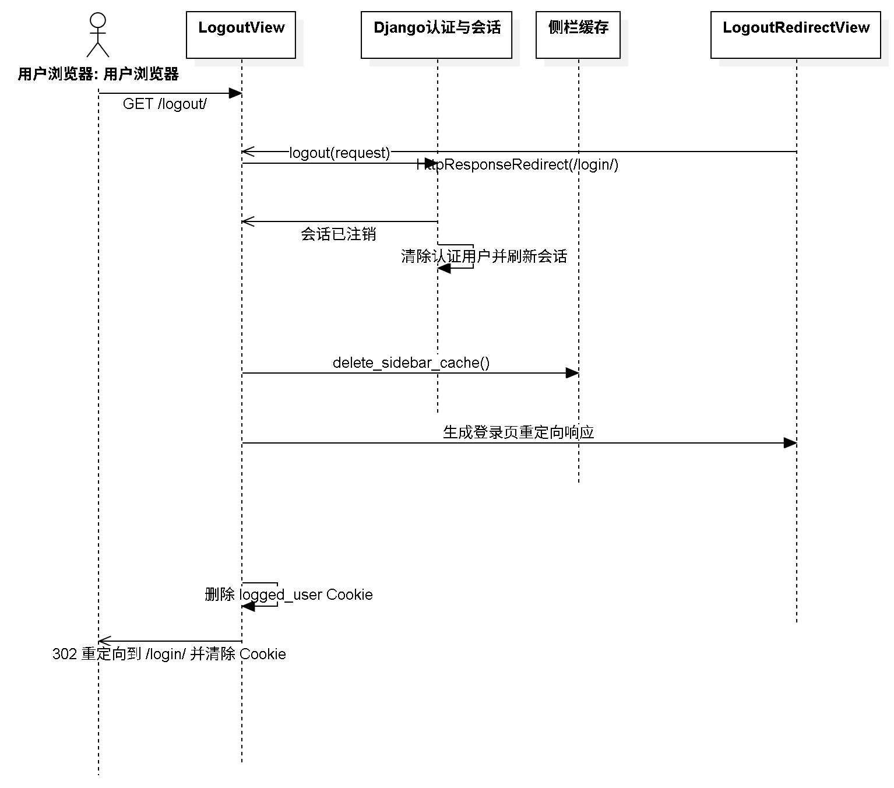

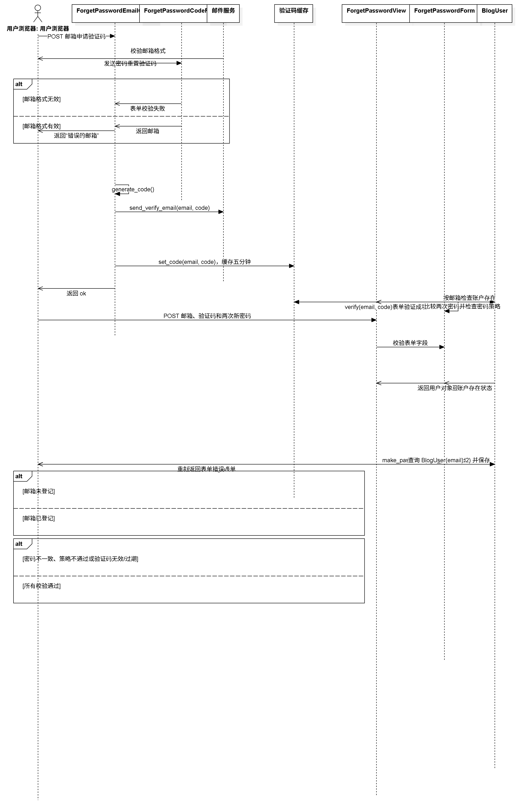

#### comments 用例

comments 应用负责「栈外」博客的评论子系统，支持三类功能：
1. 文章详情页的评论浏览、发表评论与**楼中楼回复**（`parent_comment` 自关联）；
2. 评论的 **Emoji 表情反应**（8 种表情，可再次点击取消）；
3. 管理员在 Django 后台对评论进行**审核**（启用 / 禁用）。

##### comments 用例图

comments 模块共有三类参与者：

| 参与者（Actor） | 说明 |
|---|---|
| 访客（未登录游客） | 只能浏览已审核评论、查看 Emoji 统计 |
| 注册用户（登录用户） | 发表评论、楼中楼回复、对评论发表 Emoji 反应 |
| 管理员 | 登录后台审核评论（启用 / 禁用）、管理评论反应 |

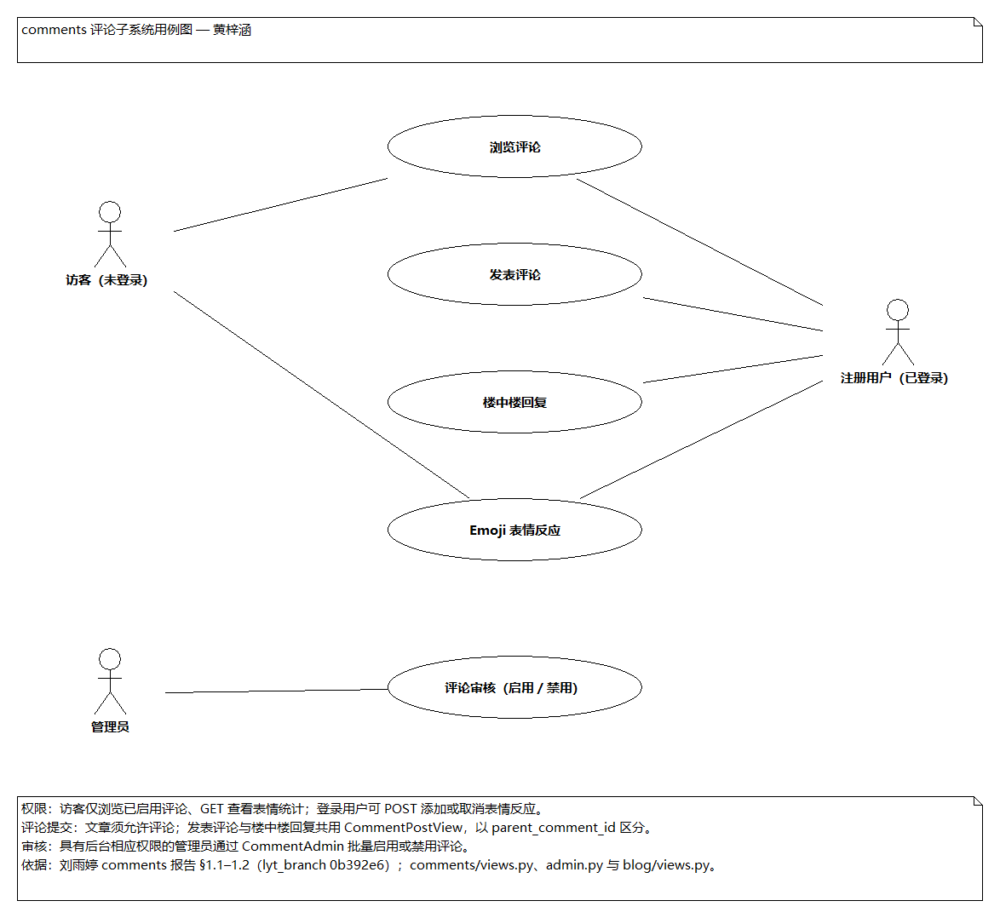

> 图中包含 5 个用例：浏览评论、发表评论、楼中楼回复、Emoji 表情反应、评论审核。
> 其中「发表评论」与「楼中楼回复」共用提交视图 `CommentPostView`，回复通过隐藏字段 `parent_comment_id` 区分。

##### comments 用例说明

###### 用例 1：浏览评论

| 项目 | 内容 |
|---|---|
| 用例名称 | 浏览评论 |
| 参与者（Actor） | 访客、注册用户 |
| 前置条件 | 文章已发布且存在；评论已通过审核（`is_enable=True`） |
| 后置条件 | 文章详情页按楼层展示评论；未审核评论不显示 |
| 基本流程 | 1. 用户访问文章详情页；2. 视图查询该文章 `is_enable=True` 的评论；3. 模板标签 `parse_commenttree` 递归组织楼中楼；4. `show_comment_item` 渲染每条评论 |
| 扩展流程 | 1a. 评论 `is_enable=False`（待审/违规）→ 不进入公开列表 |

###### 用例 2：发表评论

| 项目 | 内容 |
|---|---|
| 用例名称 | 发表评论 |
| 参与者（Actor） | 注册用户 |
| 前置条件 | 用户已登录；文章评论开放（`comment_status='o'` 且文章未关闭） |
| 后置条件 | 生成一条评论记录；按站点设置决定是否需审核；发送邮件通知 |
| 基本流程 | 1. 用户在文章详情页评论框输入正文；2. 表单 POST 到 `comments:postcomment`（携带 article_id）；3. `CommentForm` 校验正文非空；4. `CommentPostView` 取当前用户与文章；5. 校验评论开关；6. 生成 `Comment` 实例并设置 `author`、`article`；7. 读取站点设置 `comment_need_review`，无需审核则 `is_enable=True`；8. 保存入库并发送邮件；9. 重定向到 `#div-comment-<id>` |
| 扩展流程 | 1a. 未登录 → 重定向到登录页；2a. 正文为空 → `form_invalid` 回显错误；3a. 文章评论已关闭 → 抛出 `ValidationError`；4a. 开启审核 → 评论 `is_enable=False`，待管理员审核后才显示 |
| 顺序图 | 见「图 1：发表评论顺序图」 |

###### 用例 3：楼中楼回复

| 项目 | 内容 |
|---|---|
| 用例名称 | 楼中楼回复 |
| 参与者（Actor） | 注册用户 |
| 前置条件 | 用户已登录；被回复的父评论存在 |
| 后置条件 | 新评论的 `parent_comment` 指向被回复评论，形成嵌套层级 |
| 基本流程 | 1. 用户点击某条评论的「回复」；2. 表单隐藏字段自动填入 `parent_comment_id`；3. 提交后视图判断该字段非空；4. 查出父评论并设置 `comment.parent_comment`；5. 保存入库；6. 前端用 `parse_commenttree` 递归展示该评论下的所有子回复 |
| 扩展流程 | 1a. 父评论 id 不存在 → 查询失败返回 404；2a. 不填父评论 id → 视为顶层评论 |
| 顺序图 | 见「图 2：楼中楼回复顺序图」 |

###### 用例 4：Emoji 表情反应

| 项目 | 内容 |
|---|---|
| 用例名称 | Emoji 表情反应（点赞 / 取消） |
| 参与者（Actor） | 注册用户（POST 表态）；访客（GET 查看） |
| 前置条件 | 目标评论已通过审核（`is_enable=True`）；表情类型在系统允许的 8 种之内 |
| 后置条件 | 表态结果写入 `comments_commentreaction`；评论表情计数更新 |
| 基本流程 | 1. 页面加载时 GET `/comment/<id>/react` 取表情统计；2. 登录用户点击某表情 POST 提交 `reaction_type`；3. 校验登录与表情合法性；4. `get_or_create` 查找记录；5. 不存在则新建（点赞），已存在则删除（再点一次取消）；6. 返回最新统计 JSON；7. 前端更新计数 |
| 扩展流程 | 1a. 未登录 POST → 返回 401；2a. 非法表情 → 返回 400；3a. 评论不存在或未启用 → 返回 404；4a. 同一用户对同一评论重复点同一表情 → 受 `unique_together` 约束，表现为「取消点赞」 |
| 顺序图 | 见「图 3：Emoji 表情反应顺序图」 |

###### 用例 5：评论审核（后台）

| 项目 | 内容 |
|---|---|
| 用例名称 | 评论审核 |
| 参与者（Actor） | 管理员 |
| 前置条件 | 管理员已登录 Django 后台（`/admin/`） |
| 后置条件 | 评论的 `is_enable` 被更新，前台展示随之变化 |
| 基本流程 | 1. 进入「评论」列表；2. 查看评论正文、作者、所属文章、状态、时间；3. 勾选待审评论；4. 执行批量动作「启用 / 禁用」；5. 列表与前台状态同步更新 |
| 扩展流程 | 1a. 可按 `is_enable` 筛选、按正文搜索；2a. 作者 / 文章用原始 id 输入（raw_id_fields）避免下拉加载过多 |
| 顺序图 | 见「图 4：后台评论审核顺序图」 |

##### comments 顺序图

> 以下四张顺序图需在 StarUML 中绘制，导出 PNG 后放入 `doc/第六周/imgs/`，文件名与下方引用一致。每张图后的「消息序列」可直接照着在 StarUML 中拖对象与消息箭头。

###### 图 1：发表评论顺序图（comments-sequence-post-lyt.png）

参与对象（生命线）：登录用户、文章详情页/表单、CommentPostView、CommentForm、Article、BlogSettings、Comment、邮件工具、数据库。

消息序列：
1. 用户 → 表单：输入正文，提交；
2. 表单 → CommentPostView：`POST /article/{id}/postcomment`；
3. CommentPostView → CommentForm：校验数据；
   - 分支（校验失败）：返回错误 → CommentPostView 重新渲染文章页；
4. CommentPostView → Article：`get_object_or_404(article_id)`；
5. CommentPostView → Article：检查 `comment_status` / `status`（关闭则抛 `ValidationError`）；
6. CommentPostView → Comment：`form.save(False)` 生成实例（暂不入库）；
7. CommentPostView → BlogSettings：`get_blog_setting()` 读取 `comment_need_review`；
   - 分支：无需审核 → `is_enable=True`；需要审核 → `is_enable=False`（默认待审）；
8. CommentPostView → Comment：设置 `author`、`article`，调用 `save()`；
9. Comment → 数据库：INSERT 评论记录；
10. CommentPostView → 邮件工具：`send_comment_email()` 发送通知；
11. CommentPostView → 用户：302 重定向到 `#div-comment-<id>`。

###### 图 2：楼中楼回复顺序图（comments-sequence-reply-lyt.png）

参与对象：登录用户、文章详情页/表单、CommentPostView、Comment（父）、Comment（子）、数据库、模板标签 parse_commenttree。

消息序列：
1. 用户点击某条评论「回复」→ 表单隐藏字段写入 `parent_comment_id = 父评论 id`；
2. 表单 → CommentPostView：POST 提交（正文 + parent_comment_id）；
3. CommentPostView → Comment（父）：`Comment.objects.get(pk=parent_comment_id)`；
   - 分支：父评论不存在 → 404；
4. CommentPostView → Comment（子）：新建评论并 `parent_comment = 父评论`；
5. Comment（子）→ 数据库：INSERT；
6. 页面渲染时 → parse_commenttree：从父评论递归 `filter(parent_comment=c, is_enable=True)` 取全部子回复；
7. 返回层级化的评论树并渲染。

###### 图 3：Emoji 表情反应顺序图（comments-sequence-reaction-lyt.png）

参与对象：登录用户、前端表情按钮、CommentReactionView、Comment、CommentReaction、数据库。

消息序列：
1. 页面加载：前端 → CommentReactionView：`GET /comment/{id}/react`；
2. CommentReactionView → Comment：`get_object_or_404(is_enable=True)`；
3. CommentReactionView → Comment：`get_reactions_summary()` 返回各表情计数（含当前用户是否已表态）；
4. 用户点击表情 → 前端 → CommentReactionView：`POST reaction_type=👍`；
5. CommentReactionView：校验登录（失败 → 401）；
6. CommentReactionView：校验 `reaction_type` 在 8 种之内（非法 → 400）；
7. CommentReactionView → CommentReaction：`get_or_create(comment, user, reaction_type)`；
   - 分支：记录已存在 → `delete()` 取消点赞（action=removed）；不存在 → 新建（action=added）；
8. CommentReactionView → Comment：`get_reactions_summary()` 重新统计；
9. CommentReactionView → 前端：返回 JSON（action、reactions）；
10. 前端更新表情计数与高亮。

###### 图 4：后台评论审核顺序图（comments-sequence-audit-lyt.png）

参与对象：管理员、Django Admin、CommentAdmin、Comment、数据库。

消息序列：
1. 管理员登录 `/admin/`；
2. 进入「评论」列表（CommentAdmin 提供正文、作者、文章、状态、时间列）；
3. 勾选待审评论，选择批量动作「启用 / 禁用」；
4. CommentAdmin → Comment：`enable_commentstatus` / `disable_commentstatus` 执行 `queryset.update(is_enable=...)`；
5. Comment → 数据库：UPDATE；
6. 前台文章页评论列表随之显示 / 隐藏。

---

#### oauth 用例

参与者包括使用第三方账号登录的访客、第三方身份平台和邮件服务。后台 OAuthConfig 维护属于系统管理范围，未在此重复系统后台用例。当前路由支持以下五个用例；“邮箱齐备的回调登录”与“无邮箱后补填及确认”是两条不同路径。

##### UC-O01 发起第三方授权

| 项目 | 内容 |
|---|---|
| 参与者 | 访客、第三方身份平台 |
| 前置条件 | 对应 OAuthConfig 已启用，平台类型可匹配管理器。 |
| 后置条件 | 浏览器重定向第三方授权地址。 |
| 基本流程 | 1. 请求 `oauth/oauthlogin?type=github&next_url=…`。 2. `get_manager_by_type()` 查找管理器。 3. `get_redirecturl()` 校验登录后返回地址。 4. 管理器组装授权 URL。 5. 返回 302，浏览器访问授权页面。 |
| 扩展流程 | 未传 type 或无可用管理器时返回首页；非法 next_url 回退 `/`。 |
| 实现边界 | 当前图反映源码流程，不声称项目已实现 state 或 PKCE 校验。 |

##### UC-O02 授权回调并登录

| 项目 | 内容 |
|---|---|
| 参与者 | 访客、第三方身份平台 |
| 前置条件 | 收到平台回调，具有有效 type 和可换取 token 的 code。 |
| 后置条件 | 邮箱齐备的主流程保存授权账号绑定、建立本地登录会话并跳转。 |
| 基本流程 | 1. `authorize()` 选择管理器。 2. code 换 token，再获取用户资料。 3. 按 type 和 openid 查找已有 OAuthUser，更新相关资料。 4. 在事务内复用已绑定用户，或按邮箱获取/创建 BlogUser。 5. 保存 author 关系及 OAuthUser，发送登录信号。 6. Django login、设置会话期限与登录 Cookie，再重定向。 |
| 扩展流程 | token 异常返回首页或重新授权；无用户资料按代码回退；无邮箱时保存 OAuthUser 并进入补填邮箱页面。 |
| 实现边界 | 已有记录复用时显式更新的是 picture、metadata、nickname，不保证 token 和邮箱也刷新。`transaction.atomic()` 约束数据库操作，不使第三方 API、Cookie 或发信获得数据库事务语义。 |

##### UC-O03 补填邮箱并申请验证

| 项目 | 内容 |
|---|---|
| 参与者 | 第三方登录用户、邮件服务 |
| 前置条件 | 已有待绑定 OAuthUser；第三方流程未取得邮箱。 |
| 后置条件 | 保存提交邮箱，调用发信函数，显示等待邮箱验证提示。 |
| 基本流程 | 1. GET `requireemail/<oauthid>.html` 加载表单和头像。 2. 用户 POST 邮箱及隐藏 oauthid。 3. RequireEmailForm 校验字段。 4. RequireEmailView 按表单中的 ID 获取对象并保存邮箱。 5. 生成签名确认链接并调用 send_email。 6. 跳转 `bindsuccess?type=email`。 |
| 扩展流程 | 对象不存在返回 404；表单不合法回显。 |
| 实现边界 | 表单隐藏 ID 不等于会话所有权校验；代码采用 cleaned_data 中的 oauthid，本图不虚构额外绑定校验。调用发信不等于实际投递成功。 |

##### UC-O04 确认邮箱并绑定登录

| 项目 | 内容 |
|---|---|
| 参与者 | 第三方登录用户、邮件服务 |
| 前置条件 | 用户持有包含 ID 和签名的确认链接。 |
| 后置条件 | 绑定本地用户，建立登录会话，调用欢迎邮件发送并跳转成功提示页。 |
| 基本流程 | 1. `emailconfirm()` 校验签名。 2. 获取 OAuthUser。 3. 事务内复用绑定用户或按邮箱创建/获取用户。 4. 保存 author 关联。 5. 发出登录信号并登录，设置会话期限。 6. 调用欢迎邮件发送，设置 Cookie 并跳转。 |
| 扩展流程 | 签名错误返回 403，对象不存在返回 404。 |
| 实现边界 | 签名由 SECRET_KEY、ID 计算，没有包含邮箱、有效期或一次性随机值；不能将“一次性链接、过期验证”写为已实现能力。 |

##### UC-O05 查看绑定状态提示

| 项目 | 内容 |
|---|---|
| 参与者 | 第三方登录用户 |
| 前置条件 | 请求中的 OAuthUser ID 存在。 |
| 后置条件 | 返回等待验证或成功文案页面。 |
| 基本流程 | 1. `bindsuccess()` 获取 OAuthUser。 2. type=email 时显示等待验证，其他值显示成功文案。 3. 渲染 `oauth/bindsuccess.html`。 |
| 扩展流程 | 对象不存在返回 404。 |
| 实现边界 | 该页面只展示提示，不执行绑定、登录，也不单独证明绑定已经完成。 |

#### servermanager / plugins 用例

**（1）用例图（servermanager 与 plugins）**

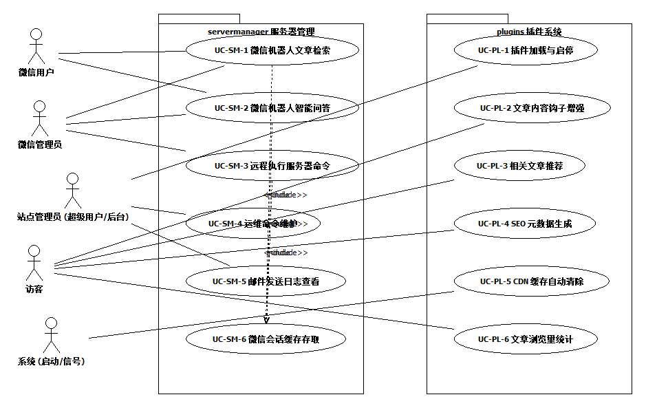

**（2）用例说明**

**UC-SM-1 微信机器人文章检索**

| 项目 | 内容 |
|------|------|
| 用例名称 | 微信机器人文章检索 |
| 参与者（Actor）| 微信用户 |
| 前置条件 | 机器人服务已运行（Werobot token 已配置）、微信公众号已接入；博客已有文章数据 |
| 后置条件 | 用户收到文章图文消息或提示文本；用户会话状态已更新 |
| 基本流程 | 1. 用户向公众号发送指令消息（?关键字 / category / recent / help） 2. 微信服务器将消息转发到 /robot 回调，robot 读取该用户会话 3. 按正则过滤器匹配指令并分发 4. BlogApi 查询数据：?关键字走 Haystack 检索，category 取分类列表，recent 取最新文章（均最多 8 条） 5. convert_to_article_reply 组装图文消息（首图/标题/摘要/文章链接） 6. 回复用户 |
| 扩展流程 | 4a. 消息不匹配任何指令 → 转入 UC-SM-2 智能问答或 UC-SM-3 管理员命令流程 4b. 关键字未检索到结果 → 回复"没有找到相关文章。" 4c. recent 暂无已发布文章 → 回复"暂时还没有文章" |
| 顺序图 | 见下图 |

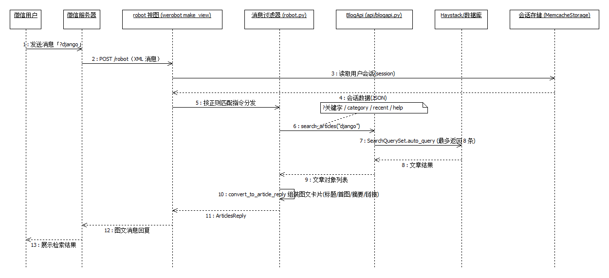

**UC-SM-2 微信机器人智能问答**

| 项目 | 内容 |
|------|------|
| 用例名称 | 微信机器人智能问答 |
| 参与者（Actor）| 微信用户 |
| 前置条件 | 已配置 OPENAI_API_KEY 且网络可达 OpenAI 接口 |
| 后置条件 | 用户收到 AI 回复文本 |
| 基本流程 | 1. 用户发送未被任何指令过滤器匹配的消息 2. 进入默认处理器 echo，构造 MessageHandler 并读取会话 3. 判定为非管理员消息 → ChatGPT.chat(消息内容) 4. 调用 OpenAI gpt-3.5-turbo 生成回复 5. 回复文本返回给用户 |
| 扩展流程 | 3a. OpenAI 接口调用异常 → 记录错误日志，回复"服务器出错了" 3b. 该用户处于管理员模式 → 转入 UC-SM-3 流程 |
| 顺序图 | 见下图 |

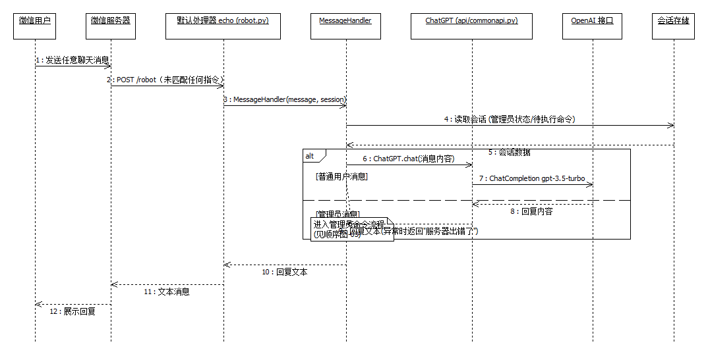

**UC-SM-3 微信机器人远程执行服务器命令**

| 项目 | 内容 |
|------|------|
| 用例名称 | 微信机器人远程执行服务器命令 |
| 参与者（Actor）| 微信管理员 |
| 前置条件 | 已在 settings 配置 WXADMIN 管理员密码；运维命令已由后台维护（见 UC-SM-4）|
| 后置条件 | 指定服务器命令被执行，输出结果返回微信；管理员状态随会话保存 |
| 基本流程 | 1. 管理员发送 ADMIN → 会话标记 isAdmin=True，提示"输入管理员密码" 2. 输入密码：做两次 SHA256 哈希后与 settings.WXADMIN 比对 3. 校验通过 → 标记 isPasswordSet=True，提示输入命令（helpme 可看命令清单） 4. 输入命令 → 暂存到会话 → 回复"确认执行: xxx 命令?" 5. 回复 Y → CommandHandler 按标题在 commands 表匹配命令 → os.popen 执行 → 返回输出 6. 发送 EXIT → 清空管理员状态，退出管理员模式 |
| 扩展流程 | 2a. 密码错误 → 错误计数 +1，累计满 3 次重置管理员状态并提示"超过验证次数" 5a. 命令标题不存在 → 提示"未找到相关命令，请输入hepme获得帮助。" 5b. 未回复 Y 而输入新文本 → 覆盖暂存的待执行命令，再次要求确认 5c. 命令执行抛异常 → 回复"命令执行出错!" |
| 顺序图 | 见下图 |

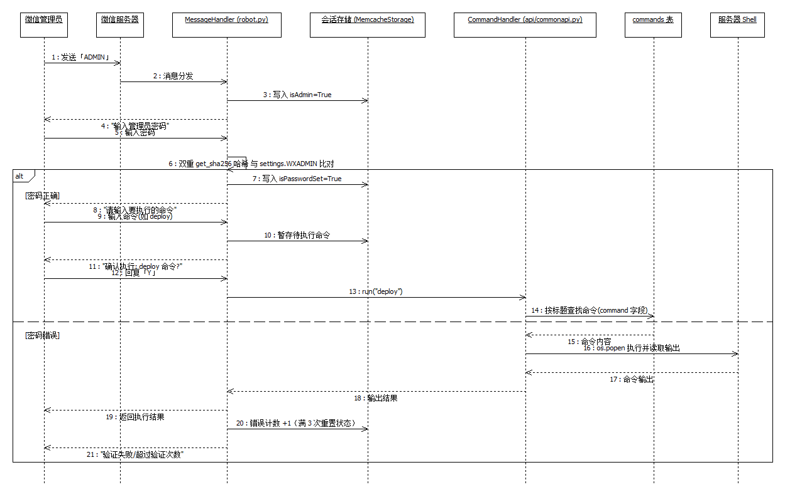

**UC-SM-4 运维命令维护**

| 项目 | 内容 |
|------|------|
| 用例名称 | 运维命令维护 |
| 参与者（Actor）| 站点管理员（超级用户）|
| 前置条件 | 以超级用户身份登录 Django 后台 |
| 后置条件 | commands 表更新；机器人重启后使用最新命令清单 |
| 基本流程 | 1. 打开后台「命令」管理 2. 新增/修改/删除命令（命令标题、命令内容、命令描述） 3. 保存写入 commands 表 4. 机器人进程（重）启动时 CommandHandler 加载全部命令 5. helpme 帮助列表与远程命令执行随即使用最新数据 |
| 扩展流程 | 5a. 机器人进程未重启 → 仍使用启动时加载的旧命令列表 |
| 顺序图 | 见下图 |

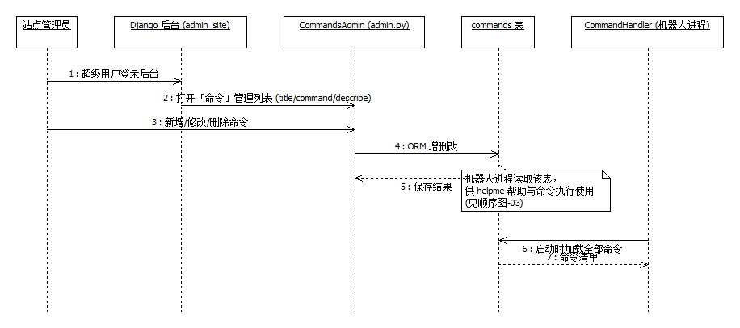

**UC-SM-5 邮件发送日志查看**

| 项目 | 内容 |
|------|------|
| 用例名称 | 邮件发送日志查看 |
| 参与者（Actor）| 站点管理员（超级用户）|
| 前置条件 | 系统已在注册验证、OAuth 绑定、评论通知等场景触发过邮件发送 |
| 后置条件 | 管理员掌握每次邮件发送的收件人、内容与结果 |
| 基本流程 | 1. 邮件信号处理器在每次发送后自动写入 EmailSendLog（收件人/标题/内容/发送结果） 2. 管理员登录后台打开「邮件发送log」 3. 列表按创建时间倒序展示标题、收件邮箱、发送结果、创建时间 4. 查看某条记录的完整内容与结果 |
| 扩展流程 | 1a. 邮件发送异常 → 同样写入日志，send_result=False 4a. 后台禁止手动新增日志（has_add_permission=False），日志只读 |
| 顺序图 | 见下图 |

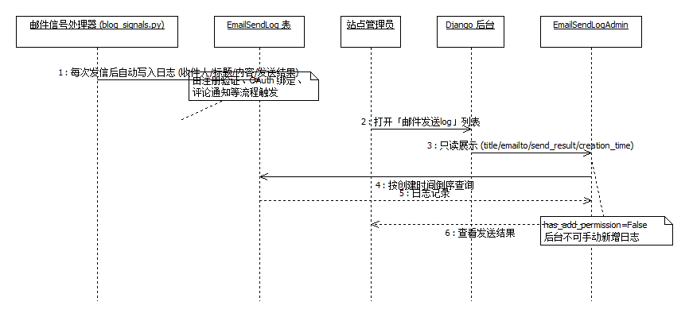

**UC-SM-6 微信会话缓存存取**

| 项目 | 内容 |
|------|------|
| 用例名称 | 微信会话缓存存取 |
| 参与者（Actor）| 微信用户（间接触发）、系统 |
| 前置条件 | Django 缓存后端已配置（默认 LocMemCache，可切换 Redis）|
| 后置条件 | 用户会话状态（管理员标记/待执行命令/计数等）被持久保存 |
| 基本流程 | 1. 机器人启动时检测缓存可用性（写入并回读测试键） 2. 缓存可用 → 会话存储设为 MemcacheStorage（key 前缀 ws_） 3. 用户消息到达 → 按用户 openid 读取会话，JSON 反序列化 4. 消息处理完毕后写回会话，JSON 序列化 |
| 扩展流程 | 1a. 缓存不可用 → 删除遗留会话文件，降级为 FileStorage 文件存储 3a. 读取异常/无会话记录 → 新建空会话对象，正常继续处理 2a. 降级为文件存储后缓存恢复 → 需重启进程才会切回缓存存储 |
| 顺序图 | 见下图 |

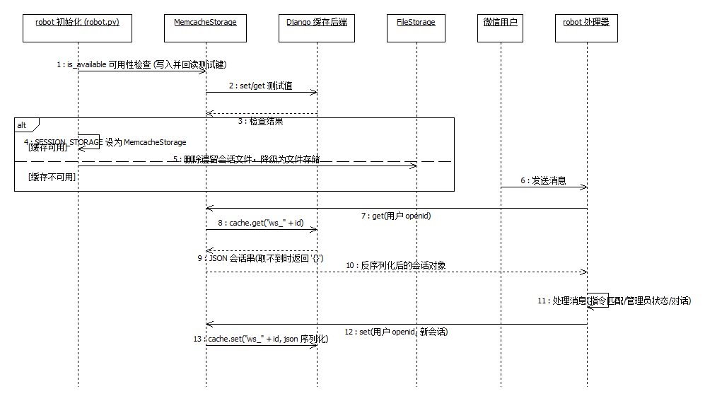

**UC-PL-1 插件加载与启停**

| 项目 | 内容 |
|------|------|
| 用例名称 | 插件加载与启停 |
| 参与者（Actor）| 站点管理员 |
| 前置条件 | 插件目录结构完整（plugins/<插件名>/plugin.py 存在模块级 plugin 实例）|
| 后置条件 | 启用的插件完成钩子注册，功能随钩子自动生效 |
| 基本流程 | 1. 管理员在 settings.py 的 ACTIVE_PLUGINS 列表中决定启用哪些插件（当前启用 8 个） 2. 重启服务，Django 应用就绪后调用 load_plugins() 3. 逐个 import plugins.<插件名>.plugin，取出模块级 plugin 实例 4. 实例化时 BasePlugin.__init__ 依次调用 init_plugin()（可校验配置）与 register_hooks()（注册钩子回调） 5. 加载完成后插件在对应钩子上开始工作 |
| 扩展流程 | 3a. 插件目录或 plugin.py 缺失 → 跳过并记录日志 4a. 插件配置无效（如 Cloudflare 未配置凭证）→ 插件自我禁用（enabled=False） 1a. 修改 ACTIVE_PLUGINS 后需重启服务才生效 |
| 顺序图 | 见下图 |

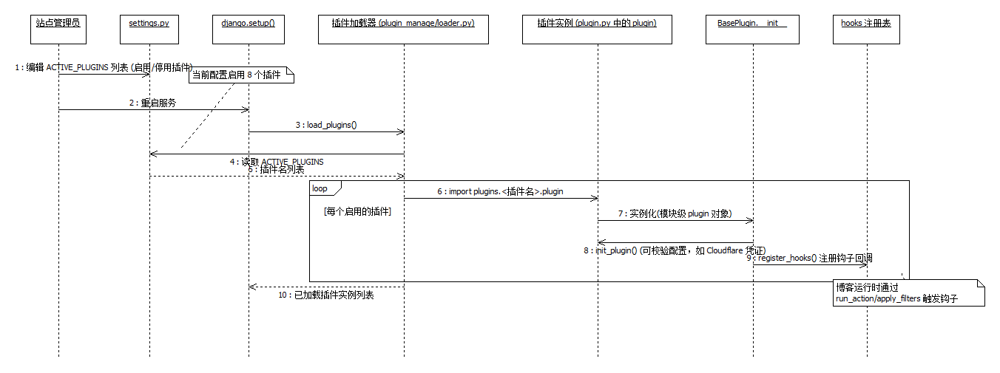

**UC-PL-2 文章内容钩子增强**

| 项目 | 内容 |
|------|------|
| 用例名称 | 文章内容钩子增强 |
| 参与者（Actor）| 访客 |
| 前置条件 | 版权、阅读时间、外部链接、图片懒加载插件已启用 |
| 后置条件 | 页面正文 HTML 被各插件依次增强后输出 |
| 基本流程 | 1. 访客打开文章详情页 2. 模板调用 render_article_content / custom_markdown 渲染正文 3. Markdown 转 HTML 4. hooks.apply_filters 沿 the_content 过滤器链按注册顺序依次执行：版权声明 → 阅读时间 → 外部链接 → 图片懒加载 5. 增强后的 HTML 渲染展示 |
| 扩展流程 | 4a. 摘要模式（首页/列表页）→ 版权声明与阅读时间插件跳过 4b. 链接已有 target 属性或为站内链接 → 外链插件跳过该链接 4c. 内容中没有 img 标签 → 图片插件原样返回 |
| 顺序图 | 见下图 |

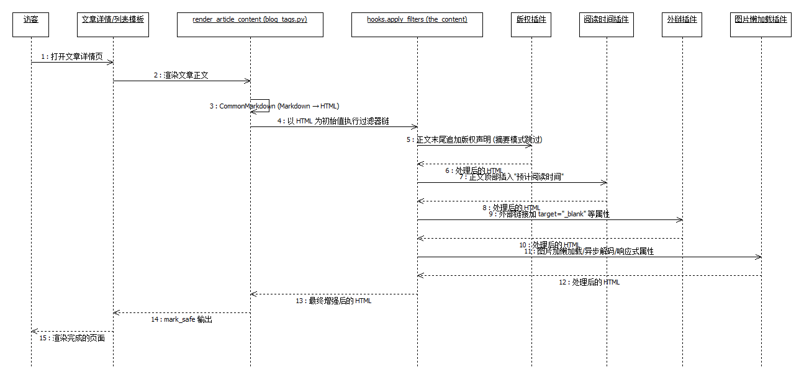

**UC-PL-3 相关文章推荐**

| 项目 | 内容 |
|------|------|
| 用例名称 | 相关文章推荐 |
| 参与者（Actor）| 访客 |
| 前置条件 | 文章推荐插件已启用；当前文章已归入分类、可带标签 |
| 后置条件 | 文章详情页底部展示"相关推荐"组件 |
| 基本流程 | 1. 访客打开文章详情页 2. 视图触发 article_detail_load 钩子 3. 插件 get_recommendations(article, 8)：先按相同标签检索已发布文章（浏览量降序） 4. 数量不足 → 按同分类补齐 5. 仍不足 → 取全站热门（浏览量降序）补齐 6. 过滤空标题后写入 context，模板渲染底部组件（bottom_widget.html） |
| 扩展流程 | 5a. 三级策略均无候选 → 不渲染推荐组件（返回 None）|
| 顺序图 | 见下图 |

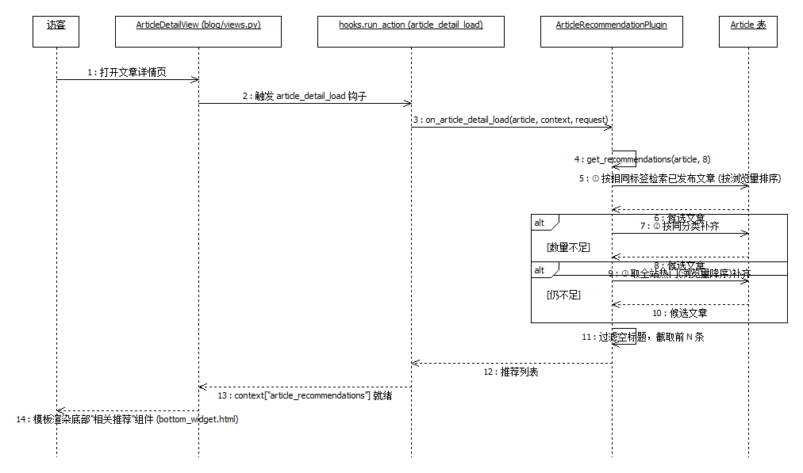

**UC-PL-4 SEO 元数据生成**

| 项目 | 内容 |
|------|------|
| 用例名称 | SEO 元数据生成 |
| 参与者（Actor）| 访客（含搜索引擎爬虫）|
| 前置条件 | SEO 优化器插件已启用 |
| 后置条件 | 页面 <head> 中携带 Open Graph 标签与 JSON-LD 结构化数据 |
| 基本流程 | 1. 页面渲染时执行 head_meta 过滤器 2. SEO 插件按 view_name 判断页面类型 3. 文章页 → Open Graph + Article 类型 JSON-LD；分类/标签/作者页 → BreadcrumbList 面包屑；其余页面 → WebSite + SearchAction 4. 生成结果追加到已有 meta 内容后输出 |
| 扩展流程 | 3a. 未识别页面类型 → 生成默认 WebSite 结构化数据 3b. 文章无首图 → JSON-LD 中移除 image 字段 |
| 顺序图 | 见下图 |

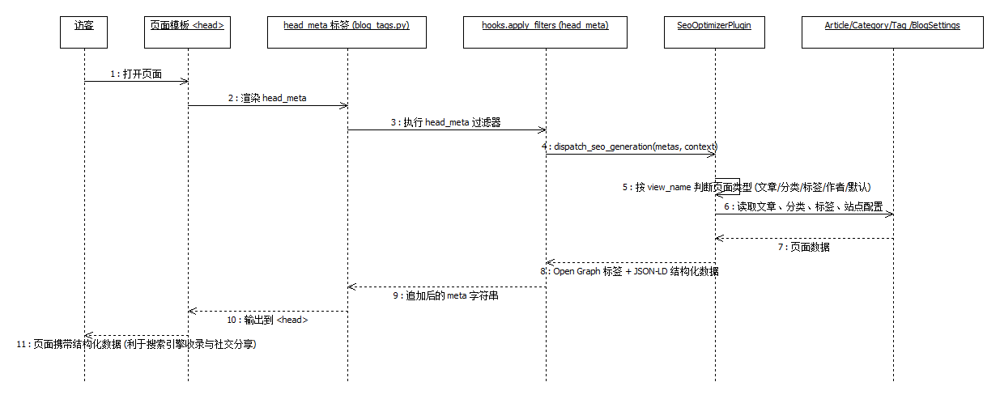

**UC-PL-5 CDN 缓存自动清除**

| 项目 | 内容 |
|------|------|
| 用例名称 | CDN 缓存自动清除 |
| 参与者（Actor）| 系统（模型保存信号）|
| 前置条件 | Cloudflare 缓存插件已启用且凭证（Zone ID / API Token）配置有效 |
| 后置条件 | 受影响页面的 CDN 缓存被清除，用户可看到最新内容 |
| 基本流程 | 1. 作者/管理员保存文章，或新评论通过审核发布 2. post_save 信号触发 CloudflareCacheHandler 3. 收集需清除的 URL（文章页/首页/分类页/标签页/RSS） 4. 按 30 条/批调用 CloudflareAPI.purge_urls 清除 5. 清除失败仅记录日志，不影响主业务流程 |
| 扩展流程 | 3a. 仅浏览量更新（update_fields={'views'}）→ 跳过，避免高频清缓存 2a. 评论未通过审核（is_enable=False）→ 跳过 1a. 配置 CLOUDFLARE_PURGE_ON_STARTUP=true → 应用启动后由后台线程清理全站缓存 |
| 顺序图 | 见下图 |

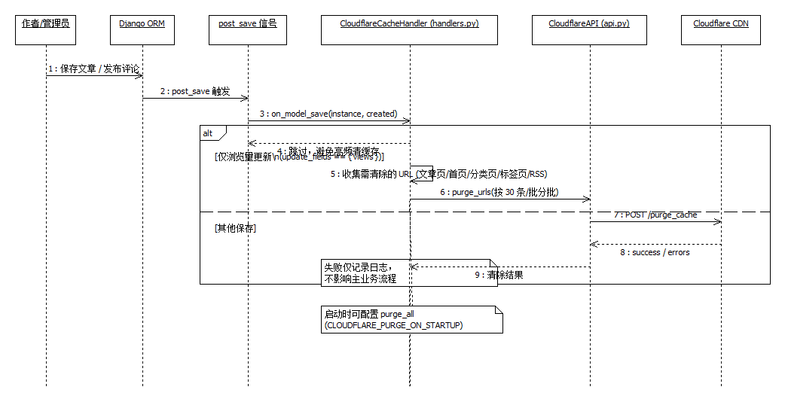

**UC-PL-6 文章浏览量统计**

| 项目 | 内容 |
|------|------|
| 用例名称 | 文章浏览量统计 |
| 参与者（Actor）| 访客 |
| 前置条件 | 浏览量统计插件已启用 |
| 后置条件 | 文章 views 字段 +1，用于热门排序与推荐 |
| 基本流程 | 1. 访客打开文章详情页 2. 正文获取完成，触发 after_article_body_get 钩子 3. ViewCountPlugin.record_view → article.viewed() 4. views += 1，以 update_fields=['views'] 保存 |
| 扩展流程 | 4a. post_save 处理器识别"仅浏览量更新" → 跳过缓存清理与搜索引擎推送 |
| 顺序图 | 见下图 |

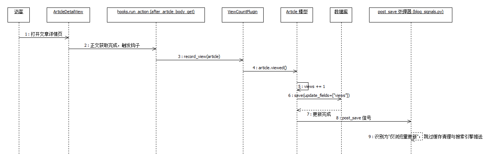

### 1.2 数据流图和数据字典

#### 系统数据流图

##### 系统上下文图（0 层）

P0 表示整个 DjangoBlog 系统。外部实体为读者/注册用户、后台管理员、第三方身份平台、邮件服务和微信平台/用户。箭头说明跨系统边界的数据交换，内部数据库及缓存在一级图展开。认证资料、授权凭据和邮箱等仅表示数据类别，图中没有真实凭据。

##### 一级数据流图

| 标记 | 内容及源码依据 |
|---|---|
| P1 内容浏览与搜索 | blog 视图、模板及搜索后端；输入阅读条件和关键词，输出文章及检索结果。 |
| P2 账户与授权 | accounts、oauth 视图和表单；输入认证资料、授权码、邮箱确认信息，输出登录结果及会话。 |
| P3 评论与反应 | comments 视图与模型；输入评论、父评论 ID 和表情，输出提交结果及统计。 |
| P4 后台内容配置与审核 | Admin 注册及后台类；输入文章、配置和审核操作，保存业务数据。 |
| P5 机器人处理 | servermanager 的 /robot 回调与处理器；输入消息/命令，输出查询、对话或执行结果。外部 AI 等扩展调用从此过程展开，依赖配置。 |
| D1 MySQL 业务数据 | 逻辑合并 Article、Category、Tag、BlogUser、OAuthUser、OAuthConfig、Comment、commands 和日志等表，不代表单张数据库表。 |
| D2 缓存与会话 | 文章查询缓存、验证码及配置的会话/机器人存储；并不保证所有存储使用同一个后端。 |
| D3 搜索索引 | 配置的 Haystack 后端及相关索引；索引构建维护另有命令/同步路径。 |

图中 E、P、D 分别表示外部实体、数据加工和数据存储。使用 StarUML 可编辑类节点及有向连接表达逻辑 DFD，箭头含义是数据流，不是类继承或执行时序。一级图是核心业务概览，不穷举每个内部函数；插件在内容加工中调用 hooks，属于内部扩展。图中不保证保存或删除业务数据后索引立即一致，也不将配置服务的可用性表述为运行验证成功。

#### 主要数据条目的数据字典

> 说明：数据条目依据《数据库表结构导出（最终版）》（第五周，全库 24 张表）与《软件数据模型设计说明书（最终版）》整理；完整字段级清单见上述文档，本表逐条给出名称、含义、类型/格式、来源、去向，覆盖全部 24 张表（16 张业务表 + 8 张 Django 内置支撑表）。

**（一）业务数据条目（16 张业务表）**

| 数据条目 | 含义 | 类型/格式 | 来源 | 去向 |
|----------|------|-----------|------|------|
| blog_article（文章/页面）| 站点文章与独立页面，含正文、发布状态、类型与浏览量 | 表：id int 主键；title varchar(200) 唯一；body longtext（Markdown）；pub_time datetime；status char(1)〔d 草稿/p 发布〕；comment_status char(1)〔o 开/c 关〕；type char(1)〔a 文章/p 页面〕；views int unsigned（≥0，CHECK 约束）；article_order int；show_toc bool；author_id → accounts_bloguser；category_id → blog_category；creation_time / last_modify_time datetime | 后台「文章」管理（管理员以 Markdown 撰写/编辑、批量改状态）；浏览量由浏览量统计插件在访问时自增 | 首页/分类页/标签页/作者页/归档页/详情页渲染；Haystack 站内搜索与微信机器人检索；相关推荐、SEO、CDN 缓存插件读取；RSS |
| blog_category（文章分类）| 文章分类，支持父子结构形成多级分类树 | 表：id int 主键；name varchar(30) 唯一；slug varchar(60)；index int（排序）；parent_category_id → blog_category（自关联，可空）；creation_time / last_modify_time datetime | 后台「文章分类」管理（保存时自动生成 slug）；文章编辑时选择归类 | 站点导航、分类归档页；文章详情面包屑；机器人 category 指令；推荐插件分类兜底 |
| blog_tag（文章标签）| 文章标签，用于聚合同类主题文章 | 表：id int 主键；name varchar(30) 唯一；slug varchar(60)；creation_time / last_modify_time datetime | 后台「文章标签」管理；文章编辑时新建/选择标签 | 标签归档页；文章详情标签展示；SEO og:tag；推荐插件标签匹配 |
| blog_article_tags（文章-标签关联）| 文章与标签的多对多中间表 | 表：id bigint；article_id → blog_article；tag_id → blog_tag；UNIQUE(article_id, tag_id) | Django ORM 由 Article.tags 多对多自动维护 | 标签聚合查询（JOIN）；标签页与推荐插件的关联检索 |
| blog_links（友情链接）| 站点友情链接，含展示位置与排序 | 表：id bigint；name varchar(30) 唯一；link varchar(200)；sequence int 唯一（排序）；is_enable bool；show_type char(1)〔i 首页/l 列表/p 文章/a 全部/s 滑动〕；creation_time / last_mod_time datetime | 后台「友情链接」管理 | 首页/列表页等位置的友链区域（按 is_enable 与 show_type 过滤）|
| blog_sidebar（侧边栏）| 侧边栏自定义内容块（HTML）| 表：id bigint；name varchar(100)；content longtext（HTML）；sequence int 唯一；is_enable bool；creation_time / last_mod_time datetime | 后台「侧边栏」管理 | 全站侧边栏渲染（带片段缓存，保存时触发缓存清理）|
| blog_blogsettings（博客全局配置）| 全站唯一配置：站名、SEO、摘要长度、评论开关、配色等 | 表：id bigint；site_name varchar(200)；site_description / site_seo_description / site_keywords longtext；article_sub_length int；sidebar_article_count / sidebar_comment_count / article_comment_count int；show_google_adsense bool；google_adsense_codes longtext；open_site_comment bool；comment_need_review bool；beian_code varchar(2000)；analytics_code longtext；show_gongan_code bool；gongan_beiancode / global_header / global_footer longtext；color_scheme varchar(20)〔8 套配色〕 | 后台「博客全局配置」（clean 约束全库仅一行；保存后清空缓存）；无记录时首次读取自动创建默认配置 | 全站页面（站名/SEO/配色/页头页脚/备案号）；评论分页数量与审核开关；摘要长度 |
| accounts_bloguser（用户）| 站点用户，扩展自 Django AbstractUser | 表：id bigint；username varchar(150) 唯一；password varchar(128)（哈希）；email varchar(254)；nickname varchar(100)；source varchar(100)；is_active / is_staff / is_superuser bool；last_login / date_joined datetime；first_name / last_name varchar(150)；creation_time / last_modify_time datetime | 注册页（source=Register，邮箱验证后激活）；OAuth 登录与绑定邮箱自动创建（source=authorize / emailconfirm）；后台用户管理；找回密码更新口令 | 登录认证（账号登录与 OAuth 绑定）；文章作者/评论作者关联展示；作者页；后台权限体系 |
| accounts_bloguser_groups（用户-用户组关联）| 用户与权限组的多对多中间表 | 表：id bigint；bloguser_id → accounts_bloguser；group_id → auth_group；UNIQUE(bloguser_id, group_id) | Django auth 权限体系（后台为用户分配组，ORM 自动维护）| 权限校验（组权限继承）|
| accounts_bloguser_user_permissions（用户-权限关联）| 用户与权限的多对多中间表 | 表：id bigint；bloguser_id → accounts_bloguser；permission_id → auth_permission；UNIQUE(bloguser_id, permission_id) | Django auth 权限体系（后台直接为用户授权，ORM 自动维护）| 权限校验（用户直授权限）|
| comments_comment（评论）| 文章评论，支持楼中楼回复与审核开关 | 表：id bigint；body longtext（限 300 字）；is_enable bool（审核通过才展示）；article_id → blog_article；author_id → accounts_bloguser；parent_comment_id → comments_comment（自关联，可空=顶层评论）；creation_time / last_modify_time datetime；组合索引（article, parent_comment, is_enable 等）| 文章详情页评论表单（登录用户提交；站点配置 comment_need_review=False 时直接启用，否则待后台审核）；后台评论管理 | 文章详情评论区（分页展示，带缓存）；侧边栏最新评论；回复邮件通知；缓存失效与搜索引擎推送逻辑 |
| comments_commentreaction（评论表情反应）| 用户对评论的 Emoji 反应（点赞）| 表：id bigint；reaction_type varchar(10)〔👍/👎/❤️/😄/🎉/😕/🚀/👀 共 8 种〕；created_at datetime；comment_id → comments_comment；user_id → accounts_bloguser；UNIQUE(comment_id, user_id, reaction_type) | 评论 Emoji 接口（登录用户点击，存在则删除取消、不存在则创建）| 评论区 reactions 统计展示（各表情数量与表态用户）|
| oauth_oauthuser（第三方授权用户）| 第三方平台登录用户信息，与本地用户可选绑定 | 表：id bigint；openid varchar(50)（平台内唯一标识）；nickname varchar(50)；token varchar(150)（访问令牌，可空）；picture varchar(350)（头像，可空）；type varchar(50)〔github/weibo/qq 等〕；email varchar(50)（可空）；metadata longtext（原始信息）；author_id → accounts_bloguser（可空，未绑定为空）；creation_time / last_modify_time datetime | OAuth 回调（授权成功后创建/更新第三方资料）；绑定邮箱页补充 email | 与本地用户绑定登录；头像本地化信号处理；后台管理 |
| oauth_oauthconfig（第三方登录配置）| 各第三方平台的接入配置 | 表：id bigint；type varchar(10)〔weibo/google/github/facebook/qq，clean 约束每平台仅一条〕；appkey varchar(200)；appsecret varchar(200)；callback_url varchar(200)；is_enable bool；creation_time / last_modify_time datetime | 后台「oauth配置」管理 | OAuth 管理器生成授权 URL；登录页第三方登录入口渲染（is_enable 过滤）|
| servermanager_commands（运维命令）| 微信机器人可远程执行的预定义命令 | 表：id bigint；title varchar(300)（命令标题）；command varchar(2000)（实际 shell 命令）；describe varchar(300)（描述）；creation_time / last_modify_time datetime | 后台「命令」管理（见 UC-SM-4）| 微信机器人 CommandHandler：helpme 帮助清单与管理员命令执行（按标题匹配）|
| servermanager_emailsendlog（邮件发送日志）| 每次邮件发送的记录与结果 | 表：id bigint；emailto varchar(300)；title varchar(2000)；content longtext；send_result bool；creation_time datetime | 邮件信号处理器在每次发送后自动写入（由注册验证、OAuth 绑定、评论通知等流程触发）| 后台「邮件发送log」只读查看（禁止手动新增）|

**（二）Django 内置支撑表（8 张，完整列出）**

| 数据条目 | 含义 | 类型/格式 | 来源 | 去向 |
|----------|------|-----------|------|------|
| auth_group（用户组）| 权限组定义 | 表：id int 主键；name varchar(150) 唯一 | 后台「组」管理创建 | 用户组分配（accounts_bloguser_groups）与组权限校验 |
| auth_group_permissions（组-权限关联）| 用户组与权限的多对多中间表 | 表：id bigint；group_id → auth_group；permission_id → auth_permission；UNIQUE(group_id, permission_id) | 后台给组配置权限（ORM 自动维护）| 权限校验（组权限继承）|
| auth_permission（权限项）| 系统全部权限条目 | 表：id int 主键；name varchar(255)；content_type_id → django_content_type；codename varchar(100)；UNIQUE(content_type_id, codename) | Django 迁移时按模型自动生成（增/删/改/查）| 用户/组授权界面勾选；权限校验 |
| django_admin_log（后台操作日志）| 后台上所有增删改操作的记录 | 表：id int 主键；action_time datetime；object_id longtext；object_repr varchar(200)；action_flag smallint unsigned（≥0，CHECK）；change_message longtext；content_type_id → django_content_type（可空）；user_id → accounts_bloguser | 后台操作时由 Django admin 自动记录 | 后台「操作历史」查看（LogEntryAdmin）|
| django_content_type（模型类型）| 每个模型的内容类型登记 | 表：id int 主键；app_label varchar(100)；model varchar(100)；UNIQUE(app_label, model) | Django 迁移时自动为每个模型生成 | auth_permission 关联；通用外键（如日志的对象类型）|
| django_migrations（迁移记录）| 数据库迁移的应用记录 | 表：id bigint；app varchar(255)；name varchar(255)；applied datetime | 每次执行 migrate 时写入 | 迁移状态判断（该迁移是否已应用）|
| django_session（会话）| 用户登录会话数据 | 表：session_key varchar(40) 主键；session_data longtext（编码后的会话内容）；expire_date datetime | 用户登录成功时写入（账号登录与 OAuth 登录均设置过期时间）| Django 会话中间件在每次请求时读取校验登录态；过期自动清理 |
| django_site（站点）| 站点域名信息（sites 框架）| 表：id int 主键；domain varchar(100) 唯一；name varchar(50) | 迁移初始数据（SITE_ID=1）；后台「站点」管理 | get_current_site 读取域名：拼接文章完整 URL、邮件链接、缓存键、CDN 清除 URL 等 |

## 2. 界面分析

#### blog 界面

##### 既有成果的引用范围

沿用第四周的 [界面设计分析](../第四周/界面设计分析.md)、[软件界面设计说明书](../第四周/软件界面设计说明书.md) 中与 blog 相关的展示页面，结合当前路由、视图和模板核对。原图是第四周历史截图，本周没有把旧截图标记为重新运行取证；认证界面的详细分析由 accounts 负责人提供。

| 界面 | 路由 / 入口 | 主要元素和用户操作 | 对应实现 | 历史图片 |
|---|---|---|---|---|
| 首页及分页 | `/`、`/page/<page>/` | 文章卡片、标题、摘要、阅读入口、导航、侧栏、分页 | `IndexView`；`blog/article_index.html` | [第四周首页](../第四周/界面截图/01_首页.png) |
| 文章详情 | `/article/<year>/<month>/<day>/<id>.html` | 正文、作者、分类、标签、相邻文章、评论显示；评论提交属于 comments | `ArticleDetailView`；`blog/article_detail.html` | [第四周详情](../第四周/界面截图/02_文章详情.png) |
| 分类列表 | `/category/<slug>.html` | 分类名称、当前分类及后代内容列表、分页 | `CategoryDetailView`；共用列表模板 | [第四周分类页](../第四周/界面截图/03_分类页_技术.png) |
| 标签列表 | `/tag/<slug>.html` | 标签名、匹配文章及分页 | `TagDetailView`；共用列表模板 | [第四周标签页](../第四周/界面截图/04_标签页_Python.png) |
| 作者列表 | `/author/<author_name>.html` | 作者名称、该作者文章列表 | `AuthorDetailView`；共用列表模板 | 当前模板静态分析，未补拍 |
| 文章归档 | `/archives.html` | 历史文章集合、时间信息和详情入口 | `ArchivesView`；`blog/article_archives.html` | [第四周归档](../第四周/界面截图/05_归档页.png) |
| 搜索结果 | `/search?q=关键词` | 搜索框、结果、高亮、分页、空结果提示 | `EsSearchView`；`search/search.html` | [第四周搜索](../第四周/界面截图/08_搜索页.png) |
| 友情链接 | `/links.html` | 友链列表和外部链接 | `LinkListView`；`blog/links_list.html` | [第四周友链](../第四周/界面截图/10_友链页.png) |
| 后台文章列表与表单 | `/admin/blog/article/` | 标题/正文搜索、状态/类型/分类筛选、批量操作；新增/编辑表单与删除确认 | `ArticlelAdmin`、`ArticleForm`、Django Admin 模板 | 第四周仅有后台登录截图，不作为文章编辑页证据 |

##### 界面流转与架构对应

前台用户从首页标题进入文章详情，也可由分类、标签、作者、归档或搜索结果进入同一个详情视图。首页、分类、标签和作者页面复用 `article_index.html`，通过不同查询条件与上下文区分内容，体现“查询差异封装在视图、展示结构复用在模板”的设计。分页标签、文章元信息、面包屑和侧栏由 `blog.templatetags.blog_tags` 提供。

后台用户进入文章管理列表后，可以新增文章、编辑指定记录或查看删除确认页面。是否有权操作由后台机制检查；作者选择范围是表单层额外约束。前台登录并不自动赋予后台文章管理权限。

##### 界面分析结论与可核对问题

| 观察 | 架构解释 / 建议 |
|---|---|
| 列表布局复用 | 同一模板配合不同视图和查询条件，降低重复展示逻辑。 |
| 内容与导航关联清楚 | Article 的分类、标签和作者关系形成多个阅读入口，模型反向 URL 与模板标签连接展示和路由。 |
| 搜索需要独立环境 | 数据库文章存在不等于全文搜索可用，需核对搜索配置、索引与错误提示。 |
| 已发布过滤存在差异 | 首页、标签、作者限制普通文章且已发布；分类、归档只限制已发布；详情未显式限制发布状态。界面描述应保留差异。 |
| 历史截图有边界 | 旧图用于引用已有分析；本周真实操作截图另存钉钉，不据旧图宣称新一轮运行验证。 |

#### accounts 界面

账户界面围绕认证和账户恢复，使用站点账户布局。表单启用 CSRF 保护，字段错误显示在表单位置。

| 页面/模板 | 主要内容与交互 | 对应功能 |
|---|---|---|
| `account/login.html` | 用户名/邮箱、密码、记住登录；忘记密码、注册、首页及 OAuth 登录入口 | 登录和认证导航 |
| `account/registration_form.html` | 用户名、邮箱、两次密码及校验反馈 | 注册并触发邮件验证 |
| `account/forget_password.html` | 邮箱、验证码、新密码和确认密码；请求验证码 | 找回密码与重置 |
| `account/result.html` | 注册邮件发送或邮箱验证结果，登录/首页入口 | 注册及验证结果提示 |

登录成功后返回经当前主机校验的 `next` 地址，否则回首页。注册账户初始未激活，验证签名链接后才可登录。找回验证码缓存有效五分钟。普通用户资料自助编辑页面未实现；昵称、来源和时间字段由模型提供，管理员可通过 Django 后台维护。

## 3. 数据模型分析

**3.1 建模依据与产物**

本节数据模型分析的原始产物均来自第四、五周实践，直接引入不重复建模：

| 产物 | 说明 | 出处 |
|------|------|------|
| 数据模型类图（StarUML 工程 + PNG 导出图）| 5 个 app 共 11 个模型类的 UML 类图，标注继承、关联与多重性 | 第四周《数据模型类图.puml / .png》，第六周按"统一用 StarUML 绘制"要求重绘并导出（工程文件 .uml + imgs/servermanager-plugins-classmodel-zly.png）|
| 数据模型类图分析 | 模型总览、核心字段说明、关系与多重性分析 | 第四周《数据模型类图分析.md》|
| 整体 E-R 图 | 全库实体-联系图（含实体、属性、1:1 / 1:N / N:M 联系）| 第五周《整体ER图》|
| 《软件数据模型设计说明书》 | 逐表逐字段的中文说明、主外键关系、实体与 Model 对应汇总、约束与一致性说明 | 第五周《软件数据模型设计说明书（最终版）》（.md/.docx）|

**3.2 数据模型总体结构**

系统采用 Django ORM，把业务数据划分在 5 个 app 中，共 **11 个模型类**（另有抽象基类 BaseModel 不建表），与数据库 djangoblog 中的 16 张业务表对应：

| app | 模型类 | 数据库表 | 职责 |
|-----|--------|----------|------|
| accounts | BlogUser | accounts_bloguser | 博客用户（继承 Django AbstractUser）|
| blog | Article | blog_article | 文章 / 页面 |
| blog | Category | blog_category | 文章分类（支持父子树形）|
| blog | Tag | blog_tag | 文章标签 |
| blog | Links | blog_links | 友情链接 |
| blog | SideBar | blog_sidebar | 侧边栏自定义 HTML 块 |
| blog | BlogSettings | blog_blogsettings | 站点全局配置（单例）|
| comments | Comment | comments_comment | 文章评论（支持回复）|
| comments | CommentReaction | comments_commentreaction | 评论 Emoji 反应 |
| oauth | OAuthUser | oauth_oauthuser | 第三方登录用户 |
| oauth | OAuthConfig | oauth_oauthconfig | 第三方登录配置 |
| servermanager | commands | servermanager_commands | 运维命令 |
| servermanager | EmailSendLog | servermanager_emailsendlog | 邮件发送日志 |

> 另有 3 张由多对多字段自动生成的中间表：blog_article_tags、accounts_bloguser_groups、accounts_bloguser_user_permissions。

**3.3 数据模型类图（UML）**

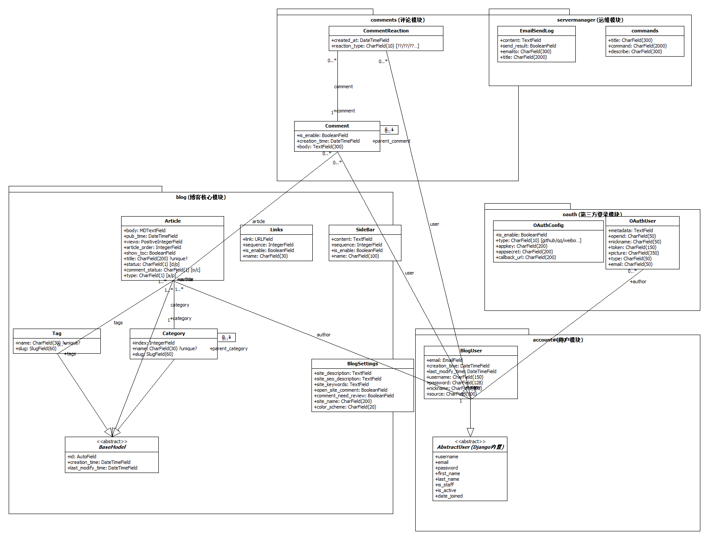

> 图例：三角空心箭头表示继承（泛化）；实线箭头表示关联，两端标注多重性；`「」` 内为该字段的取值枚举。

**3.4 数据库整体 E-R 图**

**3.5 模型关系与设计要点**

（1）**继承（泛化）关系**

| 子类 | 父类 | 说明 |
|------|------|------|
| BlogUser | AbstractUser（Django 内置）| 复用 Django 认证用户体系并扩展昵称、来源等字段 |
| Article / Category / Tag | BaseModel（抽象）| 复用主键与创建/修改时间字段，并在 save() 中自动生成 slug |

（2）**关联关系（含多重性）**

| 源 | 目标 | 关联字段 | 多重性 | 语义 |
|----|------|----------|--------|------|
| Article | Category | category | 1..* — 1 | 一个分类下有多篇文章，每篇文章必属一个分类 |
| Article | BlogUser | author | 1..* — 1 | 一个作者可写多篇文章 |
| Article | Tag | tags（M2M）| 1..* — 0..* | 文章与标签多对多 |
| Comment | Article | article | 0..* — 1 | 一篇文章可有多条评论 |
| Comment | BlogUser | author | 0..* — 1 | 一个用户可发多条评论 |
| CommentReaction | Comment | comment | 0..* — 1 | 一条评论可有多个表情反应 |
| CommentReaction | BlogUser | user | 0..* — 1 | 一个用户可对多条评论表态 |
| OAuthUser | BlogUser | author | 0..* — 0..1 | 第三方账号可选绑定一个本地用户 |

（3）**自关联（树形/楼中楼）**

- Category.parent_category（0..1 — 0..*）：构成"技术 → 后端开发/前端开发/数据库"式树形分类；
- Comment.parent_comment（0..1 — 0..*）：实现评论的楼中楼回复结构。

（4）**约束与一致性设计**

- 唯一约束：article.title、category.name、tag.name、bloguser.username、links.sequence、sidebar.sequence；
- 联合唯一：blog_article_tags(article_id, tag_id)、commentreaction(comment_id, user_id, reaction_type)、各权限中间表；
- CHECK 约束：article.views ≥ 0、django_admin_log.action_flag ≥ 0；
- 枚举取值受控：article.status/comment_status/type、commentreaction.reaction_type（8 种）、oauthconfig.type（5 平台）、blogsettings.color_scheme（8 配色）；
- 单例保护：BlogSettings.clean() 校验全库仅一行，save() 后清空缓存保证全站配置即时一致；
- 组合索引：article 按（type, status, pub_time）、（status, views）等四种场景建索引；comment 按（article, parent_comment, is_enable）等建索引，服务列表页与详情页查询。

（5）**与设计文档的衔接**：以上关系与约束的逐字段说明见第五周《软件数据模型设计说明书（最终版）》第 3 章；本文第 1.2 节数据字典与本章互为补充（前者面向"数据条目-流转"，后者面向"模型-关系"）。

## 4. 开源软件的软件架构及各个包和类的作用

#### 系统整体架构图（UML 包图）与 djangoblog 核心包

##### 系统整体包图

系统采用 Django 的「核心项目包 + 业务应用（app）」分层：`djangoblog` 核心包负责全局配置、路由与基础设施，6 个业务应用各自独立承担一个功能模块，`plugins` 通过插件钩子按需扩展业务应用。

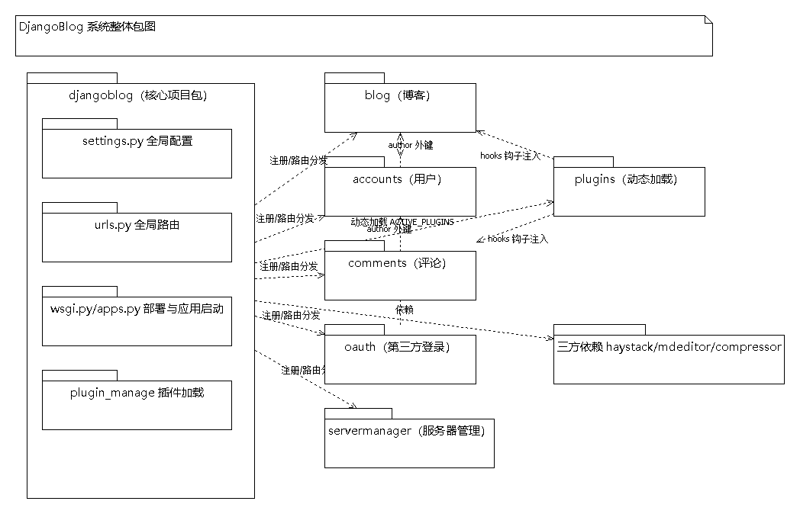

##### djangoblog 核心包各模块与主要类的作用

| 模块 | 作用 | 主要类 / 函数 |
|------|------|---------------|
| `settings.py` | 全局配置：应用注册、中间件、数据库、搜索引擎、插件、日志等 | `INSTALLED_APPS`、`MIDDLEWARE`、`env_to_bool()` |
| `urls.py` | 全局路由入口，把 URL 分发给各 app | `urlpatterns`、`i18n_patterns()`、`health_check()` |
| `wsgi.py` | 部署时的 WSGI 入口 | `application` |
| `apps.py` | 应用配置，启动时加载插件 | `DjangoblogAppConfig.ready()` |
| `base_views.py` | 带装饰器的视图基类（CSRF/登录/禁缓存）| `SecureFormView`、`AuthenticatedFormView`、`LoginFormView`、`LogoutRedirectView`、`NoCacheFormView` |
| `error_views.py` | 统一错误页渲染 | `render_error_page()`、`page_not_found_view()`、`server_error_view()`、`permission_denied_view()`、`bad_request_view()` |
| `mixins.py` | 可复用混入类（时间戳/缓存/分页/查询优化）| `TimeStampedModel`、`SlugCachedMixin`、`OptimizedArticleQueryMixin`、`CachedListViewMixin`、`PageNumberMixin`、`ArticleListMixin` |
| `constants.py` | 全局常量：缓存超时、缓存键、状态码、分页 | `CacheTimeout`、`CacheKey`、`HttpStatus`、`Pagination` |
| `utils.py` | 工具函数（缓存封装等）| `cache()` 等 |
| `admin_site.py` | 自定义后台站点 | `admin_site` |
| `logentryadmin.py` | 后台操作日志的只读展示 | `LogEntryAdmin` |
| `blog_signals.py` | 文章相关信号处理（索引同步等）| 信号接收函数 |
| `feeds.py` | RSS / Atom 订阅 | `DjangoBlogFeed` |
| `sitemap.py` | 站点地图（SEO）| `ArticleSiteMap`、`CategorySiteMap`、`TagSiteMap`、`UserSiteMap`、`StaticViewSitemap` |
| `spider_notify.py` | 向搜索引擎主动推送 URL | `SpiderNotify` |
| `elasticsearch_backend.py` | Elasticsearch 搜索后端 | `ElasticSearchEngine`、`ElasticSearchModelSearchForm` |
| `whoosh_cn_backend.py` | Whoosh 中文搜索后端 | `WhooshEngine` |
| `plugin_manage/` | 插件加载与钩子机制 | `BasePlugin`、`load_plugins()`、`hooks.register()` |

##### 各包之间的依赖关系说明

1. **djangoblog → 业务应用**：`settings.py` 注册各 app，`urls.py` 把 URL 分发到各 app 的 `urls.py`，是「总控 → 分支」的依赖关系。
2. **业务应用之间**：
   - `blog → accounts`：文章的 `author` 外键指向 `accounts.BlogUser`；
   - `comments → blog、accounts`：评论的 `article` 外键指向文章、`author` 外键指向用户；
   - `oauth → accounts`：第三方账号 `OAuthUser.author` 可选绑定本地用户。
3. **djangoblog → plugins**：`plugin_manage.loader` 按 `ACTIVE_PLUGINS` 动态加载 `plugins/` 下的插件。
4. **plugins → 业务应用**：插件通过 `hooks` 钩子（如 `article_bottom`、`sidebar`、`the_content`）把内容注入到博客/评论等页面。
5. **djangoblog → 搜索后端**：`settings.py` 根据环境变量在 Whoosh 与 Elasticsearch 之间二选一，二者均以 `haystack` 引擎形式接入。
6. **三方库**：全文搜索依赖 `haystack`，Markdown 编辑依赖 `mdeditor`，静态资源压缩依赖 `compressor`。

#### blog 包与类

##### MTV 与请求链路

本项目遵循 Django MTV 分工：Model 用 ORM 表达数据与关系；Template 负责页面结构；View 接收路由请求、组织查询和上下文。URL 配置决定请求入口，Mixin 复用缓存、分页和预加载，模板标签复用展示逻辑，中间件围绕请求/响应进行性能统计。

典型前台链路为：浏览器 → `djangoblog.urls` → `blog.urls` → 具体视图 → 缓存或 ORM → 上下文 → 模板及模板标签 → HTTP 响应。文章管理链路为：浏览器 → 管理站点 → `ArticlelAdmin`/`ArticleForm` → 模型与关系保存 → 后台响应。整体 UML 包图见本章第 4 节，本节说明 blog 在架构中的位置及依赖。

##### 包与主要类说明

| 包 / 文件 | 主要类或函数 | 作用 |
|---|---|---|
| `blog.models` | `BaseModel` | 抽象公共主键与时间字段；生成 slug、反向 URL；浏览量专用更新路径。 |
| `blog.models` | `Article` | 核心文章实体；保存标题、正文、状态、类型、作者、分类、标签及排序信息；提供评论和相邻文章辅助查询。 |
| `blog.models` | `Category`、`Tag` | 分类及分类树、标签实体；分别形成文章的外键和多对多分类组织。 |
| `blog.models` | `Links`、`SideBar`、`BlogSettings`、`LinkShowType` | 友情链接、侧栏、站点配置与链接展示类型枚举。 |
| `blog.views` | `ArticleListView`、`IndexView` | 列表公共配置与首页筛选，复用项目 Mixin。 |
| `blog.views` | `ArticleDetailView` | 详情上下文、评论显示分页、SEO 与插件钩子。 |
| `blog.views` | `CategoryDetailView`、`TagDetailView`、`AuthorDetailView` | 分类、标签、作者维度的列表查询与页面上下文。 |
| `blog.views` | `ArchivesView`、`LinkListView` | 归档与启用友链展示。 |
| `blog.views` | `EsSearchView` | Haystack 搜索视图扩展，启用高亮并组织分页、建议。 |
| `blog.views` | `fileupload`、`clean_cache_view` | 签名检查后的文件上传；直接清理站点缓存的接口。属于技术辅助入口，权限边界须单独核对。 |
| `blog.admin` | `ArticleForm`、`ArticlelAdmin` | 文章后台表单及配置，提供列表、筛选、作者选择和批量 action。保留源码中的类名拼写。 |
| `blog.admin` | `CategoryAdmin`、`TagAdmin`、`LinksAdmin`、`SideBarAdmin`、`BlogSettingsAdmin` | 各内容实体和站点配置的后台管理。 |
| `blog.forms` | `BlogSearchForm` | 已定义的 Haystack 表单扩展；当前搜索路由未显式使用此类。 |
| `blog.search_indexes` | `ArticleIndex` | Haystack 搜索索引结构；索引查询集筛选已发布文章。 |
| `blog.documents` | `ArticleDocument`、`ArticleDocumentManager` | 自定义 Elasticsearch 文章映射及同步管理，区别于 Haystack 索引定义。 |
| `blog.documents` | `ElapsedTimeDocument`、`ElaspedTimeDocumentManager`、`GeoIp`、`UserAgent` 等 | 页面耗时日志与访问设备/地理信息结构；管理器类名按源码保留。 |
| `blog.middleware` | `OnlineMiddleware` | 调用下游处理请求，统计耗时；配置启用时尝试写性能日志并替换页面占位符。 |
| `blog.context_processors` | `seo_processor` | 向模板提供站点级 SEO 上下文。 |
| `blog.templatetags` | `blog_tags`、`vite_tags` 内函数 | Markdown、目录、标签、侧栏、分页、插件资源与前端资源展示。函数不能误称为模型类。 |
| `blog.apps` | `BlogConfig` | 应用启动初始化和搜索索引检查。 |
| `blog.management.commands` | 各命令 `Command` | 索引构建、缓存清理等维护操作；不同文件中的同名 Command 按模块区分。 |

##### 外部依赖与职责边界

| 依赖包 | blog 的使用方式 | 边界 |
|---|---|---|
| `accounts` | Article.author 引用配置的用户模型 | 用户注册、登录和资料维护由 accounts 负责。 |
| `comments` | 详情视图使用 CommentForm、评论模型及关联查询 | 本节分析评论展示；评论提交、审核和回复细节由 comments 负责人提供。 |
| `djangoblog.mixins` / `utils` | 列表缓存、页码、预加载、站点设置及 Markdown 工具 | 这些类/函数属于项目核心包，不能列成 blog 自定义类。 |
| `djangoblog.plugin_manage` | 详情钩子及内容展示扩展 | 具体插件作用与装载流程由插件负责人说明。 |
| `djangoblog.elasticsearch_backend` | 当前搜索表单与自定义后端 | 搜索实际行为依赖配置及已建立索引。 |
| Django Admin / ORM / 模板引擎 | 标准管理表单、权限、保存删除、数据查询和模板渲染 | 框架机制与项目自定义代码应明确区分。 |

#### accounts 包与类

accounts 包处理注册、认证、登出、邮箱验证和密码找回，并提供自定义用户模型。

| 包 | 作用 | 包内主要类 | 类的作用 |
|---|---|---|---|
| accounts | 处理注册、认证、登出、邮箱验证和密码找回；提供自定义用户模型 | `BlogUser`、`RegisterView`、`LoginView`、`LogoutView`、`ForgetPasswordView`、`ForgetPasswordEmailCode`、`LoginForm`、`RegisterForm`、`ForgetPasswordForm`、`ForgetPasswordCodeForm`、`EmailOrUsernameModelBackend`、`BlogUserAdmin` | `BlogUser` 扩展 `AbstractUser`，增加昵称、来源和时间字段；视图编排请求并复用基础视图；表单负责校验；`utils` 调用共享邮件和缓存能力处理验证码；认证后端支持用户名/邮箱登录；后台类配置用户管理。 |

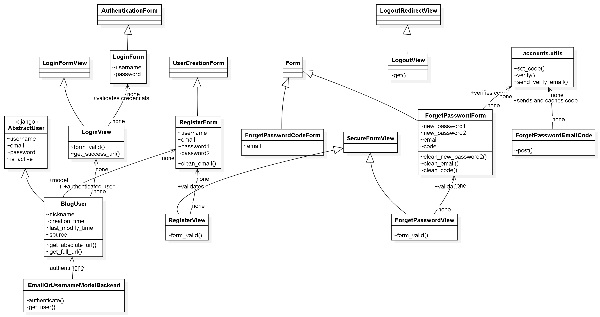

#### comments 包与类

##### comments 包的作用

comments 是一个相对独立的 Django 业务应用（app），采用 MVT 分层：
- **M（模型层）**：`models.py` 定义评论与表情反应两张表；
- **V（视图层）**：`views.py` 处理评论提交与表情反应请求；
- **T（模板层）**：通过 `templatetags/comments_tags.py` 向文章详情页提供评论渲染标签；
- 另由 `forms.py`（表单）、`admin.py`（后台审核）、`utils.py`（邮件通知）、`urls.py`（路由）协同。

##### comments 包内主要类与作用

| 文件 | 主要类 / 函数 | 作用 |
|---|---|---|
| `models.py` | **Comment** | 评论模型：正文、创建/修改时间、作者、所属文章、父评论（自关联实现楼中楼）、`is_enable` 审核开关；含 `get_reactions_summary()` 统计表情 |
| `models.py` | **CommentReaction** | 表情反应模型：记录「用户—评论—表情」，限定 8 种 Emoji，`unique_together` 防止重复点赞 |
| `forms.py` | **CommentForm** | 评论表单：只暴露正文 `body`，含隐藏字段 `parent_comment_id` 用于回复 |
| `views.py` | **CommentPostView** | 评论提交视图（继承 `AuthenticatedFormView`，需登录 + CSRF）：校验、组装评论、按设置决定是否审核、保存、重定向 |
| `views.py` | **CommentReactionView** | 表情反应 JSON 接口：GET 公开取统计，POST 登录后切换（点赞 / 取消） |
| `admin.py` | **CommentAdmin** | 评论后台：列表列、筛选、搜索、批量启用/禁用动作 |
| `admin.py` | **CommentReactionAdmin** | 表情反应后台：按表情、时间筛选，时间分层浏览 |
| `admin.py` | `enable_commentstatus` / `disable_commentstatus` | 后台批量动作：批量启用 / 禁用评论 |
| `utils.py` | `send_comment_email()` | 评论后发送感谢邮件；若为回复，再通知被回复者 |
| `templatetags/comments_tags.py` | `parse_commenttree` | 递归取出某条评论的全部子回复（楼中楼），simple_tag |
| `templatetags/comments_tags.py` | `show_comment_item` | 渲染单条评论 HTML 片段（inclusion_tag） |
| `urls.py` | `urlpatterns` | 两条路由：`postcomment`、`comment_react` |
| `apps.py` | **CommentsConfig** | 应用配置，注册 comments 应用 |

##### comments 与其他包的关系

1. **comments → blog**：`Comment.article` 外键指向 `blog.Article`，一篇文章可有 0..N 条评论（N:1）；
2. **comments → accounts**：`Comment.author`、`CommentReaction.user` 外键指向 `accounts.BlogUser`（N:1）；
3. **comments → comments（自关联）**：`Comment.parent_comment` 指向自身，实现楼中楼（0..N:1）；
4. 评论区通过模板 `include` 嵌入文章详情页（`detail → comment_list_modern / post_comment_modern`）。

---

#### oauth 包与类

本图采用 StarUML 类图承载包与主要类的职责依赖摘要；连接标签区分使用与继承语义。系统整体 UML 包图仍以组长材料为准。

| 文件 / 包 | 主要类或函数 | 作用 |
|---|---|---|
| oauth.urls / views | oauthlogin、authorize、emailconfirm、bindsuccess、RequireEmailView | 路由与授权、绑定、提示请求编排；前四项为函数，不是类。 |
| oauth.forms | RequireEmailForm | 邮箱和隐藏 ID 的字段校验及表单组件。 |
| oauth.models | OAuthUser | 保存平台身份、token、邮箱、元数据及可选本地用户外键。单条记录关联 0..1 个 BlogUser，一个 BlogUser 可对应多条 OAuthUser。 |
| oauth.models | OAuthConfig | 平台类型、应用配置、回调 URL、启用状态；clean() 校验同类型配置重复。 |
| oauth.oauthmanager | BaseOauthManager、GitHubOauthManager、GoogleOauthManager、WBOauthManager、QQOauthManager、FaceBookOauthManager | 平台适配、授权 URL、token 获取、用户资料映射；ProxyManagerMixin 为部分管理器提供请求代理适配。 |
| oauth.oauthmanager | get_oauth_apps、get_manager_by_type | 按启用配置选择平台管理器。 |
| accounts / djangoblog | BlogUser、登录信号、哈希与邮件工具 | 本地身份、附加登录处理、确认链接与发信能力；归属外部包。 |

#### servermanager / plugins 包与类

| 包 | 作用 | 包内主要类 | 类的作用 |
|----|------|-----------|----------|
| servermanager | 服务器运维支持包：提供微信机器人（文章检索 / AI 问答 / 远程命令执行）、运维命令与邮件日志的管理、微信会话的缓存存储 | robot.py、api/blogapi.py、api/commonapi.py、MemcacheStorage、models、admin（详见下表）| 承载"服务器管理"相关的全部业务能力 |
| plugins | 插件扩展包：8 个可启停插件，通过钩子机制在文章内容、文章推荐、SEO、CDN 缓存等环节扩展系统功能 | 8 个插件主类 + CloudflareCacheHandler、CloudflareAPI（详见下表）| 以"钩子/信号"方式装配到主流程，不侵入核心业务代码 |

**（一）servermanager 包内主要类**

| 类 / 模块 | 类的作用 |
|-----------|----------|
| models.commands | 运维命令模型（标题/命令/描述/创建时间/修改时间），供机器人执行与帮助清单使用 |
| models.EmailSendLog | 邮件发送日志模型（收件人/标题/内容/发送结果/创建时间），按时间倒序 |
| admin.CommandsAdmin | 后台命令管理配置：列表展示标题、命令内容、描述 |
| admin.EmailSendLogAdmin | 后台邮件日志配置：只读展示，重写 has_add_permission 禁止手动新增 |
| api.blogapi.BlogApi | 博客数据查询封装：Haystack 搜索引擎检索（≤8 条）、全部分类、按分类查文章、最新文章；供机器人调用 |
| api.commonapi.ChatGPT | 静态工具类：调用 OpenAI gpt-3.5-turbo 完成对话，异常返回友好提示 |
| api.commonapi.CommandHandler | 命令处理器：加载 commands 表、按标题匹配命令、os.popen 执行 shell 并读取输出、拼接 helpme 帮助文本 |
| MemcacheStorage.MemcacheStorage | Werobot 会话存储类：get/set/delete 与可用性检测（is_available），key 加 ws_ 前缀，JSON 序列化会话 |
| robot（模块级实例）| WeRoBot 机器人实例：token 配置、会话支持、优先缓存/降级文件的存储选择 |
| robot.convert_to_article_reply | 把文章列表转换为微信图文消息（正则提取首图、标题、摘要、完整链接）|
| robot.search / category / recents / help / weather / idcard | 消息过滤器：?关键字搜索文章、分类目录、最新文章、帮助文本、天气与身份证（占位待开发）|
| robot.echo + MessageHandler | 默认消息处理器与业务处理类：管理员身份校验（双重 SHA256 密码、3 次锁定）、命令确认执行、AI 对话、会话信息维护 |
| robot.WxUserInfo | 微信用户会话实体：isAdmin / isPasswordSet / Count / Command 四个状态字段 |
| urls.py | 路由：用 make_view 暴露 /robot 微信消息回调接口 |

**（二）plugins 包内主要插件类**

| 插件（目录）| 主要类 | 注册钩子 | 类的作用 |
|-------------|--------|----------|----------|
| article_copyright | ArticleCopyrightPlugin | the_content | 正文末尾追加版权声明（摘要模式不添加）|
| reading_time | ReadingTimePlugin | the_content | 估算阅读时间插入正文顶部（约 200 字/分钟，最短 1 分钟，摘要模式跳过）|
| external_links | ExternalLinksPlugin | the_content | 外部链接自动加 target="_blank" 与 rel 安全属性，站内链接与已有 target 的链接跳过 |
| image_lazy_loading | ImageOptimizationPlugin | the_content | 图片懒加载、异步解码、响应式属性、alt 补全、首图 LCP 优化等 8 项处理 |
| view_count | ViewCountPlugin | after_article_body_get | 文章被访问后浏览量 +1（以 update_fields 限流，避免连带缓存清理）|
| seo_optimizer | SeoOptimizerPlugin | head_meta | 按页面类型动态生成 Open Graph 标签与 JSON-LD（文章/面包屑/站点三级）|
| article_recommendation | ArticleRecommendationPlugin | article_detail_load + 位置渲染 | 标签→分类→热门三级推荐策略，渲染文章底部"相关推荐"组件，含 CSS/JS 静态资源 |
| cloudflare_cache | CloudflareCachePlugin、CloudflareCacheHandler、CloudflareAPI | Article/Comment 的 post_save 信号 | 文章/评论保存后收集相关 URL 并分批精确清除 CDN 缓存；支持启动清理全站；凭证无效时自我禁用 |

> 说明：插件系统基座（BasePlugin、hooks 注册表、loader 加载器、hook 常量）位于 djangoblog 包；plugins 包中的插件通过继承 BasePlugin、实现 register_hooks 注册钩子回调接入系统，由 settings.ACTIVE_PLUGINS 控制启停。

## 5. 软件功能与类间的对应关系

#### blog 功能-类对应

##### blog 对应表

| 功能 | 对应类 / 函数 | 所属包 | 说明 |
|---|---|---|---|
| 浏览文章列表 | `IndexView`、`ArticleListView`、`Article` | blog | 复用查询缓存、预加载和分页 Mixin。 |
| 浏览文章详情 | `ArticleDetailView`、`Article`；`blog_tags` 函数 | blog | 评论显示调用 comments；插件调用核心 hooks。 |
| 按分类浏览 | `CategoryDetailView`、`Category`、`Article` | blog | 当前分类和后代分类筛选。 |
| 按标签浏览 | `TagDetailView`、`Tag`、`Article` | blog | 依托标签多对多关系。 |
| 按作者浏览 | `AuthorDetailView`、`Article` | blog | 作者身份模型来自 accounts。 |
| 搜索文章 | `EsSearchView`、`ArticleIndex`、`ArticleDocument`、`ArticleDocumentManager` | blog | 搜索视图、Haystack 索引及独立文档同步职责不同。 |
| 当前搜索表单与引擎 | `ElasticSearchModelSearchForm`、`ElasticSearchEngine` | djangoblog | 外部依赖，并非 BlogSearchForm。 |
| 归档 | `ArchivesView`、`Article` | blog | 使用归档模板及两层缓存。 |
| 友情链接 | `LinkListView`、`Links`、`LinksAdmin` | blog | 展示启用链接与后台维护。 |
| 发布 / 编辑文章 | `ArticlelAdmin`、`ArticleForm`、`Article`、`BaseModel` | blog | 后台标准保存链路；多对多关系由后续阶段保存。 |
| 批量发布 / 草稿操作 | `makr_article_publish`、`draft_article` | blog.admin | 函数 action，直接批量更新状态。 |
| 删除文章 | `ArticlelAdmin`、`Article`，Django `ModelAdmin` | blog / Django | 框架提供确认和删除流程，未自定义删除视图。 |
| 评论开关 | `open_article_commentstatus`、`close_article_commentstatus` | blog.admin | 修改文章评论开关，评论业务由 comments 处理。 |
| 站点、侧栏配置 | `BlogSettings`、`SideBar` 及对应 Admin | blog | 展示数据由上下文处理器和模板标签使用。 |
| 页面性能统计 | `OnlineMiddleware`、`ElapsedTimeDocument`、`ElaspedTimeDocumentManager` | blog | 条件启用的性能日志，不是文章检索流程。 |

#### accounts 功能-类对应

| 功能 | 对应类 | 所属包 | 说明 |
|---|---|---|---|
| 注册和邮箱激活 | `RegisterView`、`RegisterForm`、`BlogUser`、`account_result` | accounts | 校验信息、保存未激活用户、发送签名链接并验签激活 |
| 用户名/邮箱登录 | `LoginView`、`LoginForm`、`EmailOrUsernameModelBackend` | accounts | 认证凭据、建立会话、校验返回地址并处理记住登录 |
| 退出登录 | `LogoutView` | accounts | 清除认证会话、侧栏缓存和登录 Cookie |
| 申请找回验证码 | `ForgetPasswordEmailCode`、`ForgetPasswordCodeForm`、`utils.send_verify_email`、`utils.set_code` | accounts | 校验邮箱格式，发送验证码并缓存五分钟 |
| 验证并重置密码 | `ForgetPasswordView`、`ForgetPasswordForm`、`utils.verify`、`BlogUser` | accounts | 校验邮箱、验证码和新密码，哈希后更新密码 |
| 后台管理用户资料 | `BlogUserAdmin`、`BlogUserCreationForm`、`BlogUserChangeForm` | accounts | Django 后台新增、查看和编辑用户；普通用户自助编辑页面未实现 |

#### comments 功能-类对应

| 功能 | 对应类 / 函数 | 所属包 | 说明 |
|---|---|---|---|
| 浏览评论 | `Comment`、`parse_commenttree`、`show_comment_item` | comments | 只查 `is_enable=True` 的评论，递归组织楼中楼并渲染 |
| 发表评论 | `CommentForm`、`CommentPostView`、`Comment` | comments | 表单校验、关联作者/文章、按审核设置决定是否展示 |
| 楼中楼回复 | `Comment.parent_comment`、`CommentPostView`、`parse_commenttree` | comments | 隐藏字段携带父评论 id，自关联实现嵌套回复 |
| Emoji 表情反应 | `CommentReaction`、`CommentReactionView`、`get_reactions_summary` | comments | `get_or_create` 实现点赞/取消切换，8 种表情唯一约束 |
| 评论审核 | `CommentAdmin`、`Comment.is_enable`、`enable/disable_commentstatus` | comments | 后台批量启用/禁用，控制前台可见性 |
| 邮件通知 | `send_comment_email` | comments | 评论后通知作者；回复时通知被回复者 |
| 路由分发 | `comments/urls.py` | comments | 提交评论、表情反应两个入口 |

---

#### oauth 功能-类对应

| 功能 | 对应类 / 函数 | 所属包 | 说明 |
|------|--------------|--------|------|
| 发起第三方授权 | `oauthlogin()`、`get_manager_by_type()`、`get_redirecturl()` | oauth | 按 `type` 选择管理器、校验登录后返回地址、组装授权 URL 并 302 重定向 |
| 授权回调并登录 | `authorize()`、`BaseOauthManager` 及子类、`OAuthUser`、`BlogUser` | oauth / accounts | code 换 token、取用户资料、事务内复用或创建本地用户、发送登录信号并建立会话 |
| 补填邮箱并申请验证 | `RequireEmailView`、`RequireEmailForm`、`OAuthUser`、`send_email()` | oauth / djangoblog | 保存提交邮箱、生成签名确认链接、调用发信函数 |
| 确认邮箱并绑定登录 | `emailconfirm()`、`OAuthUser`、`BlogUser` | oauth / accounts | 校验签名、事务内绑定本地用户、登录并发送欢迎邮件 |
| 查看绑定状态提示 | `bindsuccess()`、`OAuthUser` | oauth | 按 `type` 展示等待验证或成功文案 |
| 后台维护 OAuth 配置与授权用户 | `OAuthConfigAdmin`、`OAuthConfig`、`OAuthUserAdmin`、`OAuthUser` | oauth | 维护平台类型、应用配置、回调 URL、启用状态及第三方授权用户记录 |

#### 边界说明

- `OAuthUser.author` 为可空外键（`null=True`），与 `BlogUser` 是 0..1 可选绑定，一个 `BlogUser` 可对应多条 `OAuthUser`。
- `emailconfirm()` 的签名由 `SECRET_KEY + id + SECRET_KEY` 计算，不含邮箱、有效期或一次性随机值，故不把「一次性链接、过期验证」写成已实现能力。
- `OAuthConfig.clean()` 校验同类型平台配置不可重复。
- 各平台管理器（GitHub / Google / 微博 / QQ / Facebook）统一继承 `BaseOauthManager`，部分经 `ProxyManagerMixin` 提供请求代理适配。

#### servermanager / plugins 功能-类对应

| 功能 | 对应类 | 所属包 | 说明 |
|------|--------|--------|------|
| 微信文章搜索（?关键字）| BlogApi.search_articles、robot.search | servermanager | Haystack 检索最多 8 条，组装图文消息回复 |
| 微信分类查询（category）| BlogApi.get_category_lists、robot.category | servermanager | 返回全部分类名列表 |
| 微信最新文章（recent）| BlogApi.get_recent_articles、robot.recents | servermanager | 取最新文章组装图文回复 |
| 微信帮助（help / helpme）| robot.help、CommandHandler.get_help | servermanager | 指令说明与运维命令清单 |
| 微信 AI 问答 | robot.echo、MessageHandler、ChatGPT | servermanager | 未匹配指令的消息交由 gpt-3.5-turbo 回复 |
| 管理员身份校验与远程命令执行 | MessageHandler、WxUserInfo、CommandHandler、MemcacheStorage | servermanager | 双重 SHA256 密码校验、命令确认、shell 执行、会话保存 |
| 运维命令维护 | commands、CommandsAdmin | servermanager | 后台增删改命令，机器人重启后生效 |
| 邮件发送日志 | EmailSendLog、EmailSendLogAdmin | servermanager | 信号处理器自动写入，后台只读查看 |
| 微信会话缓存 | MemcacheStorage | servermanager | 缓存优先、不可用时降级文件存储 |
| 机器人消息接入 | urls.py（make_view）| servermanager | /robot 微信回调路由 |
| 插件加载与启停 | loader.load_plugins、BasePlugin、hooks | djangoblog（基座）+ plugins（插件）| ACTIVE_PLUGINS 控制启用，重启加载 |
| 文章版权声明 | ArticleCopyrightPlugin | plugins | the_content 钩子追加版权信息 |
| 阅读时间估算 | ReadingTimePlugin | plugins | the_content 钩子插入预计阅读时间 |
| 外链安全处理 | ExternalLinksPlugin | plugins | the_content 钩子为外链加 target/rel |
| 图片性能优化 | ImageOptimizationPlugin | plugins | the_content 钩子为图片添加懒加载等属性 |
| 文章浏览量统计 | ViewCountPlugin | plugins | after_article_body_get 钩子触发 views+1 |
| SEO 元数据生成 | SeoOptimizerPlugin | plugins | head_meta 钩子生成 OG 与 JSON-LD |
| 相关文章推荐 | ArticleRecommendationPlugin | plugins | article_detail_load 钩子三级推荐策略 |
| CDN 缓存自动清除 | CloudflareCachePlugin、CloudflareCacheHandler、CloudflareAPI | plugins | post_save 信号触发按 URL 清除缓存 |

## 6. 总结

本部分总结前一阶段（第一至第六周）的小组协作情况。

##### 前一阶段协作收获

1. **工程协作能力**：小组按角色分工（组长、开发经理、计划经理、质量/过程经理、支持经理），以 Git 分支（每人一支 `*_branch`）+ PR 审核的方式协作，完成了 DjangoBlog 的架构熟悉、代码标注、数据模型设计与系统架构建模；本人对 `fetch / merge / commit / push / PR` 的完整流程已能独立操作。
2. **对 Django MVT 的理解**：通过负责 comments 模块，掌握了模型（Model）、视图（View）、模板（Template）分层，以及 URL 路由、表单、后台管理、模板标签、邮件通知等机制；尤其通过 `Comment` 的三个外键（文章、作者、父评论自关联）理解了表与表之间的关联关系和「楼中楼」数据结构。
3. **建模能力**：学会用 UML 用例图、顺序图、包图表达系统的功能、交互与结构，把「读代码」上升为「建模型」。
4. **计划与进度管理**：作为计划经理，通过《任务跟踪表》维护全员进度、依赖与截止时间，体会到任务分解、依赖梳理（如支持经理先导出表结构、其他人再填字段类型）对推进协作的重要性。

##### 存在的问题

1. **Git 操作与网络环境不熟练**：初期有成员混淆分支、误在根目录提交文件、遇到代理配置导致的 `fetch` 失败却继续 `merge`，拿到的是旧缓存而非最新远程内容；说明对「fetch 联网更新引用」与「merge 本地合并」的区别理解不够。
2. **存在依赖链的任务进度容易卡**：第五周数据模型设计依赖支持经理先导出表结构，第六周泛读报告依赖组长先发模板，若上游延迟，下游只能先起草、后核对，对计划经理的跟踪与催办提出了更高要求。
3. **Django 底层理解有差异**：部分成员对 ORM 外键 `on_delete`、自关联、模板 `include`、模板标签等概念掌握不牢，需要在标注与建模中反复回看。
4. **命名与目录规范初期不统一**：早期出现过文件放根目录、docx 与 md 混用、文件命名不带姓名的情况，后来通过明确《文件命名规范》统一解决。

##### 下一步改进计划

1. **计划与跟踪**：每日固定更新一次《任务跟踪表》，在组会、上游交付、下游评审等关键节点增加检查频率；对依赖任务明确「谁先做、谁等谁」，卡住时在群里按「已完成 XX，等 XX 做 XX」格式报备。
2. **统一协作规范**：持续执行文件命名（带姓名）、只交 md、统一放入 `doc/第N周/`、图片用相对路径并随 md 一起提交等规范；对新成员补充一份 Git 常见问题（含代理、网络失败不要继续 merge）指引。
3. **技术学习**：后续重点复习 ORM 外键与自关联、模板继承与标签、Django 表单与视图基类，并结合第七、八周的代码精读与质量评估深入理解。
4. **角色衔接**：配合开发经理完成核心流程整合、配合质量/过程经理完成评审，确保泛读报告各板块能按时合并、整体 E-R 图与包图无遗漏。

---
