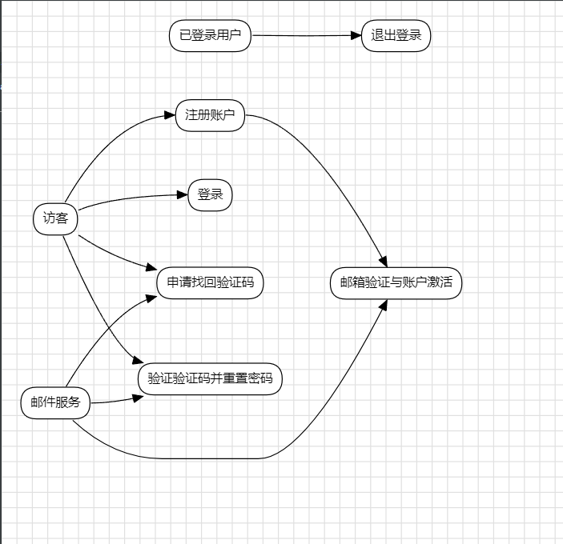
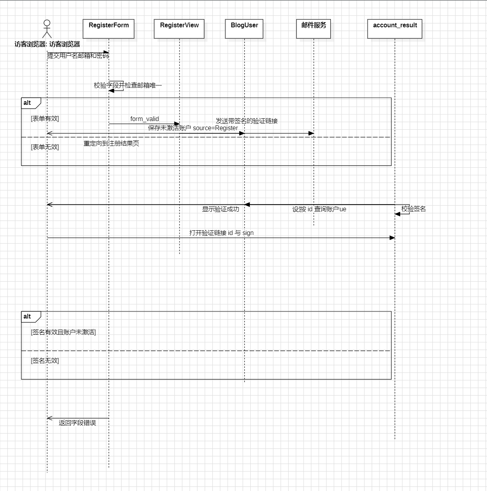
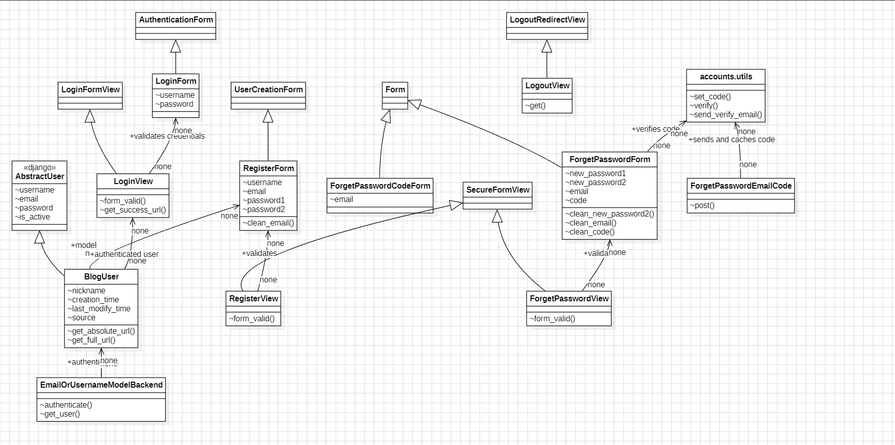

# ***开源软件系统的泛读报告

> 组号：8
> 小组成员：张月、黄梓涵、侍文博、刘雨婷、谢承志、朱亮宇
>
> **填写说明：每人只写自己负责的板块，提交自己那部分的 md（命名：`开源软件泛读报告-<部分>-<姓名>.md`），只保留自己的内容，不要并入他人的内容，最终由张月统一合并。** 各板块负责人已标注在标题下方。

---

## 1. 开源软件的功能描述

### 1.1 用例图和用例图说明
> 负责人：各 app 负责人（blog=黄梓涵、accounts=侍文博、comments=刘雨婷、oauth=谢承志、servermanager/plugins=朱亮宇）；系统级用例与整体用例图=张月；核心流程整合=黄梓涵、侍文博（开发经理）

### accounts（侍文博）

依据 `accounts/urls.py`、`views.py`、`forms.py`、`utils.py` 绘制。访客可注册、登录和找回密码，用户可退出登录；新账户需邮箱验证后激活。找回密码包括获取验证码和提交新密码。accounts 未实现普通用户自助资料编辑页面；`BlogUser` 提供资料字段，`BlogUserAdmin` 支持后台管理。

| 用例名称 | 参与者 | 前置条件 | 后置条件 | 基本流程 | 扩展流程 | 顺序图 |
|---|---|---|---|---|---|---|
| 注册并验证邮箱 | 访客、邮件服务 | 邮箱未注册且可用 | 验证成功后账户激活 | 填写注册信息；校验并保存未激活账户；发送带签名链接的邮件；访问链接并验签激活。 | 邮箱重复或表单错误时提示；签名错误时拒绝激活。 |  |
| 登录 | 用户 | 账户已激活 | 建立登录会话并跳转 | 输入用户名或邮箱及密码；认证凭据；建立会话并设置登录标记。 | 凭据错误返回表单；非法外站 next 回退首页；支持记住登录。 | `LoginView`、认证表单和认证后端协作。 |
| 退出登录 | 已登录用户 | 当前会话已认证 | 会话、登录标记和侧栏缓存清除 | 请求退出路由，清理会话、缓存和 Cookie，跳转登录页。 | 无。 | — |
| 找回密码 | 已登记邮箱用户、邮件服务 | 邮箱关联现有账户 | 更新密码后跳转登录 | 申请验证码；发送并缓存五分钟；提交邮箱、验证码和两次新密码；校验后更新密码哈希。 | 邮箱未登记、验证码错误/过期或密码校验失败时返回错误。 | — |

**用例说明格式（每个用例一条，可复制多份）：**

| 项目 | 内容 |
|------|------|
| 用例名称 | （如：发布文章）|
| 参与者（Actor）| （如：登录用户）|
| 前置条件 | |
| 后置条件 | |
| 基本流程 | 1. … 2. … 3. … |
| 扩展流程 | 1a. 若…则… |
| 顺序图 | （插入该用例的顺序图）|

### 1.2 数据流图和数据字典
> 负责人：数据流图=谢承志；数据字典=朱亮宇

- **系统数据流图**：（谢承志绘制整体数据流图，标明数据加工、数据流、数据存储、外部实体）
- **主要数据条目的数据字典**：（朱亮宇对主要数据条目逐条给出名称、含义、类型/格式、来源、去向）

| 数据条目 | 含义 | 类型/格式 | 来源 | 去向 |
|----------|------|-----------|------|------|
| | | | | |

---

## 2. 界面分析
> 负责人：黄梓涵 / 侍文博（开发经理）

### accounts 界面（侍文博）

账户界面围绕认证和账户恢复，使用站点账户布局。表单启用 CSRF 保护，字段错误显示在表单位置。

| 页面/模板 | 主要内容与交互 | 对应功能 |
|---|---|---|
| `account/login.html` | 用户名/邮箱、密码、记住登录；忘记密码、注册、首页及 OAuth 登录入口 | 登录和认证导航 |
| `account/registration_form.html` | 用户名、邮箱、两次密码及校验反馈 | 注册并触发邮件验证 |
| `account/forget_password.html` | 邮箱、验证码、新密码和确认密码；请求验证码 | 找回密码与重置 |
| `account/result.html` | 注册邮件发送或邮箱验证结果，登录/首页入口 | 注册及验证结果提示 |

登录成功后返回经当前主机校验的 `next` 地址，否则回首页。注册账户初始未激活，验证签名链接后才可登录。找回验证码缓存有效五分钟。普通用户资料自助编辑页面未实现；昵称、来源和时间字段由模型提供，管理员可通过 Django 后台维护。

---

## 3. 数据模型分析
> 负责人：朱亮宇（支持经理）

（引入前面数据模型分析的结果：类图、E-R 图、《软件数据模型设计说明书》。）

---

## 4. 开源软件的软件架构及各个包和类的作用
> 负责人：各 app 负责人写自己 app 的包/类说明（blog=黄梓涵、accounts=侍文博、comments=刘雨婷、oauth=谢承志、servermanager/plugins=朱亮宇、djangoblog=张月）；整体架构图（UML 包图）=张月

分析软件中各个包的作用、每个包内的主要类和类的作用；绘制软件的架构图（采用 UML 包图绘制），标识包与架构的关系。

| 包 | 作用 | 包内主要类 | 类的作用 |
|----|------|-----------|----------|
| accounts | 处理注册、认证、登出、邮箱验证和密码找回；提供自定义用户模型 | `BlogUser`、`RegisterView`、`LoginView`、`LogoutView`、`ForgetPasswordView`、`ForgetPasswordEmailCode`、`LoginForm`、`RegisterForm`、`ForgetPasswordForm`、`ForgetPasswordCodeForm`、`EmailOrUsernameModelBackend`、`BlogUserAdmin` | `BlogUser` 扩展 `AbstractUser`，增加昵称、来源和时间字段；视图编排请求并复用基础视图；表单负责校验；`utils` 调用共享邮件和缓存能力处理验证码；认证后端支持用户名/邮箱登录；后台类配置用户管理。 |

（此处插入整体架构图——UML 包图，张月绘制）

---

## 5. 软件功能与类间的对应关系
> 负责人：各 app 负责人列自己 app 的对应关系；汇总总表=黄梓涵（开发经理）

（采用表格方式列出，表头参考如下：）

| 功能 | 对应类 | 所属包 | 说明 |
|------|--------|--------|------|
| 注册和邮箱激活 | `RegisterView`、`RegisterForm`、`BlogUser`、`account_result` | accounts | 校验信息、保存未激活用户、发送签名链接并验签激活 |
| 用户名/邮箱登录 | `LoginView`、`LoginForm`、`EmailOrUsernameModelBackend` | accounts | 认证凭据、建立会话、校验返回地址并处理记住登录 |
| 退出登录 | `LogoutView` | accounts | 清除认证会话、侧栏缓存和登录 Cookie |
| 申请找回验证码 | `ForgetPasswordEmailCode`、`ForgetPasswordCodeForm`、`utils.send_verify_email`、`utils.set_code` | accounts | 校验邮箱格式，发送验证码并缓存五分钟 |
| 验证并重置密码 | `ForgetPasswordView`、`ForgetPasswordForm`、`utils.verify`、`BlogUser` | accounts | 校验邮箱、验证码和新密码，哈希后更新密码 |
| 后台管理用户资料 | `BlogUserAdmin`、`BlogUserCreationForm`、`BlogUserChangeForm` | accounts | Django 后台新增、查看和编辑用户；普通用户自助编辑页面未实现 |

---

## 6. 总结
> 负责人：刘雨婷（计划经理）

（总结前一阶段小组协作的收获和问题，以及下一步改进的计划。）
